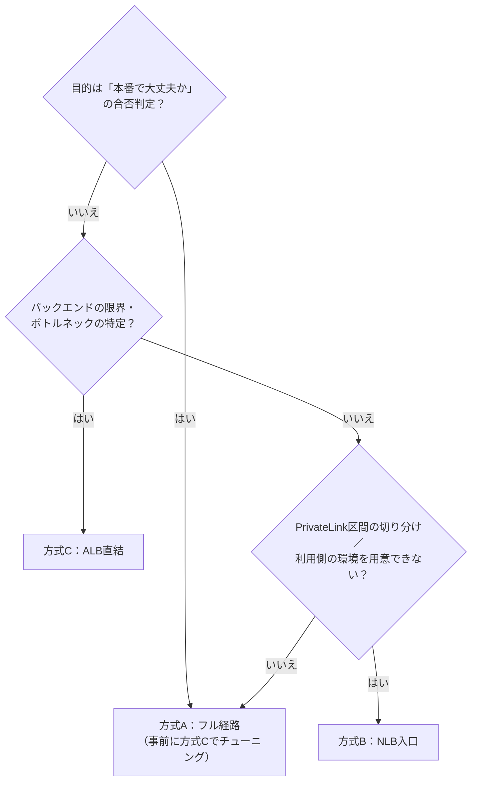
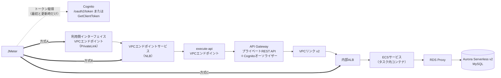

# JMeter負荷試験「どこから負荷をかけるか」方式比較ガイド

> Cognito M2M認証 × プライベートAPI Gateway（PrivateLink／NLB） × VPCリンク v2 × 内部ALB × ECS × RDS Proxy × Aurora Serverless v2（MySQL）

- 作成日：2026年10月18日
- 情報の基準：2026年10月18日時点で確認した AWS 公式ドキュメント・発表と Apache JMeter の公式情報（出典は「17. 参考資料」）
- 同じ内容の Excel 版：`JMeter負荷試験_入口方式比較ガイド.xlsx`（評価マトリクス・試算・合否判定は、Excel 版では数式で自動計算されます）

## 目次

- [0. このガイドについて](#0-このガイドについて)
- [1. 結論](#1-結論)
- [2. やさしい説明（小学生にもわかる遊園地のたとえ）](#2-やさしい説明小学生にもわかる遊園地のたとえ)
- [3. 歴史と背景](#3-歴史と背景)
- [4. 構成と経路](#4-構成と経路)
- [5. 方式比較](#5-方式比較)
- [6. 評価マトリクス](#6-評価マトリクス)
- [7. 方式A：フル経路](#7-方式aフル経路)
- [8. 方式B：NLB入口](#8-方式bnlb入口)
- [9. 方式C：ALB直結](#9-方式calb直結)
- [10. 設定変更一覧（完全版）](#10-設定変更一覧完全版)
- [11. JMeterの設計](#11-jmeterの設計)
- [12. 負荷とトークンの試算](#12-負荷とトークンの試算)
- [13. 監視と判定](#13-監視と判定)
- [14. 誤解と落とし穴](#14-誤解と落とし穴)
- [15. 実施手順](#15-実施手順)
- [16. 用語集](#16-用語集)
- [17. 参考資料](#17-参考資料)

## 0. このガイドについて

| 項目 | 内容 |
|:---|:---|
| 作成日 | 2026年10月18日 |
| 情報の基準 | 2026年10月18日時点で確認した AWS 公式ドキュメント・発表と Apache JMeter の公式情報（出典は「17\_参考資料」） |
| このガイドの目的 | JMeterで対象APIを負荷試験するとき、①Cognitoのトークン取得から全経路を通す（方式A）、②VPCエンドポイントサービス（NLB）から入れる（方式B）、③内部ALBに直接入れる（方式C）のどれを使うべきかを、テストのしやすさ・本番の再現性・安全性・費用の観点で厳密に評価します。あわせて、方式ごとに「JMeter用に変更・追加・確認すべき設定」をもれなく示します。 |
| 読んでほしい人 | 試験を計画・実施する人、インフラ／ネットワーク担当、アプリ担当、判断する立場の人。専門用語が苦手な人のために、「02\_やさしい説明」（小学生にもわかるたとえ話）と「16\_用語集」を用意しています。 |
| 想定している経路（API） | JMeter → 利用側インターフェイスVPCエンドポイント（PrivateLink） → VPCエンドポイントサービス（NLB） → execute-api インターフェイスVPCエンドポイント → API Gateway（プライベートREST API＋Cognitoオーソライザー） → VPCリンク v2 → 内部ALB → ECSサービス（タスク内コンテナ） → RDS Proxy → Aurora Serverless v2（MySQL） |
| 想定している経路（トークン） | JMeter →（NATゲートウェイ等の外向き通信）→ Cognito のトークンエンドポイント（/oauth2/token）または GetClientToken API |

### 前提（このガイドの想定）

1. 本番のM2Mクライアントは、Cognitoのクライアントクレデンシャル（client\_credentials）でアクセストークンを取得し、有効期限まで使い回す（AWSの推奨どおり）。
2. API Gateway はプライベート REST API。各メソッドに Cognito ユーザープールオーソライザーと OAuth スコープを設定している。
3. NLB は VPC エンドポイントサービス（PrivateLink）として公開され、ターゲットは execute-api インターフェイスVPCエンドポイントの IP アドレス。利用者は自分の VPC に作ったインターフェイスVPCエンドポイントから接続する。
4. API Gateway は VPCリンク v2 で内部 ALB へプライベート統合している（REST API では2025年11月から可能になった構成）。
5. 試験は本番と分けた、本番と同じ作りの環境（できれば別の AWS アカウント）で行う。
6. 実際の構成がこの想定と違う場合（例：NLB で TLS を終端している、カスタムドメインを使っている）は、該当する確認項目を自分の環境に読み替えてください。

### 結論（ひとことで）

> 合否判定は「方式A（フル経路）」、その前のボトルネック調査は「方式C（ALB直結）」。トークン取得はJMeterのシナリオに含めるが、毎リクエストではなく「最初に1回＋期限前に更新」。JMeter専用のCognitoオーソライザーは不要（専用アプリクライアントを1つ追加するだけ）。

### 読み方

| こんな人は | この順に読む |
|:---|:---|
| 急いでいる人 | 01\_結論 → 06\_評価マトリクス → 10\_設定変更一覧 の順に読む |
| はじめての人・説明する相手がいる人 | 02\_やさしい説明 → 03\_歴史と背景 → 04\_構成と経路 |
| 実際に作業する人 | 10\_設定変更一覧 → 11\_JMeter設計 → 12\_負荷とトークン試算 → 15\_実施手順 |
| 結果を判断する人 | 13\_監視と判定 → 14\_誤解と落とし穴 |

### 凡例

| 記号 | 意味 |
|:---|:---|
| ◎ | 最適／必須（必ず実施・確認する） |
| ○ | 適している／推奨 |
| △ | 条件付き（該当する場合だけ実施）／注意が必要 |
| × | 適さない／使えない |
| － | 不要／関係しない |
| ■ | その方式で通る部品（「■（入口）」はJMeterが最初につなぐ場所） |
| ● | トークン取得のときだけ通る（最初と更新のとき） |
| □ | その方式では通らない部品 |
| 網掛けセル | 薄い灰色で塗ったセルは入力欄です。値を変えると数式で自動計算されます（06・12・13シート） |

### Excel 版のシート構成

| シート | 内容 |
|:---|:---|
| 00\_表紙 | このガイドの目的・前提・凡例・シート一覧 |
| 01\_結論 | 結論、ご質問の論点への回答、判断フロー、進め方、やってはいけないこと |
| 02\_やさしい説明 | 小学生にもわかる「遊園地」のたとえ話で、全体と3つの方式を説明 |
| 03\_歴史と背景 | 各技術が登場した歴史と背景、この問いが必要になった経緯 |
| 04\_構成と経路 | 経路上の部品ごとの役割・制限・監視点と、各方式が通る範囲 |
| 05\_方式比較 | 3方式のメリット・デメリットを観点ごとに比較 |
| 06\_評価マトリクス | 重み付き評価（受入判定／ボトルネック調査）。数式で自動計算 |
| 07\_方式A\_フル経路 | 方式A：Cognitoのトークン取得から全経路を通す方式の詳細 |
| 08\_方式B\_NLB入口 | 方式B：VPCエンドポイントサービス（NLB）から入れる方式の詳細 |
| 09\_方式C\_ALB直結 | 方式C：内部ALBに直接入れる方式の詳細 |
| 10\_設定変更一覧 | JMeter用に変更・追加・確認すべき設定の完全な一覧（方式別の要否つき） |
| 11\_JMeter設計 | テストプランの構成、主要な設定、プロパティ、スクリプト例、コマンド |
| 12\_負荷とトークン試算 | 必要スレッド数・トークン取得回数・費用の試算（入力すると自動計算） |
| 13\_監視と判定 | 見るべきメトリクス、遅延の分解のしかた、合否判定表 |
| 14\_誤解と落とし穴 | よくある誤解と事実、症状ごとの原因と対策 |
| 15\_実施手順 | 計画から後片付けまでの手順チェックリスト |
| 16\_用語集 | 用語のやさしい説明と正確な説明 |
| 17\_参考資料 | 根拠にした公式ドキュメントなど（確認日つき） |

> 料金・クォータ・仕様は変わることがあります。実施前に「17\_参考資料」の公式ページで最新の値を確認してください。金額は米国東部（バージニア北部）の例で、リージョンによって異なります。

## 1. 結論

### 1.1 結論

| No | 結論 | 理由・内容 | 関連シート |
|:---|:---|:---|:---|
| 1 | 1つに決めず、目的で使い分ける | 合否判定（利用者が体験する性能の保証）は方式A、ボトルネック調査・チューニングは方式C、方式Bは補助（PrivateLink区間の切り分けや、利用側の環境をすぐ用意できないときの代替）。目的が違えば、最適な入口も変わります（06\_評価マトリクスで、目的別に重みを変えて確認しています）。 | 06\_評価マトリクス |
| 2 | 合否判定は方式A（フル経路）で行う | API Gateway のスロットリングや29秒の統合タイムアウト、Cognitoオーソライザーによる認可、PrivateLink・NLB まで含めて、利用者と同じ条件で測れるのは方式Aだけです。区間ごとの内訳は CloudWatch のメトリクスとログで分解できます（13\_監視と判定）。 | 04\_構成と経路、13\_監視と判定 |
| 3 | トークン取得は「シナリオに含める」が「毎リクエストは取らない」 | setUpスレッドグループで最初に1回取得 → 全スレッドで共有 → 期限の5分前に取り直す、が正解です。理由は3つ。①本番のM2Mクライアントもトークンを使い回すのが作法（AWS公式も推奨）。②トークン発行（ClientAuthentication）は1アカウント・1リージョンあたり150RPSが上限で、他システムと共有・引き上げ不可。③M2Mトークンは1件ごとに課金（米国東部の例：1件0.00225USD、無料枠なし）。毎リクエスト取得にすると、APIではなくCognitoを試験することになります。 | 11\_JMeter設計、12\_負荷とトークン試算 |
| 4 | 「パブリックに公開された端末」は不要 | 必要なのは、①Cognitoのトークンエンドポイントへの「外向き」HTTPS通信（NATゲートウェイやプロキシ経由で可）と、②プライベートな入口（利用側VPCエンドポイント／NLB／ALB）への到達性だけです。JMeterはVPC内のプライベートサブネットに置けます。外向き通信を許可できない場合は、JMeterの外でトークンを取って渡すか、2026年8月に追加された GetClientToken API を cognito-idp のVPCエンドポイント経由で呼びます（ユーザープールにドメインが無い場合に限る）。 | 10\_設定変更一覧（2-5、2-6） |
| 5 | JMeter専用のCognitoオーソライザーは追加しない | 同じユーザープールに「JMeter専用アプリクライアント」を1つ作り、本番クライアントと同じスコープを許可すれば、既存のオーソライザーがそのまま検証します。オーソライザーの追加・付け替えは本番と同じAPI定義を書き換えることになり、試験対象そのものが変わります（消し忘れはセキュリティ事故にもつながります）。 | 10\_設定変更一覧（1-1、4-1、4-2） |
| 6 | 方式C（ALB直結）は「裏口」なので、期限付き・最小限で | ALBのセキュリティグループに「JMeterのセキュリティグループだけ」を期限付きで許可し、終わったら必ず削除して、届かないことを確認します。API Gateway が付ける Host・パス（ステージ名）・ヘッダーを再現しないと、本番と違う処理になります。結果は前段を含まない「バックエンドの実力」として扱い、合否判定には使いません。 | 09\_方式C\_ALB直結、10\_設定変更一覧（5-1〜5-5） |
| 7 | 方式Bは「Cognitoを避ける方法」にはならない | 認可は API Gateway で行うため、NLBから入ってもトークンは必要です。NLBに直結するときは、本番と同じFQDN（SNIとHost）のままNLBへ向ける工夫（JMeterのDNS Cache Managerの静的ホスト）が必要で、手間は方式Aとあまり変わりません。 | 08\_方式B\_NLB入口、10\_設定変更一覧（3-5〜3-7） |

### 1.2 評価結果（6. 評価マトリクスの初期値で計算）

| 方式 | いちばん向いている使い方 | 受入判定 | ボトルネック調査 | おすすめ度 |
|:---|:---|:---|:---|:---|
| 方式A（フル経路） | 受入判定（合否）、SLA確認、耐久試験、スパイク試験 | 73.0 点（1 位・適格） | 56.0 点（3 位） | ◎ 受入判定の主軸 |
| 方式B（NLB入口） | PrivateLink区間の切り分け、利用側の環境を用意できないときの代替 | 67.0 点（2 位・適格） | 61.0 点（2 位） | ○〜△ 補助（必要なときだけ） |
| 方式C（ALB直結） | ボトルネック調査、チューニング、バックエンドの限界性能の把握 | 59.0 点（3 位・不適格） | 79.0 点（1 位） | ◎ 事前調査の主軸／× 受入判定には使えない |

### 1.3 ご質問の論点への回答（テストのしやすさ）

| No | 論点 | 回答 | 関連シート |
|:---|:---|:---|:---|
| 1 | Cognitoでトークンを取得してAPI Gatewayを呼ぶには、パブリックにアクセス可能な端末が必要？ | 外向きのHTTPS通信ができれば足り、外から受信できる公開端末は不要です。プライベートサブネット＋NATゲートウェイで実行できます。ただし、トークンエンドポイント（ユーザープールのドメイン）はPrivateLink非対応なので、外向きの経路は必要です（例外：ドメインの無いユーザープールで GetClientToken を cognito-idp のVPCエンドポイント経由で呼ぶ場合）。 | 10\_設定変更一覧（2-5、2-6） |
| 2 | 内部ALBならCognitoは不要だが、ALBの許可設定が必要？ | そのとおりです。ALBのセキュリティグループに、JMeterのセキュリティグループからのインバウンドを期限付きで追加します。加えて、API Gateway が付ける Host・パス・ヘッダーの再現が必要です。ALBでJWT検証（2025年11月〜）を有効にしている場合や、アプリ自身がJWTを検証している場合は、方式Cでもトークンが必要です。 | 09\_方式C\_ALB直結、10\_設定変更一覧（5-1〜5-5） |
| 3 | Cognitoの設定をJMeter用に追加する必要は？ | 方式A・Bでは必要です。既存のユーザープールに、JMeter専用アプリクライアント（クライアントシークレットあり、client\_credentials を許可、本番と同じスコープ）を追加し、試験後に削除します。リソースサーバーやスコープの新規追加は不要です（新しいスコープを作ると、メソッド側の設定変更が必要になるため）。 | 10\_設定変更一覧（1-1〜1-9） |
| 4 | API GatewayのCognitoオーソライザーをJMeter専用に追加する必要は？ | 不要（非推奨）です。既存のオーソライザーは、同じユーザープールのどのアプリクライアントのトークンでも検証します。確認すべきなのは、メソッドにOAuthスコープが設定されていること（未設定だとアクセストークンが401になる）と、トークン検証の正規表現（aud）が設定されていないこと（アクセストークンには aud が無いため拒否される）です。 | 10\_設定変更一覧（4-1、4-2） |
| 5 | VPCエンドポイントサービス（NLB）につなげるのは良い方法？ | Cognitoは結局必要で、PrivateLinkの利用側区間を通らないぶん本番との差が出ます。利用側の環境を用意できるなら方式A、PrivateLink区間の影響を切り分けたいときの補助として方式Bを使います。なお、JMeter専用のVPCにエンドポイントサービス宛てのインターフェイスエンドポイントを作って接続するやり方は、経路上は方式Aと同じなので、本ガイドでは方式Aとして扱います。 | 08\_方式B\_NLB入口、05\_方式比較 |

### 1.4 判断フロー



| No | 質問 | 「はい」のとき | 関連シート |
|:---|:---|:---|:---|
| 1 | Q1　目的は「本番で大丈夫か」の合否判定？ | はい → 方式A（事前に方式Cでチューニングしておくと手戻りが減る） | 07\_方式A\_フル経路 |
| 2 | Q2　目的はバックエンド（ECS・RDS Proxy・Aurora）の限界やボトルネックの特定？ | はい → 方式C | 09\_方式C\_ALB直結 |
| 3 | Q3　利用側の環境（利用側VPC）を用意できない／PrivateLink区間の影響を切り分けたい？ | はい → 方式B（または JMeter専用の利用側VPCを作って方式A） | 08\_方式B\_NLB入口 |
| 4 | Q4　JMeterからCognitoへ外向き通信ができない？ | はい → ①JMeterの外でトークンを取得して渡す　②GetClientToken＋cognito-idp のVPCエンドポイント（ドメインの無いユーザープールのみ）　③NAT／プロキシを試験期間だけ許可 | 10\_設定変更一覧（2-6） |
| 5 | Q5　目標RPSが API Gateway のアカウント上限（10,000RPS）を超える？ | はい → Service Quotas で事前に引き上げを申請（承認に時間がかかることがある） | 10\_設定変更一覧（0-7） |
| 6 | Q6　試験時間がトークンの有効期限（既定60分）より長い？ | はい → 更新用のスレッドグループを入れる（11\_JMeter設計） | 11\_JMeter設計 |
| 7 | Q7　5分以内に負荷が2倍を超えて跳ね上がるスパイク試験をする？ | はい → ALB／NLB の LCU予約を検討（本番でも予約するかどうかとそろえる） | 10\_設定変更一覧（0-8） |

### 1.5 おすすめの進め方

| No | フェーズ | 内容 | 関連シート |
|:---|:---|:---|:---|
| 1 | フェーズ0　計画 | 目的・合否基準・負荷の形（RPS）を数値で決め、関係者の承認を得る | 06・12・13 |
| 2 | フェーズ1　準備 | JMeterをVPC内に用意し、Cognitoの専用アプリクライアント、ネットワーク・名前解決・監視を設定する | 10・11 |
| 3 | フェーズ2　疎通 | 1スレッド・1リクエストで、方式Aと方式Cの両方が200になることを確認する | 11 |
| 4 | フェーズ3　方式Cでベースライン | バックエンドだけの実力を測り、最初に詰まる部品を見つけて直す | 09・13 |
| 5 | フェーズ4　方式Aで本番相当 | ピーク負荷・スパイク・耐久（トークン更新を含む）を測って合否を判定し、方式Cとの差から前段のオーバーヘッドをつかむ | 07・13 |
| 6 | フェーズ5　方式B（必要なとき） | PrivateLink利用側区間の影響を切り分ける | 08 |
| 7 | フェーズ6　後片付け・報告 | 追加した許可・クライアント・エンドポイントを撤去し、データを戻して報告する | 10（後片付け）・15 |

### 1.6 やってはいけないこと

| No | やってはいけないこと | 理由 | 関連シート |
|:---|:---|:---|:---|
| 1 | 毎リクエストでトークンを取得する | Cognitoの上限（150RPS）と1件ごとの課金。APIの試験にならない | 12\_負荷とトークン試算 |
| 2 | 本番のアカウント・本番環境で、無断で高い負荷をかける | API Gateway・Cognitoの上限はアカウント単位で共有。他のシステムが止まる | 10\_設定変更一覧（0-1） |
| 3 | ALBのセキュリティグループを 0.0.0.0/0 や VPC 全体の CIDR に開ける | 認可なしでバックエンドに届く経路ができる | 10\_設定変更一覧（5-1） |
| 4 | JMeter専用オーソライザーを本番と同じAPIに追加して放置する | 試験対象が変わり、消し忘れがセキュリティホールになる | 10\_設定変更一覧（4-1） |
| 5 | クライアントシークレットをJMXに直接書いてリポジトリに入れる | 漏えいする | 10\_設定変更一覧（1-8） |
| 6 | GUIモードで本番の負荷を流す | JMeterが先に詰まり、正しく測れない | 10\_設定変更一覧（8-2） |
| 7 | ウォームアップなしで計測する | Auroraの容量やECSのタスク数が増えきる前の値を「性能」と誤解する | 10\_設定変更一覧（8-11） |
| 8 | エラー率を見ずに応答時間だけを見る | 「速いけど全部401」を見逃す | 13\_監視と判定 |

## 2. やさしい説明（小学生にもわかる遊園地のたとえ）

このしくみを「遊園地」にたとえてみます。JMeterは、本番の日の前に「お客さん役」をたくさん作って、遊園地がとても混んでもちゃんと動くかを確かめるロボットです。どこからロボットを入れるかで、わかることが変わります。

### 2.1 部品を遊園地にたとえると

| 部品 | たとえ（遊園地） | ほんとうの役割 | ここがポイント |
|:---|:---|:---|:---|
| JMeter | お客さん役のロボット軍団 | たくさんのリクエストを同時に送り、応答の速さやエラーを測る道具（Apache JMeter） | 本番の日の前に「混んでもこわれないか」を確かめるリハーサル係 |
| Cognito（トークン発行） | チケット売り場 | M2M（機械どうし）用のアクセストークン（JWT）を発行する認証サービス（Amazon Cognito） | チケット売り場は1秒に150枚までしか配れず、1枚ごとにお金がかかる |
| アクセストークン | 手首につけるリストバンド | 「だれが・どこまで使ってよいか（スコープ）」が書かれ、署名された証明書。ふつうは60分有効 | 1回もらえば期限まで何度でも使える。毎回もらいに行かない |
| クライアントID／シークレット | ロボットの会員番号と合言葉 | トークンをもらうための身分証明（アプリクライアントの識別子と、秘密の文字列） | 合言葉はひみつ。紙（JMXファイル）に書いてみんなに配らない |
| 利用側インターフェイスVPCエンドポイント（PrivateLink） | となり町から続く専用地下トンネルの入口 | インターネットを通らずに、別のVPC・別のアカウントのサービスへつなぐ入口 | 外の道路を通らないので安全。本物のお客さんはここから来る |
| VPCエンドポイントサービス（NLB） | トンネル出口の交通整理係 | PrivateLinkでサービスを公開するための仕組みと、その本体のネットワークロードバランサー（L4で高速に振り分け） | 荷物の中身は見ずに、とにかく速く道を振り分ける |
| execute-api VPCエンドポイント | 受付の建物に入るドア | プライベートAPIに入るための専用の入口（API Gateway用のインターフェイスVPCエンドポイント） | このドアからしか受付に入れない |
| API Gateway（プライベートREST API） | 正門の受付・改札 | 認可（トークンの確認）、流量制限（スロットリング）、変換、振り分けを行うAPIの玄関 | 混みすぎたら入場制限（429）。30秒近く待たせると打ち切り（504） |
| Cognitoオーソライザー | 改札のリストバンド読み取り機 | トークンの署名・有効期限・スコープを確認する API Gateway の機能 | 読み取り機は1台で十分。ロボット専用の読み取り機は作らなくてよい |
| VPCリンク v2 | 受付から奥のエリアへの関係者通路 | API Gateway から VPC の中の内部ALBへ、プライベートにつなぐ通路 | 2025年11月から、REST APIでもNLBをはさまずにALBへ直接つながるようになった |
| 内部ALB | エリアの案内係 | HTTPの中身（パスやHost）を見て、どのコンテナへ送るかを決めるロードバランサー（L7） | 宛名（Host・パス）がちがうと、ちがうお店に案内してしまう |
| ECSサービス（タスク内コンテナ） | お店の店員さん | アプリの処理を実行するコンテナ。混んできたら台数を自動で増やす（Auto Scaling） | 店員さんが増えるまでには数分かかる |
| RDS Proxy | 倉庫の前の整理係 | データベースへの接続をまとめて使い回し（接続プール）、接続の殺到からDBを守る | 店員さんが一度に倉庫へ押しかけないよう、順番を整える |
| Aurora Serverless v2（MySQL） | 大きさが自動で変わる魔法の倉庫 | 負荷に合わせて容量（ACU）を自動で増やしたり減らしたりするデータベース | 大きくなるには少し時間がかかる。準備運動（ウォームアップ）が大事 |

### 2.2 3つの方式を遊園地にたとえると

| 方式 | どう進む？ | いいところ | 気をつけるところ |
|:---|:---|:---|:---|
| 方式A　正門から入る（フル経路） | ロボットがチケット売り場でリストバンドをもらい（1時間に1回だけ）、本物のお客さんと同じトンネル → 正門の改札 → 案内係 → お店 → 倉庫と進む | いちばん本番に近い練習。「本番で大丈夫？」の合格テストができる | チケット売り場は「外の大通り」沿いにあるので、そこへ出る道（NATゲートウェイ）が必要。でも、外から入ってこられる入口（公開された端末）はいらない |
| 方式B　トンネルの出口から入る（NLB入口） | トンネルの出口にいる交通整理係のところから入り、そこから先は本物と同じように進む | 正門から奥（改札・お店・倉庫）は本物と同じように試せる | 正門の改札はあるので、結局リストバンドは必要。トンネルの中の練習にはならない |
| 方式C　裏口から入る（ALB直結） | 正門を通らず、裏口から案内係のところへ直接行く | リストバンドがいらず、お店と倉庫の実力をじっくり測れる。弱いところを見つけやすい | 裏口のカギを開ける（ALBのセキュリティグループで許可する）必要がある。終わったらすぐカギを閉める。正門の混み具合やチェックの時間は測れない |

### 2.3 まとめ（ここだけ覚えればOK）

| ひとこと | 説明 |
|:---|:---|
| 合格テストは正門から | 「本番の日に大丈夫か」は、本物のお客さんと同じ道（方式A）で確かめます。 |
| 弱いところ探しは裏口から | 「お店や倉庫のどこが先に苦しくなるか」を調べるのは、裏口（方式C）が便利です。 |
| トンネルの調査は出口から | 「トンネルのせいで遅いの？」を調べたいときだけ、トンネルの出口（方式B）から入ります。 |
| リストバンドは毎回もらわない | チケット売り場は1秒に150枚までしか配れず、1枚ごとにお金がかかります。最初に1回もらって、切れる5分前に付け替えれば十分です。 |
| 外への出口は必要、入口はいらない | チケット売り場は外の大通りにあるので、外へ出る道（NAT）は必要です。でも、外の人が入ってこられる入口（公開された端末）はいりません。 |
| ロボット専用の読み取り機はいらない | 改札の読み取り機は、同じチケット売り場のリストバンドならどれでも読めます。ロボット用の会員証（アプリクライアント）を1つ作るだけで大丈夫です。 |
| 裏口のカギは必ず閉める | 裏口（ALB）を開けたら、テストが終わったらすぐに閉めて、閉まっていることを確かめます。 |
| 新しいチケット自販機（2026年8月〜） | トンネルの中でも使えるチケット自販機（GetClientToken）ができました。ただし、外の大通りのチケット売り場（ドメイン）を閉めた遊園地だけが、トンネルの中で使えます。 |

## 3. 歴史と背景

年は発表・一般提供の時期の目安です。

### 3.1 年表：どの技術が、なぜ生まれたか

| 年 | 出来事 | 背景（なぜ生まれた・必要になった） | 今回の試験への影響 |
|:---|:---|:---|:---|
| 1990年代 | Webの普及と、商用の負荷試験ツールの登場 | インターネットで多くの人が同時にサービスを使うようになり、「混んでも壊れないか」を本番前に確かめる必要が生まれた | 「負荷試験」という工程の始まり |
| 1998年 | Apache JMeter 誕生（Stefano Mazzocchi が Apache JServ〔のちの Tomcat〕の性能試験のために作成） | 無料で使え、自由に改造できる負荷試験ツールが求められた | 今も代表的なOSS。2026年10月時点の公式最新版は 5.6.3（Java 8以上で動作、Java 17以上を推奨） |
| 2006年 | AWS の S3・EC2 が始まる | サーバーを必要なときに必要な分だけ借りられるクラウドの時代へ | 負荷をかける側のマシン（JMeterの実行機）も、必要な台数だけ用意できるようになった |
| 2007〜2012年 | OAuth 1.0（2007年）→ OAuth 2.0（RFC 6749・RFC 6750、2012年） | パスワードを渡さずに「使ってよい範囲」だけを渡す仕組みが必要になった。機械どうしの通信のためにクライアントクレデンシャル方式が定義された | 今回のM2Mトークン取得（client\_credentials）の原典 |
| 2009年 | Amazon VPC 登場 | クラウドの中に、自社専用の閉じたネットワークを作りたいという企業のニーズ | 「VPCの中からしか届かないAPI」が生まれる土台。JMeterもVPCの中に置く必要がある理由 |
| 2014年 | Amazon Cognito 登場 | モバイル・Webアプリの認証を自前で作らずに済ませたいニーズ | トークンを発行するサービスとしての Cognito の始まり |
| 2015年 | Amazon API Gateway（7月）、Amazon ECS の一般提供、JWT の標準化（RFC 7519） | APIの玄関（認証・流量制御・監視）をサーバー管理なしで提供したい。コンテナを大規模に動かしたい。トークンの中身を署名付きで持ち運びたい | API Gateway のスロットリング（既定10,000RPS）が試験の上限になりうる。JWTなので、Cognitoに毎回問い合わせずに検証できる |
| 2016年 | Cognito ユーザープール、API Gateway の Cognito オーソライザー、ALB が登場 | 利用者・アプリの認証基盤をマネージドにしたい。HTTPの中身を見て振り分けたい | オーソライザーでJWTを検証する、今回の構成の土台 |
| 2017年 | NLB（9月）、AWS PrivateLink のエンドポイントサービス・API Gateway の VPCリンク（NLB経由）・AWS Fargate（11月）。このころ Cognito の OAuth 2.0 機能（リソースサーバー・カスタムスコープ等）も整う | VPCどうし・アカウントどうしを、インターネットを通さずに一方向で安全につなぎたい（IPアドレスが重なっていてもよい）。PrivateLinkで公開するにはNLBが必要 | 構成にある「VPCエンドポイントサービス（NLB）」の起源 |
| 2018年 | API Gateway のプライベートAPI（VPCエンドポイント経由でのみ呼べるAPI） | 社内・システム間のAPIをインターネットに出したくない（金融・公共などの要件） | インターネット上の負荷試験サービスからは届かない。JMeterをVPCの中（またはつながったネットワーク）に置く必要が生まれた |
| 2020年 | RDS Proxy の一般提供（6月）、HTTP API の一般提供（VPCリンク v2：ALB／NLB／Cloud Map） | サーバーレスやコンテナからの大量のDB接続を整理したい。より安く簡単なAPIがほしい | RDS Proxy の接続数・待ち時間・ピン留めが試験の観察点に。VPCリンク v2 の始まり |
| 2022年 | Aurora Serverless v2 の一般提供（4月） | 負荷に合わせて、細かく素早く容量を変えたい | 容量（ACU）が増えるには時間がかかるため、試験にはウォームアップが必要 |
| 2023年 | NLB でセキュリティグループが使えるようになる（8月） | NLBの入口でも通信を細かく絞りたい | NLBに直結する方式Bでは、NLBのSGでJMeterを許可する必要がある（SGはNLBの作成時にしか付けられない） |
| 2024年 | Cognito の M2M 課金開始（5月）、API Gateway の統合タイムアウト29秒超え（Regional・プライベート、6月）、NLB の TCPアイドルタイムアウト変更（9月）、ELB の LCU予約・プライベートAPIのカスタムドメイン・Aurora Serverless v2 の 0 ACU（自動一時停止）・Cognito の機能プラン（11月） | 利用の広がりに合わせた料金の整理。生成AIなどの長い処理への対応。大きなイベントに備えた事前の容量確保 | 「毎リクエストでトークン取得」は費用の面でも不利に。スパイク試験の前にLCUを予約できる。RDS Proxy が接続を保つ間は Aurora は一時停止しない |
| 2025年 | ALB の JWT検証（11月）、REST API の VPCリンク v2 による ALB への直接統合（11月）、Cognito ユーザープールの PrivateLink 対応（11月）、M2M のアプリクライアント料金の廃止（11月）、API Gateway の拡張セキュリティポリシー（TLS 1.3 など）とエンドポイントアクセスモード（STRICT） | NLBをはさまないシンプルで安い構成にしたい。M2Mの検証をロードバランサーでも行いたい。閉域で認証APIを使いたい。より強いTLSを使いたい | 今回の構成（VPCリンク v2 → ALB）が可能になった。STRICTモードではSNIとHostの一致が必須。ただし Cognito のトークンエンドポイント（ドメイン）は PrivateLink では使えない |
| 2026年 | Cognito の GetClientToken API（8月31日）：ドメインなしで M2M トークンを取得でき、AWS WAF と PrivateLink に対応。JMeter の次期メジャー版は Java 17 以上が必要になる予定 | ホストUI用のドメインを持たずにM2Mを実現したい。インターネットへ出ずにトークンを取りたい | ユーザープールにドメインが無ければ、インターネットへの出口なしでJMeterがトークンを取れる道ができた（ドメインを使う今の構成では、そのままでは使えない） |

### 3.2 「どこから負荷をかけるか」が問題になった経緯

| 段階 | 何が起きたか | その結果 | 今回の試験では |
|:---|:---|:---|:---|
| ① 入口がひとつだった時代 | Webサーバー1台＋DBのような単純な構成で、入口から負荷をかければ全体を測れた | どこから負荷をかけるかで迷う必要がほとんどなかった | － |
| ② 部品が直列に増えた | クラウドとマネージドサービスで、入口から奥まで多くの部品（認証、APIの玄関、ロードバランサー、コンテナ、接続プール、DB）がつながるようになった | どこで詰まっているかが見えにくくなり、「途中から負荷をかけて切り分ける」需要が生まれた | 方式C（ALB直結）が「切り分け用」として意味を持つ |
| ③ APIが閉域になった | セキュリティ要件で、APIをインターネットに出さないプライベートAPI＋PrivateLinkが広まった | インターネット上の負荷試験サービスからは届かず、負荷をかける側もVPCの中に置く必要が出た | JMeterの置き場所が、方式選びの大きな条件になった |
| ④ 認証がトークンになった | OAuth 2.0 と JWT が標準になり、機械どうしの通信もトークンで認可するようになった | 負荷試験ツールもトークンを取得・管理する必要が出た。トークンを発行する側（Cognito）にも速度の上限がある | 「トークン取得をシナリオに含めるか」という論点が生まれた |
| ⑤ トークン取得にお金がかかるようになった | 2024年5月から Cognito の M2M トークンは件数で課金（2025年11月にアプリクライアントの料金は廃止、トークンの料金は継続） | 「毎回トークンを取る」作りは、上限だけでなく費用の面でも不利になった | トークンは使い回す（キャッシュする）のが前提に |
| ⑥ 経路がシンプルに、閉域が広がった | 2025〜2026年に、VPCリンク v2 による ALB 直結、Cognito の PrivateLink 対応、GetClientToken API が登場 | 選べる構成・方法が増え、以前の常識（NLBが必須、トークンはインターネット経由だけ）が変わった | 最新の仕様を前提に、改めて方式を選び直す必要が出た（このガイドの目的） |

## 4. 構成と経路

### 4.1 経路図



### 4.2 経路上の部品と、各方式が通る範囲

■＝通る　■（入口）＝JMeterが最初につなぐ場所　●＝トークン取得のときだけ通る　□＝通らない　－＝関係しない

| No | 部品（区間） | 役割 | たとえ | 方式A | 方式B | 方式C | 主な制限・既定値（試験に効くもの） | 主な監視メトリクス |
|:---:|:---|:---|:---|:---:|:---:|:---:|:---|:---|
| 0 | JMeter（負荷をかける側） | リクエストを作って送り、応答時間・エラーを記録する | ロボット軍団 | ■ | ■ | ■ | 負荷をかける側のCPU・メモリ・ネットワークが先に詰まると、システムを実際より遅く評価してしまう | JMeterホストのCPU使用率・メモリ・GC・ネットワーク量 |
| 1 | Cognito（トークン取得） | client\_credentials（/oauth2/token）または GetClientToken でアクセストークンを発行 | チケット売り場 | ● | ● | － | ClientAuthentication は150RPS（アカウント×リージョンで共有・引き上げ不可）。アクセストークンの有効期限は5分〜1日（既定60分）。1件ごとに課金 | Service Quotas の使用状況（ClientAuthentication）、トークン取得の応答コード |
| 2 | 利用側インターフェイスVPCエンドポイント（PrivateLink） | 利用側のVPCから、エンドポイントサービスへ入る入口 | トンネルの入口 | ■（入口） | □ | □ | 帯域は既定でAZあたり10Gbps（自動で最大100Gbps）。MTUは8500バイト。エンドポイントのSG・ポリシー・名前解決が関係する | AWS/PrivateLinkEndpoints：ActiveConnections、NewConnections、BytesProcessed、PacketsDropped |
| 3 | VPCエンドポイントサービス（NLB） | PrivateLinkで公開された入口。L4で execute-api VPCエンドポイントのIPへ振り分ける | 交通整理係 | ■ | ■（入口） | □ | TCPアイドルタイムアウトは既定350秒（60〜6000秒で変更可、TLSリスナーは350秒固定）。クロスゾーン負荷分散は既定でオフ。SGはNLBの作成時にしか付けられない | AWS/NetworkELB：ActiveFlowCount、NewFlowCount、ProcessedBytes、TCP\_Client／ELB／Target\_Reset\_Count、UnHealthyHostCount、SecurityGroupBlockedFlowCount\_Inbound |
| 4 | execute-api インターフェイスVPCエンドポイント | プライベートAPIへの入口（API Gateway用のエンドポイント） | 受付の建物のドア | ■ | ■ | □ | APIのリソースポリシーで許可されたVPCエンドポイントからしか呼べない。帯域は2と同じ | AWS/PrivateLinkEndpoints（2と同じ） |
| 5 | API Gateway（プライベートREST API） | 認可、流量制限、変換、統合先へのルーティング | 正門の受付・改札 | ■ | ■ | □ | アカウント×リージョンで10,000RPS（バースト5,000）をすべてのAPIで共有。統合タイムアウトは既定29秒（Regional・プライベートは引き上げ可、その場合アカウントの流量上限が下がることがある）。ペイロードの上限は10MB | AWS/ApiGateway：Count、Latency、IntegrationLatency、4XXError、5XXError（アクセスログ・X-Rayも） |
| 6 | Cognitoオーソライザー | トークンの署名・有効期限・スコープを確認する | リストバンド読み取り機 | ■ | ■ | □ | メソッドにOAuthスコープが無いとIDトークン扱いになり、アクセストークンは401。トークン検証（aud）の正規表現を設定すると、アクセストークンは拒否される | 4XXError（401）、アクセスログの $context.authorizer.claims.client\_id |
| 7 | VPCリンク v2 | API Gateway から VPC 内の内部ALBへのプライベートな通路 | 関係者通路 | ■ | ■ | □ | 作成後にサブネット・SGは変えられない。60日間通信が無いとINACTIVEになり、再開に数分かかる。関係する資源が同じアカウントにあることが条件 | 直接のメトリクスは少ない。API Gateway の IntegrationLatency と ALB 側のメトリクスで間接的に見る |
| 8 | 内部ALB | HTTPの中身（Host・パス）を見て、ECSのタスクへ振り分ける | 案内係 | ■ | ■ | ■（入口） | アイドルタイムアウトは既定60秒。5分以内に2倍を超える急増にはLCU予約を検討。リスナールール（Host・パス・ヘッダー）やJWT検証の設定に注意 | AWS/ApplicationELB：RequestCount、TargetResponseTime、HTTPCode\_ELB\_5XX\_Count、HTTPCode\_Target\_5XX\_Count、RejectedConnectionCount、ActiveConnectionCount、ConsumedLCUs、PeakLCUs |
| 9 | ECSサービス（タスク内コンテナ） | アプリの処理を実行する。Auto Scaling でタスク数を増減する | 店員さん | ■ | ■ | ■ | スケールアウトの反応と起動に数分かかる。最大タスク数、CPU・メモリの割り当て、ヘルスチェックに注意 | CPUUtilization、MemoryUtilization、RunningTaskCount（Container Insights）、アプリのログ |
| 10 | RDS Proxy | DB接続をプールして使い回す。接続の殺到からDBを守る | 倉庫前の整理係 | ■ | ■ | ■ | MaxConnectionsPercent、接続の借用タイムアウト、セッションのピン留め（固定）で接続が使い回せなくなることに注意 | ClientConnections、DatabaseConnections、DatabaseConnectionsCurrentlySessionPinned、DatabaseConnectionsBorrowLatency、QueryDatabaseResponseLatency |
| 11 | Aurora Serverless v2（MySQL） | データの保存と検索。負荷に応じて容量（ACU）を自動で調整する | 魔法の倉庫 | ■ | ■ | ■ | 最小〜最大ACUの範囲でしか増えない。増えるのに時間がかかる。RDS Proxy が接続を保つため、自動一時停止（0 ACU）は起きない | ServerlessDatabaseCapacity、ACUUtilization、CPUUtilization、DatabaseConnections、DMLLatency・SelectLatency・CommitLatency、Deadlocks |
|  | 通る部品の数（12部品中） |  |  | 12 | 11 | 5 |  |  |

### 4.3 各方式の経路（ひと目でわかる版）

| 方式 | 経路（▶の順に通る） |
|:---|:---|
| 方式A（フル経路） | JMeter ▶ 利用側VPCエンドポイント ▶ NLB（エンドポイントサービス） ▶ execute-api VPCエンドポイント ▶ API Gateway（Cognitoオーソライザーで認可） ▶ VPCリンク v2 ▶ 内部ALB ▶ ECS ▶ RDS Proxy ▶ Aurora |
| 方式B（NLB入口） | JMeter ▶ NLB（エンドポイントサービス） ▶ execute-api VPCエンドポイント ▶ API Gateway（Cognitoオーソライザーで認可） ▶ VPCリンク v2 ▶ 内部ALB ▶ ECS ▶ RDS Proxy ▶ Aurora |
| 方式C（ALB直結） | JMeter ▶ 内部ALB ▶ ECS ▶ RDS Proxy ▶ Aurora |
| トークン（方式A・B） | JMeter ▶（NATゲートウェイ等の外向き通信） ▶ Cognito（/oauth2/token または GetClientToken）　※最初の1回と、期限前の更新のときだけ |

### 4.4 各方式の入口（JMeterの置き場所と接続先）

| 方式 | JMeterの置き場所 | 接続先（名前解決） | 送る主なヘッダー・パス |
|:---|:---|:---|:---|
| 方式A（フル経路） | 利用側VPC（または JMeter専用の利用側VPC）のプライベートサブネット。Cognitoへ出るための NATゲートウェイ等 | 本番と同じFQDN（利用側VPCエンドポイントに名前解決される） | Authorization: Bearer &lt;アクセストークン&gt;（APIキーが必須なら x-api-key も） |
| 方式B（NLB入口） | 提供側VPC（NLBと同じVPC）、またはNLBへルーティングできるネットワーク。NATゲートウェイ等 | 本番と同じFQDNを、JMeterの DNS Cache Manager（静的ホスト）でNLBへ向ける | 方式Aと同じ |
| 方式C（ALB直結） | 内部ALBに届くVPC（同じVPCを推奨）のプライベートサブネット。NATは不要 | API Gateway の統合URIのホスト名（静的ホストでALBへ向ける）、またはALBのDNS名 | Host（統合URIのホスト名）と、API Gateway が付けているヘッダー。パスはステージ名を含む形（例：/prod/orders） |

## 5. 方式比較

### 5.1 観点ごとの比較

| 観点 | 方式A（フル経路） | 方式B（NLB入口） | 方式C（ALB直結） |
|:---|:---|:---|:---|
| ひとことで | 正門から入る：本番の利用者と同じ道・同じ手順 | トンネルの出口から入る：提供側の入口から先を本番どおりに | 裏口から入る：受付を通らずにアプリとDBへ |
| JMeterの入口 | 利用側インターフェイスVPCエンドポイント（本番と同じFQDN） | VPCエンドポイントサービスの本体であるNLB | 内部ALB |
| 通る部品（04シート） | すべて（12部品中12） | 利用側PrivateLink区間以外（12部品中11） | ALBから先だけ（12部品中5） |
| Cognitoのトークン | 必要（最初に1回取得して共有し、期限前に更新） | 必要（方式Aと同じ） | 原則不要（ALBのJWT検証やアプリでのJWT検証をしている場合は必要） |
| JMeterの置き場所 | 利用側VPC（または専用の利用側VPC）＋Cognitoへの外向き通信 | 提供側VPCなどNLBに届く場所＋Cognitoへの外向き通信 | ALBに届くVPC（外向き通信は不要） |
| 主な設定変更 | Cognitoに専用アプリクライアントを追加（専用の利用側VPCを作るなら、エンドポイントサービスの許可と承認も） | 方式Aの内容＋NLB（またはターゲット）のSGでJMeterを許可 | ALBのSGでJMeterを期限付きで許可＋Host・パス・ヘッダーの再現 |
| 測れること | 利用者が体験する応答時間・エラー・制限のすべて | 提供側（API Gateway 以降）のすべて | バックエンド（アプリ・RDS Proxy・DB）の実力と限界 |
| 測れないこと | ほぼ無し（区間ごとの内訳はメトリクスで分解する） | 利用側PrivateLink区間（利用側エンドポイント・名前解決・AZの対応） | API Gateway・認可・スロットリング・29秒タイムアウト・NLB・PrivateLink |
| 向いている目的 | 受入判定（合否）、SLA確認、耐久試験、スパイク試験 | PrivateLink区間の切り分け、利用側の環境を用意できないときの代替 | ボトルネック調査、チューニング、バックエンドの限界性能の把握 |
| セキュリティへの影響 | 低：正規の認可経路だけを使う | 低〜中：正規の認可経路だが、提供側の入口（NLB）に許可を追加する | 中〜高：認可を通らない経路を一時的に作る（最小限の許可・期限付き・撤去が必須） |
| 試験の費用 | 高め：API Gateway、PrivateLink 2区間、NLB、ALB、少量のトークン | 中：方式Aから利用側PrivateLink区間の分が減る | 低：ALBから先だけ |
| トラブル時の切り分け | 難しめ：部品が多い（方式Cの結果と比べると楽になる） | 中：方式Aとの差で利用側区間の影響がわかる | 易しい：部品が少ない |
| 総合評価 | ◎ 受入判定の主軸 | ○〜△ 補助（必要なときだけ） | ◎ 事前調査の主軸／× 受入判定には使えない |

### 5.2 設定変更・確認の項目数（10. 設定変更一覧から集計）

| 区分 | 方式A | 方式B | 方式C |
|:---|:---:|:---:|:---:|
| ◎ 必須 | 39 | 41 | 27 |
| ○ 推奨 | 17 | 16 | 12 |
| △ 条件付き | 17 | 14 | 8 |
| 合計（◎＋○＋△） | 73 | 71 | 47 |

参考：さらに内側（ECSタスクのIPへ直接、DBへ直接JDBC）から負荷をかける方法もありますが、ALBの振り分け・ヘルスチェック・接続の分散を通らないため、通常は方式Cで十分です。

項目数が多い＝悪い、ではありません。方式Aの項目の多くは「確認」で、試験対象（API定義）そのものは変えません。方式Cは項目が少なめでも、認可を通らない経路を作る（5-1）という重い変更を含みます。

## 6. 評価マトリクス

点数（1〜5）は本ガイドによる評価です。5がいちばん良い。網掛けの重み・点数を自分の組織の事情に合わせて変えると、総合点と順位が自動で再計算されます。重みの合計は、目的ごとに100にしてください。

### 6.1 評価表

| No | 評価観点 | 何を評価するか | 重み（受入判定） | 重み（ボトルネック調査） | A | B | C | 採点の理由（A） | 採点の理由（B） | 採点の理由（C） |
|:---:|:---|:---|:---:|:---:|:---:|:---:|:---:|:---|:---|:---|
| 1 | 本番再現性（経路・認可・制限の忠実度） | 利用者と同じ部品・設定・制限を通るか。測った値をそのまま「本番の性能」と言えるか | 30 | 10 | 5 | 4 | 1 | すべての部品を、本番と同じ順番・同じ認可で通る | 利用側PrivateLink区間（利用側エンドポイント・名前解決・AZの対応）だけ通らない | API Gateway・認可・スロットリング・NLB・PrivateLinkを通らない |
| 2 | ボトルネックの切り分けやすさ | 遅いとき・エラーのときに、原因の部品を特定しやすいか | 10 | 30 | 2 | 3 | 5 | 12の部品が直列で、内訳はメトリクスで分解する必要がある | 利用側区間を外せるので、方式Aとの差で切り分けに使える | 部品が少なく、アプリ・DBの問題に集中できる |
| 3 | JMeterシナリオの作りやすさ・保守性 | スクリプトの複雑さ、壊れやすさ | 10 | 15 | 2 | 2 | 4 | トークンの取得・共有・更新のロジックが必要 | 方式Aと同じトークン処理に加え、FQDNをNLBへ向ける静的ホストの設定が必要 | トークンは不要。ただし Host・パス・ヘッダーの再現が必要 |
| 4 | 実行環境（ネットワーク）の用意しやすさ | JMeterを置ける場所と、通信経路の準備の手間 | 10 | 10 | 2 | 3 | 4 | 利用側VPC（または専用の利用側VPC＋エンドポイントの承認）と、Cognitoへの外向き通信が必要 | 提供側VPCと、Cognitoへの外向き通信が必要 | ALBに届くVPCだけでよい（外向き通信は不要） |
| 5 | 試験対象（SUT）への変更の少なさ | 試験のために、本番と同じ設定を変える量とその影響 | 10 | 5 | 4 | 3 | 3 | Cognitoにアプリクライアントを1つ追加する程度（専用の利用側VPCを使う場合はエンドポイントサービスの許可を追加） | 方式Aに加えて、NLB（またはターゲット）のSGの変更が必要 | ALBのSGの変更が必要（ヘッダー条件を使っている場合は追加の調整も） |
| 6 | セキュリティリスクの低さ | 試験のための変更が、認可を迂回する経路や消し忘れのリスクを生まないか | 15 | 10 | 5 | 4 | 2 | 正規の認可経路だけを使う | 正規の認可経路を使うが、提供側の入口（NLB）への許可を追加する | 認可を通らない経路を一時的に作る（期限付き・最小限の許可・撤去が必須） |
| 7 | 試験コストの低さ | 試験そのものにかかる AWS の料金 | 5 | 10 | 2 | 3 | 5 | API Gateway のリクエスト料金、PrivateLink 2区間のデータ処理料金、NLB・ALBの利用料、少量のトークン料金 | 方式Aから、利用側PrivateLink区間の料金が減る | API Gateway・PrivateLink・NLB の料金がかからない |
| 8 | 外部クォータ・他システムへの影響の小ささ | アカウントで共有する上限（API Gateway 10,000RPS、Cognito 150RPS）や、他システムへの波及 | 10 | 10 | 3 | 3 | 5 | API Gateway のアカウント上限を消費する（トークンは少量なので Cognito への影響は小さい） | 方式Aと同じ | API Gateway・Cognito の上限を消費しない |
|  | 重みの合計 |  | 100 | 100 |  |  |  |  |  |  |

### 6.2 結果

| 項目 | 目的 | 方式A | 方式B | 方式C |
|:---|:---:|:---:|:---:|:---:|
| 総合点（100点満点） | 受入判定 | 73.0 | 67.0 | 59.0 |
| 順位 | 受入判定 | 1 | 2 | 3 |
| 足切り条件（本番再現性が4以上） | 受入判定 | 適格 | 適格 | 不適格 |
| 総合点（100点満点） | ボトルネック調査 | 56.0 | 61.0 | 79.0 |
| 順位 | ボトルネック調査 | 3 | 2 | 1 |

### 6.3 注意点

1. 総合点＝Σ（重み×点数）÷（5×重みの合計）×100。100点満点に換算しています。
2. 受入判定には「足切り条件」を設けています：本番再現性が4未満の方式は、総合点に関係なく受入判定に使えません（本番と違う経路で測った値は、合否の根拠にならないため）。
3. 重みを変えると順位が入れかわることがあります（例：受入判定で本番再現性の重みを下げ、切り分けやすさの重みを上げると方式Cの点が上がる）。だからこそ、受入判定では足切り条件で本番再現性を担保しています。

## 7. 方式A：フル経路

### 7.1 概要

| 項目 | 内容 |
|:---|:---|
| ひとことで | 本番の利用者と同じ道を、同じ手順（トークン取得 → API呼び出し）で通す方式です。 |
| 経路（トークン） | JMeter →（NATゲートウェイ等の外向き通信）→ Cognito のトークンエンドポイント（/oauth2/token）または GetClientToken API　※最初の1回と、期限前の更新のときだけ |
| 経路（API） | JMeter → 利用側インターフェイスVPCエンドポイント（PrivateLink） → VPCエンドポイントサービス（NLB） → execute-api インターフェイスVPCエンドポイント → API Gateway（プライベートREST API＋Cognitoオーソライザー） → VPCリンク v2 → 内部ALB → ECSサービス（タスク内コンテナ） → RDS Proxy → Aurora Serverless v2（MySQL） |
| この方式で答えが出る問い | (1) 利用者から見て、ピーク時の応答時間・エラー率は目標どおりか（合否）<br>(2) どの部品の、どの上限に最初にぶつかるか<br>(3) トークンの更新をまたぐ長時間でも安定しているか<br>(4) スパイク（急増）のとき、スケールが間に合うか |
| 前提条件 | (1) JMeterを利用側VPC（本番の利用者と同じ側）に置ける。利用側VPCが他部署・他社のものなら、JMeter専用の「利用側VPC」を作り、エンドポイントサービス宛てのインターフェイスVPCエンドポイントを作る（許可プリンシパルの追加・接続の承認・AZ IDの一致）<br>(2) JMeterから Cognito のトークンエンドポイントへ外向きのHTTPS（NAT／プロキシ）<br>(3) JMeter専用アプリクライアント（本番と同じスコープ）<br>(4) 本番と同じFQDNで名前解決できる |

### 7.2 メリット

| メリット | 重要度 | 内容 | 根拠 |
|:---|:---:|:---|:---|
| 合否判定にそのまま使える | ◎ | 利用者と同じ部品・設定・制限（API Gateway のスロットリング、29秒タイムアウト、10MBの上限、認可）を通るため、測った値を「本番の性能」として説明できる。 | 04\_構成と経路：12部品中12部品を通る |
| 部品どうしの「つなぎ目」の問題を見つけられる | ◎ | タイムアウトの連鎖（API Gateway 29秒、ALB 60秒、NLB 350秒、アプリ・DB）、keep-alive とアイドルタイムアウトの不一致、SNI／Host、ヘッダーの大きさなど、部品単体では出ない問題が出る。 | 各部品の既定値が違うため（04\_構成と経路の「主な制限」） |
| 認可（JWT検証）にかかる時間も含めて測れる | ○ | Cognitoオーソライザーの検証時間も、API Gateway の Latency に含まれる。 | API Gateway の Latency と IntegrationLatency の差で確認できる |
| 試験対象への変更が最小 | ○ | Cognitoにアプリクライアントを1つ足すだけ。API定義やオーソライザーには触らない。 | 10\_設定変更一覧（API Gateway の項目は確認のみ） |
| スケールの連鎖を本番どおりの順番で確かめられる | ○ | 前段の流量制御を通った後の負荷がバックエンドに届くため、ALB → ECS → RDS Proxy → Aurora に本番と同じ形の負荷がかかる。 | 前段（API Gateway）での制限・平準化が含まれるため |
| 長時間の試験で、トークン更新の動きも確かめられる | ○ | 本番クライアントの更新のタイミングで、問題が出ないかを確かめられる。 | 更新用スレッドグループで再現できる（11\_JMeter設計） |

### 7.3 デメリットと対策

| デメリット | 重要度 | 内容 | 対策 |
|:---|:---:|:---|:---|
| JMeterの置き場所の条件が厳しい | ◎ | Cognitoへの外向き通信と、プライベートな入口への到達の両方が必要。 | プライベートサブネット＋NATゲートウェイで実行する（外からの受信の公開は不要）。閉域が必須なら、外部で取得したトークンを渡すか、GetClientToken＋cognito-idp のVPCエンドポイント（ドメインの無いユーザープールのみ）を使う。 |
| トークン処理でスクリプトが複雑になる | ○ | 取得・共有・更新・失敗時の停止が必要。 | 11\_JMeter設計のひな形（setUp＋更新スレッド＋props共有）をそのまま使う。 |
| 原因の切り分けに手間がかかる | ○ | 直列の部品が多い。 | API Gateway の Latency／IntegrationLatency、ALB の TargetResponseTime、RDS Proxy の待ち時間などで区間ごとに分解する（13\_監視と判定）。事前に方式Cでバックエンドの実力をつかんでおく。 |
| 試験の費用がいちばん高い | ○ | API Gateway のリクエスト料金、PrivateLink（2区間）のデータ処理料金、NLB・ALB の利用料がかかる。 | 短い試験を段階的に行い、試験時間を計画的に使う（12\_負荷とトークン試算で概算）。 |
| アカウントで共有する上限に当たる | ◎ | API Gateway は1アカウント・1リージョンで10,000RPS（バースト5,000）をすべてのAPIで共有している。 | 試験専用のアカウントを使う。目標が上限を超えるなら事前に申請する。 |
| 利用側の環境の調整が必要な場合がある | △ | 利用側VPCが他社・他部署のもので、JMeterを置けない。 | JMeter専用の利用側VPCを作り、エンドポイントサービスの許可プリンシパルの追加と接続の承認を、提供側に依頼する。 |

### 7.4 この方式でJMeter用に変更・追加・確認する設定（73項目）

◎＝必須　○＝推奨　△＝条件付き（該当する場合のみ）。ほかの方式との比較は「10. 設定変更一覧」を見てください。

| No | 分類 | 要否 | 対象 | 変更・確認の内容 | 理由 | 元に戻す方法 | 確認方法 |
|:---:|:---|:---:|:---|:---|:---|:---|:---|
| 0-1 | 共通準備 | ◎ | 試験環境 | 本番と分けた、本番と同じ作りの環境（できれば別のAWSアカウント）で行う。本番との差分を一覧にする | API Gateway（10,000RPS）や Cognito（150RPS）の上限はアカウント×リージョン単位で共有され、同じアカウントの他システムを巻き込むため | － | 差分一覧 |
| 0-2 | 共通準備 | ◎ | 関係者への周知・承認 | 試験の日時・負荷量・送信元・連絡先を、運用監視・セキュリティ・利用側VPCの所有者・他システムの担当へ伝え、承認を得る | アラームへの誤対応や、他システムへの影響を防ぐため | － | 承認の記録 |
| 0-3 | 共通準備 | ◎ | AWSのテストポリシー | Amazon EC2 テストポリシーを確認する（正当なリクエストによる負荷試験は可能。意図的なフラッディングはDDoSの扱いで禁止） | 規約違反やトラフィックの制限を避けるため | － | 確認日とURLを記録 |
| 0-4 | 共通準備 | ◎ | 目標値と合否基準 | 目標RPS・試験時間・p95／p99の応答時間・エラー率を数値で決める | 合否判定と、どこまで負荷をかけるかの基準になるため | － | 13\_監視と判定の合否表 |
| 0-5 | 共通準備 | ◎ | スケールに関わる設定 | ECSの Auto Scaling（最小・最大タスク数、ポリシー）、Auroraの最小・最大ACU、RDS Proxy の設定を本番と同じにする | 違うと、結果が本番の性能を表さないため | － | 設定値の比較 |
| 0-6 | 共通準備 | ◎ | テストデータ | 本番相当の件数・分布のデータを用意し、試験の前にDBのスナップショットを取る | DBの性能はデータの量と分布で大きく変わるため。更新系のAPIではデータが変わるため | スナップショットから復元 | 件数の確認 |
| 0-7 | 共通準備 | △ | API Gateway のアカウント上限 | 目標RPSが10,000RPS（バースト5,000）を超えるなら、Service Quotas で事前に引き上げを申請する | 上限を超えると429になり、試験にならないため（承認に時間がかかることがある） | 通常は戻す必要なし | Service Quotas の値 |
| 0-8 | 共通準備 | △ | LCU予約（ALB／NLB） | 5分以内に2倍を超えて増えるスパイク試験をするなら、LCU予約を検討する（本番でも予約するかどうかとそろえる） | 自動スケールが追いつかず、503や接続拒否が出るのを防ぐため | 予約を解除 | PeakLCUs、予約の状態 |
| 1-1 | Cognito | ◎ | JMeter専用アプリクライアント | 既存のユーザープールに、クライアントシークレットありのアプリクライアントを新しく作る（例：loadtest-jmeter-202611） | 本番クライアントの資格情報を使い回さないため（漏えい・失効の影響を分け、ログでJMeterの通信を見分けられる） | 試験後に削除 | aws cognito-idp describe-user-pool-client |
| 1-2 | Cognito | ◎ | 許可するフロー（トークンエンドポイント方式） | AllowedOAuthFlows に client\_credentials を設定し、AllowedOAuthFlowsUserPoolClient を true にする（/oauth2/token を使う場合。1-3とどちらか一方） | 本番クライアントと同じ取り方で試験するため | クライアントの削除で消える | トークン取得の成功 |
| 1-3 | Cognito | △ | 許可するフロー（GetClientToken方式・2026年8月〜） | ExplicitAuthFlows に ALLOW\_CLIENT\_TOKEN\_AUTH だけを設定する（ほかの認証フローとは併用できない） | ドメインなしで SDK／API 経由でトークンを取れる。VPCエンドポイント（PrivateLink）経由で使えるのは、ユーザープールにドメインが無い場合だけ | クライアントの削除で消える | aws cognito-idp get-client-token |
| 1-4 | Cognito | ◎ | スコープ | 本番クライアントと同じリソースサーバーのカスタムスコープを AllowedOAuthScopes に設定する（例：orders-api/orders.read）。新しいスコープは作らない | API Gateway はメソッドのスコープとトークンの scope を照合し、合わなければ401。新しいスコープを作るとメソッド側の変更が必要になるため | クライアントの削除で消える | トークンをデコードして scope を確認 |
| 1-5 | Cognito | ○ | アクセストークンの有効期限 | 既定は60分（5分〜1日で設定可）。基本は本番と同じにして、JMeter側で更新する。どうしても更新を入れられないときだけ、試験時間＋余裕まで延ばす（最大1日） | 途中で期限が切れて401が出るのを防ぐため | 元の値に戻す（専用クライアントなら削除） | 応答の expires\_in |
| 1-6 | Cognito | ◎ | トークン取得の回数 | 毎リクエストでは取得しない。JMeterの1台につき、開始時の1回＋期限前の更新だけにする | ClientAuthentication は150RPS（アカウント×リージョンで共有・引き上げ不可）。M2Mトークンは1件ごとに課金（米国東部の例：1件0.00225USD、無料枠なし） | － | JMeter結果の [SETUP] の件数 |
| 1-7 | Cognito | △ | トリガー・WAF | ユーザープールにトークン生成前の Lambda トリガー（M2M用）や AWS WAF がある場合、JMeter用クライアントでも正しく動くか、レート制限にかからないかを確認する | トークン取得の失敗・遅れの原因になるため | 一時的な除外ルールを削除 | Lambda のログ、WAF のログ |
| 1-8 | Cognito | ◎ | クライアントシークレットの保管 | JMXに書かない。Secrets Manager に保存し、実行時に環境変数で渡す（JMXの中では System.getenv で読む）。結果ファイル・ログに出さない | JMXはGitなどで共有されやすく、漏えいしやすいため | クライアントの削除でシークレットも無効 | JMXとログを検索して秘密が無いこと |
| 1-9 | Cognito | △ | client\_id を使うアプリの処理 | アプリが client\_id（トークンのクレーム）で利用者やテナントを見分けているなら、JMeter用の client\_id をアプリ側の許可リスト・設定に登録する | 未登録だと403やデータなしになり、本番と違う処理を測ってしまうため | 登録を削除 | アプリのログ |
| 2-1 | ネットワーク | ◎ | JMeterの実行基盤 | VPC内のプライベートサブネットに EC2（または ECS／Fargate）でJMeterを置く。パブリックIPは付けない | プライベートAPIや内部ALBには、VPCの中（またはつながったネットワーク）からしか届かないため | インスタンス・タスクの削除 | curlでの疎通 |
| 2-2 | ネットワーク | ◎ | 置き場所（方式A） | 本番の利用者と同じ利用側VPCに置く。利用側VPCが他部署・他社のものなら、JMeter専用の利用側VPCを作り、エンドポイントサービス宛てのインターフェイスVPCエンドポイントを作る | 本番と同じ入口（利用側のPrivateLink区間）を通すため | 専用VPC・エンドポイントの削除 | エンドポイントの状態が available |
| 2-5 | ネットワーク | ◎ | Cognitoへの外向き通信 | NATゲートウェイ（またはプロキシ）経由で、トークンエンドポイント（https://&lt;ドメイン&gt;/oauth2/token）へHTTPS（443）で出られるようにする。外からの受信は開けない | トークンエンドポイント（ユーザープールのドメイン）はPrivateLinkでは届かず、公開の経路でしか使えないため | 一時的に作ったNAT・ルートの削除 | curlでトークン取得 |
| 2-6 | ネットワーク | △ | 外向き通信を許可できない場合 | ①JMeterの外（踏み台・CIなど）でトークンを取得して、JMeterに渡す（試験が有効期限内に終わる場合）／②ユーザープールにドメインが無ければ、GetClientToken を cognito-idp のインターフェイスVPCエンドポイント経由で呼ぶ | 閉域のルールと両立させるため（ドメインを使っている構成では②は使えない） | － | トークン取得の成功 |
| 2-7 | ネットワーク | △ | プロキシの除外設定 | JMeterを -H／-P でプロキシ経由にする場合は、-N（プロキシを使わないホスト）にプライベートAPIのFQDNとALBのFQDNを入れる | API呼び出しまでプロキシを通ると経路が変わり、プロキシが先に詰まるため | － | プロキシのログにAPI呼び出しが無いこと |
| 2-8 | ネットワーク | ○ | JMeterホストの運用経路 | SSM Session Manager（ssm・ssmmessages・ec2messages のVPCエンドポイント）と S3 のゲートウェイエンドポイントで、ログイン・JMXの配布・結果の回収を行う | SSHの受信ポートを開けずに運用するため | 不要になったエンドポイントの削除 | Session Manager で接続できる |
| 2-9 | ネットワーク | ◎ | 負荷をかける力 | 1台で足りなければ複数台で分散実行するか、Distributed Load Testing on AWS（Fargate、JMeter対応。既存VPCのサブネットを指定でき、コンテナ取得のため外向き通信が必要）を使う。JMeterホストのCPUは目安として70〜80%未満に保つ | 負荷をかける側が先に詰まると、システムを実際より遅く評価してしまうため | － | JMeterホストのCPU・ネットワーク |
| 3-1 | PrivateLink／NLB | △ | エンドポイントサービスの許可（専用の利用側VPCを作る場合） | エンドポイントサービスの「許可されたプリンシパル」に、JMeter側のアカウント（またはロール）のARNを追加し、接続リクエストを承認する（承認が必要な設定の場合） | 許可・承認が無いと、エンドポイントを作れない、または使えないため | プリンシパルの削除、接続の拒否・削除 | エンドポイントの状態が available |
| 3-2 | PrivateLink／NLB | △ | AZの対応 | JMeter側エンドポイントのサブネットを、NLBがあるAZと同じAZ ID（例：apne1-az1）に作る | AZ名（ap-northeast-1a など）はアカウントごとに対応が違い、AZ IDが合わないとそのAZではつながらないため | － | AZ IDの確認 |
| 3-3 | PrivateLink／NLB | △ | JMeter側エンドポイントのSG | JMeter側インターフェイスVPCエンドポイントのSGで、JMeterのSGからの443を許可する | エンドポイントのネットワークインターフェイスへの通信を許可するため | ルールの削除 | 接続の確認 |
| 3-4 | PrivateLink／NLB | ◎ | 名前解決（方式A） | 本番の利用者と同じFQDNで呼べるようにする（エンドポイントサービスのプライベートDNS名、Route 53 プライベートホストゾーン、または JMeter の DNS Cache Manager の静的ホスト） | SNIとHostを本番と同じにするため（STRICTモードでは一致が必須） | 一時的なレコードの削除 | nslookup、curl |
| 3-5 | PrivateLink／NLB | △ | NLBのSG（NLBにSGがある場合） | 方式B：インバウンド443をJMeterのSGから許可する。方式A：「PrivateLinkトラフィックにインバウンドルールを適用」が有効（既定）なら、送信元はクライアントのプライベートIPとして評価されるので、JMeter（専用の利用側VPC）のCIDRが許可されているか確認する | 許可が無いと、NLBでブロックされるため | 追加したルールの削除 | SecurityGroupBlockedFlowCount\_Inbound |
| 3-8 | PrivateLink／NLB | ○ | AZごとの偏り | NLBのクロスゾーン負荷分散（既定でオフ）と、JMeterの名前解決の結果（AZごとのIP）を確認し、AZの偏りが無いようにする | 偏ると一部のAZだけが詰まり、本番と違う結果になるため | － | AZ別のメトリクス |
| 3-9 | PrivateLink／NLB | ○ | アイドルタイムアウト | NLBのTCPアイドルタイムアウト（既定350秒、TLSリスナーは350秒固定）と、JMeterの接続の存続時間（httpclient4.time\_to\_live 既定60秒）の関係を確認する | 長くアイドルだった接続がリセットされ、不定期なエラーになるのを防ぐため | － | TCP\_ELB\_Reset\_Count |
| 4-1 | API Gateway | ◎ | Cognitoオーソライザー | 変更しない（JMeter専用オーソライザーは追加しない）。同じユーザープールのアプリクライアントが発行したトークンは、既存のオーソライザーがそのまま検証する | メソッドに付けられるオーソライザーは1つで、追加・付け替えは本番と同じAPI定義を書き換えることになるため（消し忘れはセキュリティ事故につながる） | － | 1リクエストで200 |
| 4-2 | API Gateway | ◎ | メソッドのスコープ・トークン検証 | メソッドに Authorization Scopes が設定されていること、オーソライザーの「トークンの検証（aud の正規表現）」が設定されていないことを確認する | スコープが無いとIDトークン扱いでアクセストークンは401。aud の検証があると、aud を持たないアクセストークンは拒否されるため | － | 1リクエストで200 |
| 4-3 | API Gateway | △ | リソースポリシー | NLBの先の execute-api VPCエンドポイント経由なので、原則は変更しない。JMeter専用の execute-api VPCエンドポイントを使う場合だけ、そのVPCエンドポイントIDを許可に追加して再デプロイする | 許可されていないVPCエンドポイントからは403になるため | 追加分を削除して再デプロイ | 403が出ないこと |
| 4-4 | API Gateway | ◎ | スロットリング | ステージ・メソッドのレートとバースト、使用量プランの値を確認する。「本番の制限込みで確かめる」ならそのまま、「限界を探す」なら試験環境だけ一時的に上げ、本番との違いとして記録する | 429が本番どおりの動きなのか、試験の都合なのかを区別するため | 元の値に戻す | 4XXError と 429 の件数 |
| 4-5 | API Gateway | △ | APIキー | メソッドでAPIキーが必須なら、JMeter用のキーを使用量プランに結び付け、x-api-key ヘッダーで送る | キーが無いと403になるため | キーの削除 | 403が出ないこと |
| 4-6 | API Gateway | ◎ | セキュリティポリシー・エンドポイントアクセスモード | 拡張セキュリティポリシー（SecurityPolicy\_\*）で STRICT の場合、SNIとHostが一致しない呼び方は拒否される。JMeterは本番と同じFQDNで接続する（IPの直接指定や、別名で接続してHostだけ書き換えるのは不可）。JMeterのJavaが必要なTLS（例：TLS 1.3）に対応していることも確認する | 接続のしかたの違いによる失敗を防ぐため | － | アクセスログの $context.tlsVersion |
| 4-7 | API Gateway | ○ | アクセスログ | アクセスログに $context.requestId、$context.status、$context.integrationLatency、$context.responseLatency、$context.authorizer.claims.client\_id などを出す | JMeterの通信だけを抜き出し、API Gateway の中と統合先の時間を分けて見るため | 元の形式に戻す | ログに出ていること |
| 4-8 | API Gateway | ○ | 実行ログ・X-Ray | 実行ログ（INFO・詳細）は高負荷時に費用と量が大きいので、ERRORレベルか短時間だけにする。X-Ray のトレースはサンプリングで使う | 計測そのものの影響を抑えつつ、原因を調べられるようにするため | 元に戻す | － |
| 4-9 | API Gateway | ◎ | 統合タイムアウト | 本番と同じ値で試験する（既定29秒。Regional・プライベートは引き上げ可能だが、アカウントの流量上限が下がることがある） | 遅い処理は504になる。本番と同じ判定にするため | － | 504の件数 |
| 4-10 | API Gateway | △ | WAF（付いている場合） | レートベースルールなどで JMeter の通信がブロックされないか確認する（送信元IPは NLB などにまとめて見えることがある） | 意図しない403を防ぐため | 一時的な除外の削除 | WAF のログ |
| 4-11 | API Gateway | △ | キャッシュ（有効な場合） | ステージのキャッシュが有効なら、本番と同じ設定・同じばらつき（パラメータの分布）で試験する | 同じリクエストばかりだとキャッシュが効いて、実際より速く見えるため | － | CacheHitCount／CacheMissCount |
| 6-1 | ECS／アプリ | ◎ | Auto Scaling | ターゲット追跡のメトリクス・しきい値・クールダウン、最小・最大タスク数を本番と同じにする。スケールアウトにかかる時間を計測するかどうかを決めておく | スケールの遅れは、スパイクのときのエラーの主な原因になるため | － | RunningTaskCount の推移 |
| 6-2 | ECS／アプリ | ○ | ログの量 | アプリのログレベルを本番と同じにする（試験のために増やさない） | ログの出力そのものが性能を下げるため | 元に戻す | － |
| 6-3 | ECS／アプリ | △ | 外部への依存 | アプリが外部APIや他システムを呼ぶなら、スタブに置き換えるか、相手の了承を得る | 他システムへの負荷や課金を防ぐため | スタブの解除 | － |
| 6-4 | ECS／アプリ | ○ | ヘルスチェック | ALBのターゲットグループのヘルスチェック（間隔・しきい値・パス）を本番と同じにする | 高負荷でヘルスチェックが失敗し、タスクが入れ替わる連鎖を本番どおりに再現するため | － | UnHealthyHostCount |
| 7-1 | RDS Proxy／Aurora | ◎ | Auroraの容量 | 最小・最大ACUを本番と同じにする。最小ACUが小さい場合は、計測の前にウォームアップの時間を取る | 容量が増えるのには時間がかかるため | － | ServerlessDatabaseCapacity |
| 7-2 | RDS Proxy／Aurora | △ | 自動一時停止（0 ACU） | RDS Proxy が接続を保つので、最小0 ACUでも一時停止は起きない。RDS Proxy を外して比べる試験をするときは、再開に約15秒（24時間を超えて止まっていた場合は30秒以上）かかることに注意する | 最初のリクエストの遅れやタイムアウトの原因になるため | － | RDSイベント（RDS-EVENT-0370〜0374） |
| 7-3 | RDS Proxy／Aurora | ◎ | RDS Proxy の接続の設定 | MaxConnectionsPercent、MaxIdleConnectionsPercent、接続の借用タイムアウト（ConnectionBorrowTimeout）を本番と同じにし、ピン留めの発生を監視する | 接続の借用待ちが、そのまま応答時間の悪化になるため | － | DatabaseConnectionsCurrentlySessionPinned、DatabaseConnectionsBorrowLatency |
| 7-4 | RDS Proxy／Aurora | ○ | DBの監視 | Performance Insights／CloudWatch Database Insights と、スロークエリログ（CloudWatch Logs へ出力）を有効にする | どのSQLが詰まっているかを特定するため | 必要に応じて元に戻す | － |
| 8-1 | JMeter | ◎ | バージョン・Java | JMeter 5.6.3（2026年10月時点の公式最新）＋ Java 17以上を使う（次期メジャー版は Java 17 以上が必要になる予定） | TLS 1.3 への対応・性能・今後のサポートのため | － | jmeter -v |
| 8-2 | JMeter | ◎ | 実行モード | GUIは作成・デバッグだけに使い、負荷はCLI（jmeter -n -t … -l … -e -o …）で流す | GUIは負荷をかける力を大きく下げるため | － | － |
| 8-3 | JMeter | ○ | メモリ（ヒープ） | 環境変数 HEAP（例：-Xms4g -Xmx4g）でメモリを確保する | メモリ不足による停止を防ぐため | － | jmeter.log |
| 8-4 | JMeter | ◎ | トークン取得（setUpスレッドグループ） | setUpスレッドグループ（1スレッド×1回）でトークンを取得し、JSR223 で props に保存する。失敗したら試験を止める | 全スレッドで1つのトークンを共有する（本番クライアントのキャッシュと同じ）ため | － | 最初の [SETUP] が成功 |
| 8-5 | JMeter | ○ | トークンの更新 | 試験時間がトークンの有効期限より長い場合は、1スレッドの更新用スレッドグループで、期限の5分前を過ぎたら取り直して props を上書きする | 期限切れによる401を防ぐため | － | 試験の後半に401が無い |
| 8-6 | JMeter | ◎ | Authorization ヘッダー | HTTP Header Manager に Authorization: Bearer ${\_\_P(access\_token)} を設定する | 共有トークンを毎リクエストで参照し、更新後は自動で新しいトークンを使うため | － | 200が返る |
| 8-7 | JMeter | ◎ | 接続先とタイムアウト（HTTP Request Defaults） | https／本番と同じFQDN（方式Cは統合URIのホスト名）／443／実装は HttpClient4。接続タイムアウトの例は5,000ms、応答タイムアウトの例は35,000ms（方式Cは29,000ms） | SNI・Hostを本番と同じにする。異常時に早く失敗させ、504を正しく受け取る（方式Cは本番の504相当を失敗として数える） | － | － |
| 8-8 | JMeter | ○ | DNS Cache Manager | テストプランの直下に置き、「各反復でキャッシュをクリア」をONにする。方式B・Cは静的ホスト（FQDN → NLB／ALBのDNS名）を設定し、「カスタムDNSリゾルバー」でVPCのDNS（VPCのCIDRの先頭+2、または169.254.169.253）を指定する | JVMのDNSキャッシュで特定のIP（AZ・ノード）に偏るのを防ぐため。方式B・Cでは、つなぐ先を確実に指定するため | － | AZ別・ノード別のメトリクス |
| 8-9 | JMeter | ○ | 接続の再利用 | 負荷用スレッドグループの「各反復で同じユーザーを使用（Same user on each iteration）」をON（既定）のままにする | OFFにすると httpclient.reset\_state\_on\_thread\_group\_iteration（既定 true）に従って、反復ごとに接続とTLSの状態がリセットされ、毎回TLSハンドシェイクになるため | － | NewConnectionCount／NewFlowCount |
| 8-10 | JMeter | ○ | 負荷の作り方 | 目標RPSは「固定スレッド＋Precise Throughput Timer」で作る（接続を使い回すM2Mクライアント向け）。到着率モデルにしたい場合は Open Model Thread Group（5.5〜、実験的機能。到着ごとに新しいスレッド＝新しい接続になる点に注意） | M2M APIの負荷は「1秒に何件来るか」で決まることが多いため | － | 実際のRPSと目標の差 |
| 8-11 | JMeter | ◎ | ランプアップとウォームアップ | 段階的に負荷を上げ、最初の数分（例：5〜10分）は計測から外す。ECS・Aurora・ALBのスケールが落ち着いてから定常の計測をする | 冷えた状態の遅さを、本番の性能と誤解しないため | － | － |
| 8-12 | JMeter | ◎ | アサーション | 応答コード（200など）とJSONの必須項目を確認し、401／403／429／5xx を分けて集計する | 「速いけど全部エラー」を見逃さないため | － | － |
| 8-13 | JMeter | ◎ | リスナーと結果の保存 | 「結果をツリーで表示」などは無効にする。結果はJTL（CSV）に保存してHTMLレポートを作る。トークン取得（[SETUP]）は jmeter.reportgenerator.sample\_filter でレポートから除外する | 負荷をかける力を落とさず、計測の対象をはっきりさせるため | － | － |
| 8-14 | JMeter | ○ | 自動再試行 | httpclient4.retrycount=0（既定）のままにする | 自動再試行は失敗を隠し、負荷も増やしてしまうため | － | － |
| 8-15 | JMeter | ○ | 分散実行 | 負荷をかける機械ごとに setUp でトークンを取る（取得は台数分で済む）。時刻を同期する（Amazon Time Sync Service など） | 結果を正しく合算するため | － | － |
| 8-16 | JMeter | ◎ | 秘密の扱い（結果・ログ） | リクエストのヘッダー・本文を結果ファイルに保存しない設定にし、jmeter.log にトークンを出さない | トークンやシークレットの漏えいを防ぐため | － | 結果とログを検索 |
| 9-1 | 監視・運用 | ◎ | ダッシュボード | 各部品のメトリクスを1画面にまとめた CloudWatch ダッシュボードを用意する（13\_監視と判定） | どこで詰まったかを素早く切り分けるため | 不要なら削除 | － |
| 9-2 | 監視・運用 | ○ | アラームの扱い | 試験中もアラームは止めず、「試験中」だとわかるように通知先へ伝えておく | 運用の誤対応を防ぎつつ、試験中の異常にも気づけるようにするため | － | － |
| 9-3 | 監視・運用 | ◎ | 時刻の記録 | 各フェーズの開始・終了の時刻（UTCと日本時間）を記録する | メトリクスとJMeterの結果を突き合わせるため | － | － |
| 10-2 | 後片付け | ◎ | Cognitoのアプリクライアント | JMeter専用アプリクライアントを削除する（シークレットも無効になる）。Secrets Manager のシークレットも削除する | 使わない資格情報を残さないため | － | describe で見つからない |
| 10-3 | 後片付け | ◎ | 一時的な変更 | スロットリング・ログレベル・NLBやVPCエンドポイントのSG・エンドポイントサービスの許可プリンシパル・専用のエンドポイントやVPC・NAT・LCU予約を、元に戻す／削除する | 設定のずれ、費用、セキュリティの問題を残さないため | － | 試験前の設定と比較 |
| 10-4 | 後片付け | ◎ | データ | スナップショットから復元するか、テストデータを削除する | 次の試験や、ほかの利用者に影響を残さないため | － | 件数の確認 |
| 10-5 | 後片付け | ◎ | JMeterホストと結果 | JMeterホストを停止・削除し、結果ファイルの保管場所と保存期間を決める（秘密が含まれていないか確認する） | 不要な費用と情報漏えいを防ぐため | － | － |

### 7.5 JMeterシナリオのポイント

1. setUpスレッドグループでトークンを1回取得し、props（全スレッドで共有）に保存する。失敗したら試験を止める。
2. 試験が有効期限（既定60分）より長いときは、1スレッドの更新用スレッドグループで、期限の5分前に取り直す。
3. 負荷用のスレッドグループでは Authorization: Bearer ${\_\_P(access\_token)} を付ける。
4. 接続先は本番と同じFQDNにする。DNS Cache Manager で反復ごとにDNSキャッシュをクリアし、AZの偏りを防ぐ。
5. 応答タイムアウトは API Gateway の統合タイムアウト（既定29秒）より少し長く（例：35秒）して、504を正しく受け取る。
6. 「各反復で同じユーザーを使用（Same user on each iteration）」をONのままにして、接続を使い回す（本番のM2Mクライアントに近い）。
7. トークン取得サンプラーのラベルを「[SETUP]」で始め、HTMLレポートから除外する。

### 7.6 結果の読み方

1. JMeterの応答時間 ≒ 利用者が体験する時間（JMeterの置き場所が利用者と同じ側の場合）。
2. 「API Gateway の Latency − IntegrationLatency」≒ API Gateway の中（認可を含む）の時間。
3. 「JMeterの応答時間 − API Gateway の Latency」≒ PrivateLink・NLB・TLS など前段のネットワークの時間。
4. 「IntegrationLatency − ALB の TargetResponseTime」≒ VPCリンク＋ALB の時間。
5. 方式Cの結果との差 ≒ 前段（PrivateLink〜API Gateway〜VPCリンク）が足している時間。
6. 差を取るときは、同じ時間帯・同じ統計（平均どうし、p95どうし）で比べる。パーセンタイルどうしの引き算は目安。

### 7.7 本番の負荷の前に行う疎通確認（スモークテスト）

1. JMeterホストから curl でトークンを取得できる（200 で access\_token が返る）。
2. トークンを手元でデコードし、scope・client\_id・exp（有効期限）を確認する（トークンを社外のWebサービスに貼り付けない）。
3. curl -H "Authorization: Bearer &lt;トークン&gt;" https://&lt;本番と同じFQDN&gt;/&lt;パス&gt; で200が返る（STRICTモードでも SNI＝Host なので通る）。
4. JMeterを1スレッド・1回で実行し、「結果をツリーで表示」（GUI）で確認したあと、そのリスナーは無効にする。
5. API Gateway のアクセスログで、client\_id が JMeter用のものになっていることを確認する。

### 7.8 後片付け

1. JMeter専用アプリクライアントを削除する（シークレットも無効になる）。Secrets Manager のシークレットも削除する。
2. JMeter専用の利用側VPC・インターフェイスエンドポイント・NAT（専用に作った場合）を削除し、エンドポイントサービスの許可プリンシパルも削除する。
3. 一時的に変えたスロットリング・ログの設定などを元に戻す。
4. 結果ファイル・ログに秘密が含まれていないことを確認し、保管場所と保存期間を決める。

## 8. 方式B：NLB入口

### 8.1 概要

| 項目 | 内容 |
|:---|:---|
| ひとことで | トンネルの出口（提供側のNLB）から入り、受付（API Gateway）から先を本番どおりに通す方式です。 |
| 経路（トークン） | JMeter →（NATゲートウェイ等の外向き通信）→ Cognito のトークンエンドポイント（/oauth2/token）または GetClientToken API　※最初の1回と、期限前の更新のときだけ |
| 経路（API） | JMeter（提供側VPCの中など） → VPCエンドポイントサービス（NLB） → execute-api インターフェイスVPCエンドポイント → API Gateway（Cognitoオーソライザー） → VPCリンク v2 → 内部ALB → ECSサービス → RDS Proxy → Aurora Serverless v2 |
| この方式で答えが出る問い | (1) 提供側（API Gateway 以降）だけで、目標の性能を満たすか<br>(2) 方式Aとの差から、利用側PrivateLink区間（利用側エンドポイント・名前解決・AZの対応）の影響はどれくらいか<br>(3) 利用側の環境が用意できる前に、提供側を先に確かめられるか |
| 前提条件 | (1) JMeterを提供側VPC（または NLB へルーティングできるネットワーク）に置ける<br>(2) Cognitoへの外向き通信（方式Aと同じ）<br>(3) NLBのSG（またはターゲット側のSG）でJMeterを許可する<br>(4) 本番と同じFQDNのまま、NLBへ向ける名前解決（JMeterの DNS Cache Manager の静的ホスト） |

### 8.2 メリット

| メリット | 重要度 | 内容 | 根拠 |
|:---|:---:|:---|:---|
| API Gateway 以降は本番と同じ | ○ | 認可・スロットリング・VPCリンク・ALB・ECS・DBを、本番どおりに確かめられる。 | 04\_構成と経路：12部品中11部品を通る |
| 利用側の環境がいらない | ○ | 提供側のアカウント・VPCだけで準備できる。 | 利用側エンドポイントの作成・承認が不要 |
| PrivateLink利用側区間の切り分けに使える | ○ | 方式Aとの差を見ると、利用側エンドポイント・名前解決・AZの対応の影響がわかる。 | 違うのは利用側PrivateLink区間だけなので |
| 方式Aより費用が少し安い | △ | 利用側PrivateLink区間のデータ処理料金がかからない。 | 通る区間が1つ少ない |

### 8.3 デメリットと対策

| デメリット | 重要度 | 内容 | 対策 |
|:---|:---:|:---|:---|
| Cognitoは結局必要 | ◎ | 認可は API Gateway で行うため、トークンの取得・共有・更新の手間は方式Aと同じ。 | 方式Aと同じひな形（11\_JMeter設計）を使う。 |
| 本番の入口（利用側PrivateLink区間）を通らない | ◎ | 利用側エンドポイントのSG・ポリシー・名前解決・AZの対応の問題は見つからない。 | 合否判定は方式Aで行う。 |
| 名前（SNI／Host）を本番と同じにする工夫が必要 | ◎ | NLBのDNS名で接続してHostヘッダーだけ書き換えると、SNIとHostがずれる。拡張セキュリティポリシーのSTRICTモードでは拒否される。 | 本番FQDNのまま、DNS Cache Manager の静的ホストでNLBへ向ける（値にNLBのDNS名を入れると、全AZのIPに解決される）。 |
| 気づかないうちにNLBを通っていないことがある | ○ | 提供側VPCで execute-api のプライベートDNSが有効だと、{api-id}.execute-api.&lt;region&gt;.amazonaws.com は execute-api VPCエンドポイントを直接指す。 | 静的ホストでNLBを指定し、NLBの NewFlowCount が増えることを確かめる。 |
| 提供側の入口への許可が必要 | ○ | NLBにSGがあれば、JMeterのSGを許可する。NLBにSGが無く、クライアントIP保持が有効なら、ターゲット（execute-api VPCエンドポイント）のSGで許可する。 | 期限付き・最小限の許可にし、試験後に削除する。 |
| AZの偏りが起きやすい | △ | NLBのクロスゾーン負荷分散は既定でオフ。JMeterが一部のIPに偏ると、一部のAZだけ詰まる。 | DNS Cache Manager で反復ごとにクリアし、AZ別のメトリクスを確認する。 |

### 8.4 この方式でJMeter用に変更・追加・確認する設定（71項目）

◎＝必須　○＝推奨　△＝条件付き（該当する場合のみ）。ほかの方式との比較は「10. 設定変更一覧」を見てください。

| No | 分類 | 要否 | 対象 | 変更・確認の内容 | 理由 | 元に戻す方法 | 確認方法 |
|:---:|:---|:---:|:---|:---|:---|:---|:---|
| 0-1 | 共通準備 | ◎ | 試験環境 | 本番と分けた、本番と同じ作りの環境（できれば別のAWSアカウント）で行う。本番との差分を一覧にする | API Gateway（10,000RPS）や Cognito（150RPS）の上限はアカウント×リージョン単位で共有され、同じアカウントの他システムを巻き込むため | － | 差分一覧 |
| 0-2 | 共通準備 | ◎ | 関係者への周知・承認 | 試験の日時・負荷量・送信元・連絡先を、運用監視・セキュリティ・利用側VPCの所有者・他システムの担当へ伝え、承認を得る | アラームへの誤対応や、他システムへの影響を防ぐため | － | 承認の記録 |
| 0-3 | 共通準備 | ◎ | AWSのテストポリシー | Amazon EC2 テストポリシーを確認する（正当なリクエストによる負荷試験は可能。意図的なフラッディングはDDoSの扱いで禁止） | 規約違反やトラフィックの制限を避けるため | － | 確認日とURLを記録 |
| 0-4 | 共通準備 | ◎ | 目標値と合否基準 | 目標RPS・試験時間・p95／p99の応答時間・エラー率を数値で決める | 合否判定と、どこまで負荷をかけるかの基準になるため | － | 13\_監視と判定の合否表 |
| 0-5 | 共通準備 | ◎ | スケールに関わる設定 | ECSの Auto Scaling（最小・最大タスク数、ポリシー）、Auroraの最小・最大ACU、RDS Proxy の設定を本番と同じにする | 違うと、結果が本番の性能を表さないため | － | 設定値の比較 |
| 0-6 | 共通準備 | ◎ | テストデータ | 本番相当の件数・分布のデータを用意し、試験の前にDBのスナップショットを取る | DBの性能はデータの量と分布で大きく変わるため。更新系のAPIではデータが変わるため | スナップショットから復元 | 件数の確認 |
| 0-7 | 共通準備 | △ | API Gateway のアカウント上限 | 目標RPSが10,000RPS（バースト5,000）を超えるなら、Service Quotas で事前に引き上げを申請する | 上限を超えると429になり、試験にならないため（承認に時間がかかることがある） | 通常は戻す必要なし | Service Quotas の値 |
| 0-8 | 共通準備 | △ | LCU予約（ALB／NLB） | 5分以内に2倍を超えて増えるスパイク試験をするなら、LCU予約を検討する（本番でも予約するかどうかとそろえる） | 自動スケールが追いつかず、503や接続拒否が出るのを防ぐため | 予約を解除 | PeakLCUs、予約の状態 |
| 1-1 | Cognito | ◎ | JMeter専用アプリクライアント | 既存のユーザープールに、クライアントシークレットありのアプリクライアントを新しく作る（例：loadtest-jmeter-202611） | 本番クライアントの資格情報を使い回さないため（漏えい・失効の影響を分け、ログでJMeterの通信を見分けられる） | 試験後に削除 | aws cognito-idp describe-user-pool-client |
| 1-2 | Cognito | ◎ | 許可するフロー（トークンエンドポイント方式） | AllowedOAuthFlows に client\_credentials を設定し、AllowedOAuthFlowsUserPoolClient を true にする（/oauth2/token を使う場合。1-3とどちらか一方） | 本番クライアントと同じ取り方で試験するため | クライアントの削除で消える | トークン取得の成功 |
| 1-3 | Cognito | △ | 許可するフロー（GetClientToken方式・2026年8月〜） | ExplicitAuthFlows に ALLOW\_CLIENT\_TOKEN\_AUTH だけを設定する（ほかの認証フローとは併用できない） | ドメインなしで SDK／API 経由でトークンを取れる。VPCエンドポイント（PrivateLink）経由で使えるのは、ユーザープールにドメインが無い場合だけ | クライアントの削除で消える | aws cognito-idp get-client-token |
| 1-4 | Cognito | ◎ | スコープ | 本番クライアントと同じリソースサーバーのカスタムスコープを AllowedOAuthScopes に設定する（例：orders-api/orders.read）。新しいスコープは作らない | API Gateway はメソッドのスコープとトークンの scope を照合し、合わなければ401。新しいスコープを作るとメソッド側の変更が必要になるため | クライアントの削除で消える | トークンをデコードして scope を確認 |
| 1-5 | Cognito | ○ | アクセストークンの有効期限 | 既定は60分（5分〜1日で設定可）。基本は本番と同じにして、JMeter側で更新する。どうしても更新を入れられないときだけ、試験時間＋余裕まで延ばす（最大1日） | 途中で期限が切れて401が出るのを防ぐため | 元の値に戻す（専用クライアントなら削除） | 応答の expires\_in |
| 1-6 | Cognito | ◎ | トークン取得の回数 | 毎リクエストでは取得しない。JMeterの1台につき、開始時の1回＋期限前の更新だけにする | ClientAuthentication は150RPS（アカウント×リージョンで共有・引き上げ不可）。M2Mトークンは1件ごとに課金（米国東部の例：1件0.00225USD、無料枠なし） | － | JMeter結果の [SETUP] の件数 |
| 1-7 | Cognito | △ | トリガー・WAF | ユーザープールにトークン生成前の Lambda トリガー（M2M用）や AWS WAF がある場合、JMeter用クライアントでも正しく動くか、レート制限にかからないかを確認する | トークン取得の失敗・遅れの原因になるため | 一時的な除外ルールを削除 | Lambda のログ、WAF のログ |
| 1-8 | Cognito | ◎ | クライアントシークレットの保管 | JMXに書かない。Secrets Manager に保存し、実行時に環境変数で渡す（JMXの中では System.getenv で読む）。結果ファイル・ログに出さない | JMXはGitなどで共有されやすく、漏えいしやすいため | クライアントの削除でシークレットも無効 | JMXとログを検索して秘密が無いこと |
| 1-9 | Cognito | △ | client\_id を使うアプリの処理 | アプリが client\_id（トークンのクレーム）で利用者やテナントを見分けているなら、JMeter用の client\_id をアプリ側の許可リスト・設定に登録する | 未登録だと403やデータなしになり、本番と違う処理を測ってしまうため | 登録を削除 | アプリのログ |
| 2-1 | ネットワーク | ◎ | JMeterの実行基盤 | VPC内のプライベートサブネットに EC2（または ECS／Fargate）でJMeterを置く。パブリックIPは付けない | プライベートAPIや内部ALBには、VPCの中（またはつながったネットワーク）からしか届かないため | インスタンス・タスクの削除 | curlでの疎通 |
| 2-3 | ネットワーク | ◎ | 置き場所（方式B） | 提供側VPC（NLBと同じVPC）、またはNLBへルーティングできるネットワーク（ピアリング・Transit Gateway）に置く | NLBに直接届く必要があるため | インスタンスの削除 | NLBへのTCP接続 |
| 2-5 | ネットワーク | ◎ | Cognitoへの外向き通信 | NATゲートウェイ（またはプロキシ）経由で、トークンエンドポイント（https://&lt;ドメイン&gt;/oauth2/token）へHTTPS（443）で出られるようにする。外からの受信は開けない | トークンエンドポイント（ユーザープールのドメイン）はPrivateLinkでは届かず、公開の経路でしか使えないため | 一時的に作ったNAT・ルートの削除 | curlでトークン取得 |
| 2-6 | ネットワーク | △ | 外向き通信を許可できない場合 | ①JMeterの外（踏み台・CIなど）でトークンを取得して、JMeterに渡す（試験が有効期限内に終わる場合）／②ユーザープールにドメインが無ければ、GetClientToken を cognito-idp のインターフェイスVPCエンドポイント経由で呼ぶ | 閉域のルールと両立させるため（ドメインを使っている構成では②は使えない） | － | トークン取得の成功 |
| 2-7 | ネットワーク | △ | プロキシの除外設定 | JMeterを -H／-P でプロキシ経由にする場合は、-N（プロキシを使わないホスト）にプライベートAPIのFQDNとALBのFQDNを入れる | API呼び出しまでプロキシを通ると経路が変わり、プロキシが先に詰まるため | － | プロキシのログにAPI呼び出しが無いこと |
| 2-8 | ネットワーク | ○ | JMeterホストの運用経路 | SSM Session Manager（ssm・ssmmessages・ec2messages のVPCエンドポイント）と S3 のゲートウェイエンドポイントで、ログイン・JMXの配布・結果の回収を行う | SSHの受信ポートを開けずに運用するため | 不要になったエンドポイントの削除 | Session Manager で接続できる |
| 2-9 | ネットワーク | ◎ | 負荷をかける力 | 1台で足りなければ複数台で分散実行するか、Distributed Load Testing on AWS（Fargate、JMeter対応。既存VPCのサブネットを指定でき、コンテナ取得のため外向き通信が必要）を使う。JMeterホストのCPUは目安として70〜80%未満に保つ | 負荷をかける側が先に詰まると、システムを実際より遅く評価してしまうため | － | JMeterホストのCPU・ネットワーク |
| 3-5 | PrivateLink／NLB | ◎ | NLBのSG（NLBにSGがある場合） | 方式B：インバウンド443をJMeterのSGから許可する。方式A：「PrivateLinkトラフィックにインバウンドルールを適用」が有効（既定）なら、送信元はクライアントのプライベートIPとして評価されるので、JMeter（専用の利用側VPC）のCIDRが許可されているか確認する | 許可が無いと、NLBでブロックされるため | 追加したルールの削除 | SecurityGroupBlockedFlowCount\_Inbound |
| 3-6 | PrivateLink／NLB | △ | ターゲット（execute-api VPCエンドポイント）のSG | NLBにSGが無く、ターゲットグループでクライアントIP保持が有効な場合は、execute-api VPCエンドポイントのSGでJMeterのSG（またはIP）を許可する | NLBは中身を見ずに転送するので、ターゲット側で送信元が評価されるため | 追加したルールの削除 | 接続の確認 |
| 3-7 | PrivateLink／NLB | ◎ | 名前解決（方式B） | 本番FQDNのまま、JMeterの DNS Cache Manager の静的ホストで「FQDN → NLBのDNS名」に向ける。提供側VPCで execute-api のプライベートDNSが有効だと、{api-id}.execute-api.&lt;region&gt;.amazonaws.com はNLBではなく execute-api VPCエンドポイントを直接指すので注意 | 意図した入口（NLB）を確実に通すため | － | NLBの NewFlowCount が増える |
| 3-8 | PrivateLink／NLB | ○ | AZごとの偏り | NLBのクロスゾーン負荷分散（既定でオフ）と、JMeterの名前解決の結果（AZごとのIP）を確認し、AZの偏りが無いようにする | 偏ると一部のAZだけが詰まり、本番と違う結果になるため | － | AZ別のメトリクス |
| 3-9 | PrivateLink／NLB | ○ | アイドルタイムアウト | NLBのTCPアイドルタイムアウト（既定350秒、TLSリスナーは350秒固定）と、JMeterの接続の存続時間（httpclient4.time\_to\_live 既定60秒）の関係を確認する | 長くアイドルだった接続がリセットされ、不定期なエラーになるのを防ぐため | － | TCP\_ELB\_Reset\_Count |
| 4-1 | API Gateway | ◎ | Cognitoオーソライザー | 変更しない（JMeter専用オーソライザーは追加しない）。同じユーザープールのアプリクライアントが発行したトークンは、既存のオーソライザーがそのまま検証する | メソッドに付けられるオーソライザーは1つで、追加・付け替えは本番と同じAPI定義を書き換えることになるため（消し忘れはセキュリティ事故につながる） | － | 1リクエストで200 |
| 4-2 | API Gateway | ◎ | メソッドのスコープ・トークン検証 | メソッドに Authorization Scopes が設定されていること、オーソライザーの「トークンの検証（aud の正規表現）」が設定されていないことを確認する | スコープが無いとIDトークン扱いでアクセストークンは401。aud の検証があると、aud を持たないアクセストークンは拒否されるため | － | 1リクエストで200 |
| 4-3 | API Gateway | △ | リソースポリシー | NLBの先の execute-api VPCエンドポイント経由なので、原則は変更しない。JMeter専用の execute-api VPCエンドポイントを使う場合だけ、そのVPCエンドポイントIDを許可に追加して再デプロイする | 許可されていないVPCエンドポイントからは403になるため | 追加分を削除して再デプロイ | 403が出ないこと |
| 4-4 | API Gateway | ◎ | スロットリング | ステージ・メソッドのレートとバースト、使用量プランの値を確認する。「本番の制限込みで確かめる」ならそのまま、「限界を探す」なら試験環境だけ一時的に上げ、本番との違いとして記録する | 429が本番どおりの動きなのか、試験の都合なのかを区別するため | 元の値に戻す | 4XXError と 429 の件数 |
| 4-5 | API Gateway | △ | APIキー | メソッドでAPIキーが必須なら、JMeter用のキーを使用量プランに結び付け、x-api-key ヘッダーで送る | キーが無いと403になるため | キーの削除 | 403が出ないこと |
| 4-6 | API Gateway | ◎ | セキュリティポリシー・エンドポイントアクセスモード | 拡張セキュリティポリシー（SecurityPolicy\_\*）で STRICT の場合、SNIとHostが一致しない呼び方は拒否される。JMeterは本番と同じFQDNで接続する（IPの直接指定や、別名で接続してHostだけ書き換えるのは不可）。JMeterのJavaが必要なTLS（例：TLS 1.3）に対応していることも確認する | 接続のしかたの違いによる失敗を防ぐため | － | アクセスログの $context.tlsVersion |
| 4-7 | API Gateway | ○ | アクセスログ | アクセスログに $context.requestId、$context.status、$context.integrationLatency、$context.responseLatency、$context.authorizer.claims.client\_id などを出す | JMeterの通信だけを抜き出し、API Gateway の中と統合先の時間を分けて見るため | 元の形式に戻す | ログに出ていること |
| 4-8 | API Gateway | ○ | 実行ログ・X-Ray | 実行ログ（INFO・詳細）は高負荷時に費用と量が大きいので、ERRORレベルか短時間だけにする。X-Ray のトレースはサンプリングで使う | 計測そのものの影響を抑えつつ、原因を調べられるようにするため | 元に戻す | － |
| 4-9 | API Gateway | ◎ | 統合タイムアウト | 本番と同じ値で試験する（既定29秒。Regional・プライベートは引き上げ可能だが、アカウントの流量上限が下がることがある） | 遅い処理は504になる。本番と同じ判定にするため | － | 504の件数 |
| 4-10 | API Gateway | △ | WAF（付いている場合） | レートベースルールなどで JMeter の通信がブロックされないか確認する（送信元IPは NLB などにまとめて見えることがある） | 意図しない403を防ぐため | 一時的な除外の削除 | WAF のログ |
| 4-11 | API Gateway | △ | キャッシュ（有効な場合） | ステージのキャッシュが有効なら、本番と同じ設定・同じばらつき（パラメータの分布）で試験する | 同じリクエストばかりだとキャッシュが効いて、実際より速く見えるため | － | CacheHitCount／CacheMissCount |
| 6-1 | ECS／アプリ | ◎ | Auto Scaling | ターゲット追跡のメトリクス・しきい値・クールダウン、最小・最大タスク数を本番と同じにする。スケールアウトにかかる時間を計測するかどうかを決めておく | スケールの遅れは、スパイクのときのエラーの主な原因になるため | － | RunningTaskCount の推移 |
| 6-2 | ECS／アプリ | ○ | ログの量 | アプリのログレベルを本番と同じにする（試験のために増やさない） | ログの出力そのものが性能を下げるため | 元に戻す | － |
| 6-3 | ECS／アプリ | △ | 外部への依存 | アプリが外部APIや他システムを呼ぶなら、スタブに置き換えるか、相手の了承を得る | 他システムへの負荷や課金を防ぐため | スタブの解除 | － |
| 6-4 | ECS／アプリ | ○ | ヘルスチェック | ALBのターゲットグループのヘルスチェック（間隔・しきい値・パス）を本番と同じにする | 高負荷でヘルスチェックが失敗し、タスクが入れ替わる連鎖を本番どおりに再現するため | － | UnHealthyHostCount |
| 7-1 | RDS Proxy／Aurora | ◎ | Auroraの容量 | 最小・最大ACUを本番と同じにする。最小ACUが小さい場合は、計測の前にウォームアップの時間を取る | 容量が増えるのには時間がかかるため | － | ServerlessDatabaseCapacity |
| 7-2 | RDS Proxy／Aurora | △ | 自動一時停止（0 ACU） | RDS Proxy が接続を保つので、最小0 ACUでも一時停止は起きない。RDS Proxy を外して比べる試験をするときは、再開に約15秒（24時間を超えて止まっていた場合は30秒以上）かかることに注意する | 最初のリクエストの遅れやタイムアウトの原因になるため | － | RDSイベント（RDS-EVENT-0370〜0374） |
| 7-3 | RDS Proxy／Aurora | ◎ | RDS Proxy の接続の設定 | MaxConnectionsPercent、MaxIdleConnectionsPercent、接続の借用タイムアウト（ConnectionBorrowTimeout）を本番と同じにし、ピン留めの発生を監視する | 接続の借用待ちが、そのまま応答時間の悪化になるため | － | DatabaseConnectionsCurrentlySessionPinned、DatabaseConnectionsBorrowLatency |
| 7-4 | RDS Proxy／Aurora | ○ | DBの監視 | Performance Insights／CloudWatch Database Insights と、スロークエリログ（CloudWatch Logs へ出力）を有効にする | どのSQLが詰まっているかを特定するため | 必要に応じて元に戻す | － |
| 8-1 | JMeter | ◎ | バージョン・Java | JMeter 5.6.3（2026年10月時点の公式最新）＋ Java 17以上を使う（次期メジャー版は Java 17 以上が必要になる予定） | TLS 1.3 への対応・性能・今後のサポートのため | － | jmeter -v |
| 8-2 | JMeter | ◎ | 実行モード | GUIは作成・デバッグだけに使い、負荷はCLI（jmeter -n -t … -l … -e -o …）で流す | GUIは負荷をかける力を大きく下げるため | － | － |
| 8-3 | JMeter | ○ | メモリ（ヒープ） | 環境変数 HEAP（例：-Xms4g -Xmx4g）でメモリを確保する | メモリ不足による停止を防ぐため | － | jmeter.log |
| 8-4 | JMeter | ◎ | トークン取得（setUpスレッドグループ） | setUpスレッドグループ（1スレッド×1回）でトークンを取得し、JSR223 で props に保存する。失敗したら試験を止める | 全スレッドで1つのトークンを共有する（本番クライアントのキャッシュと同じ）ため | － | 最初の [SETUP] が成功 |
| 8-5 | JMeter | ○ | トークンの更新 | 試験時間がトークンの有効期限より長い場合は、1スレッドの更新用スレッドグループで、期限の5分前を過ぎたら取り直して props を上書きする | 期限切れによる401を防ぐため | － | 試験の後半に401が無い |
| 8-6 | JMeter | ◎ | Authorization ヘッダー | HTTP Header Manager に Authorization: Bearer ${\_\_P(access\_token)} を設定する | 共有トークンを毎リクエストで参照し、更新後は自動で新しいトークンを使うため | － | 200が返る |
| 8-7 | JMeter | ◎ | 接続先とタイムアウト（HTTP Request Defaults） | https／本番と同じFQDN（方式Cは統合URIのホスト名）／443／実装は HttpClient4。接続タイムアウトの例は5,000ms、応答タイムアウトの例は35,000ms（方式Cは29,000ms） | SNI・Hostを本番と同じにする。異常時に早く失敗させ、504を正しく受け取る（方式Cは本番の504相当を失敗として数える） | － | － |
| 8-8 | JMeter | ◎ | DNS Cache Manager | テストプランの直下に置き、「各反復でキャッシュをクリア」をONにする。方式B・Cは静的ホスト（FQDN → NLB／ALBのDNS名）を設定し、「カスタムDNSリゾルバー」でVPCのDNS（VPCのCIDRの先頭+2、または169.254.169.253）を指定する | JVMのDNSキャッシュで特定のIP（AZ・ノード）に偏るのを防ぐため。方式B・Cでは、つなぐ先を確実に指定するため | － | AZ別・ノード別のメトリクス |
| 8-9 | JMeter | ○ | 接続の再利用 | 負荷用スレッドグループの「各反復で同じユーザーを使用（Same user on each iteration）」をON（既定）のままにする | OFFにすると httpclient.reset\_state\_on\_thread\_group\_iteration（既定 true）に従って、反復ごとに接続とTLSの状態がリセットされ、毎回TLSハンドシェイクになるため | － | NewConnectionCount／NewFlowCount |
| 8-10 | JMeter | ○ | 負荷の作り方 | 目標RPSは「固定スレッド＋Precise Throughput Timer」で作る（接続を使い回すM2Mクライアント向け）。到着率モデルにしたい場合は Open Model Thread Group（5.5〜、実験的機能。到着ごとに新しいスレッド＝新しい接続になる点に注意） | M2M APIの負荷は「1秒に何件来るか」で決まることが多いため | － | 実際のRPSと目標の差 |
| 8-11 | JMeter | ◎ | ランプアップとウォームアップ | 段階的に負荷を上げ、最初の数分（例：5〜10分）は計測から外す。ECS・Aurora・ALBのスケールが落ち着いてから定常の計測をする | 冷えた状態の遅さを、本番の性能と誤解しないため | － | － |
| 8-12 | JMeter | ◎ | アサーション | 応答コード（200など）とJSONの必須項目を確認し、401／403／429／5xx を分けて集計する | 「速いけど全部エラー」を見逃さないため | － | － |
| 8-13 | JMeter | ◎ | リスナーと結果の保存 | 「結果をツリーで表示」などは無効にする。結果はJTL（CSV）に保存してHTMLレポートを作る。トークン取得（[SETUP]）は jmeter.reportgenerator.sample\_filter でレポートから除外する | 負荷をかける力を落とさず、計測の対象をはっきりさせるため | － | － |
| 8-14 | JMeter | ○ | 自動再試行 | httpclient4.retrycount=0（既定）のままにする | 自動再試行は失敗を隠し、負荷も増やしてしまうため | － | － |
| 8-15 | JMeter | ○ | 分散実行 | 負荷をかける機械ごとに setUp でトークンを取る（取得は台数分で済む）。時刻を同期する（Amazon Time Sync Service など） | 結果を正しく合算するため | － | － |
| 8-16 | JMeter | ◎ | 秘密の扱い（結果・ログ） | リクエストのヘッダー・本文を結果ファイルに保存しない設定にし、jmeter.log にトークンを出さない | トークンやシークレットの漏えいを防ぐため | － | 結果とログを検索 |
| 9-1 | 監視・運用 | ◎ | ダッシュボード | 各部品のメトリクスを1画面にまとめた CloudWatch ダッシュボードを用意する（13\_監視と判定） | どこで詰まったかを素早く切り分けるため | 不要なら削除 | － |
| 9-2 | 監視・運用 | ○ | アラームの扱い | 試験中もアラームは止めず、「試験中」だとわかるように通知先へ伝えておく | 運用の誤対応を防ぎつつ、試験中の異常にも気づけるようにするため | － | － |
| 9-3 | 監視・運用 | ◎ | 時刻の記録 | 各フェーズの開始・終了の時刻（UTCと日本時間）を記録する | メトリクスとJMeterの結果を突き合わせるため | － | － |
| 10-2 | 後片付け | ◎ | Cognitoのアプリクライアント | JMeter専用アプリクライアントを削除する（シークレットも無効になる）。Secrets Manager のシークレットも削除する | 使わない資格情報を残さないため | － | describe で見つからない |
| 10-3 | 後片付け | ◎ | 一時的な変更 | スロットリング・ログレベル・NLBやVPCエンドポイントのSG・エンドポイントサービスの許可プリンシパル・専用のエンドポイントやVPC・NAT・LCU予約を、元に戻す／削除する | 設定のずれ、費用、セキュリティの問題を残さないため | － | 試験前の設定と比較 |
| 10-4 | 後片付け | ◎ | データ | スナップショットから復元するか、テストデータを削除する | 次の試験や、ほかの利用者に影響を残さないため | － | 件数の確認 |
| 10-5 | 後片付け | ◎ | JMeterホストと結果 | JMeterホストを停止・削除し、結果ファイルの保管場所と保存期間を決める（秘密が含まれていないか確認する） | 不要な費用と情報漏えいを防ぐため | － | － |

### 8.5 JMeterシナリオのポイント

1. トークン処理は方式Aと同じ（setUp＋更新＋props共有）。
2. DNS Cache Manager：「カスタムDNSリゾルバーを使用」をONにし、DNSサーバーにVPCのDNS（VPCのCIDRの先頭+2、または169.254.169.253）を指定する。静的ホストに「本番FQDN → NLBのDNS名」を登録し、各反復でキャッシュをクリアする。
3. HTTP Request Defaults のサーバー名は本番FQDNのままにする（IPアドレスを直接書かない）。
4. そのほかの設定は方式Aと同じ。

### 8.6 結果の読み方

1. 方式Aとの差 ≒ 利用側PrivateLink区間（利用側エンドポイント〜NLB）の影響。
2. NLBの NewFlowCount・ActiveFlowCount が増えている（＝NLBを通っている）ことを必ず確認する。
3. 差が大きいときは、利用側エンドポイントのAZ配置・SG・名前解決（どのIPに解決されているか）を確認する。

### 8.7 本番の負荷の前に行う疎通確認（スモークテスト）

1. JMeterの設定で、本番FQDNが（静的ホストにより）NLBのIPに解決されることを確認する（jmeter.log やデバッグで確認）。
2. curl --resolve &lt;FQDN&gt;:443:&lt;NLBのIP&gt; -H "Authorization: Bearer &lt;トークン&gt;" https://&lt;FQDN&gt;/&lt;パス&gt; で200が返る（SNIとHostはFQDNのまま）。
3. NLBの NewFlowCount が増えることを確認する（execute-api VPCエンドポイントに直接行っていないこと）。

### 8.8 後片付け

1. NLB・ターゲットのSGに追加した許可ルールを削除する。
2. JMeter専用アプリクライアントを削除する。
3. 一時的な変更を元に戻す。

## 9. 方式C：ALB直結

### 9.1 概要

| 項目 | 内容 |
|:---|:---|
| ひとことで | 受付（API Gateway）を通らず、裏口から案内係（内部ALB）へ直接入る方式です。 |
| 経路 | JMeter（ALBに届くVPCの中） → 内部ALB → ECSサービス（タスク内コンテナ） → RDS Proxy → Aurora Serverless v2（Cognito・API Gateway・VPCリンク・NLB・PrivateLink は通らない） |
| この方式で答えが出る問い | (1) アプリとDBだけの実力（最大スループット、最初に詰まる部品）<br>(2) ECS の Auto Scaling、RDS Proxy、Aurora の容量の設定は妥当か（チューニングの前後比較）<br>(3) 前段（API Gateway）の上限を超える負荷を、バックエンドが受けられるか（将来の拡張の検討） |
| 前提条件 | (1) JMeterをALBに届くVPC（同じVPCを推奨）に置ける<br>(2) ALBのSGに、JMeterのSGを期限付きで許可する<br>(3) API Gateway がALBに送る Host・パス（ステージ名を含む）・ヘッダーを把握している<br>(4) ALBでJWT検証をしていない（しているならトークンを用意する） |

### 9.2 メリット

| メリット | 重要度 | 内容 | 根拠 |
|:---|:---:|:---|:---|
| ボトルネックを見つけやすい | ◎ | 部品が少ないので、アプリ・SQL・接続プール・DBの容量の問題に集中できる。 | 04\_構成と経路：通るのは12部品中5部品 |
| Cognito・トークンがいらない | ◎ | スクリプトが簡単で、Cognitoへの外向き通信もいらない。 | 認可は API Gateway で行っているため（ALBのJWT検証がない場合） |
| 前段の上限に縛られない | ○ | API Gateway のスロットリングやアカウントの上限を気にせず、バックエンドの限界まで負荷をかけられる（ストレス試験）。 | API Gateway を通らないため |
| 費用が安い | ○ | API Gateway・PrivateLink・NLB の料金がかからない。 | 通る部品が少ない |
| 他システムへの影響が小さい | ○ | API Gateway・Cognito のアカウント共有の上限を消費しない。 | どちらも通らないため |

### 9.3 デメリットと対策

| デメリット | 重要度 | 内容 | 対策 |
|:---|:---:|:---|:---|
| 合否判定には使えない | ◎ | API Gateway・認可・スロットリング・29秒タイムアウト・PrivateLink・NLB を通らない。 | 合否は方式Aで判定する。方式Cは事前調査と位置づける。 |
| 認可を通らない「裏口」を一時的に作る | ◎ | ALBのSGを開けると、トークンなしでバックエンドに届く。 | 送信元はJMeterのSGだけ（CIDRやVPC全体は不可）。説明欄に期限と目的を書く。試験後すぐ削除し、届かないことを確認する。VPCフローログで他からの接続が無いかも確かめる。 |
| API Gateway が付けるもの（Host・パス・ヘッダー）を再現しないと、別の動きになる | ◎ | プライベート統合では、バックエンドへのパスにステージ名が入る（例：/prod/orders）。Host は統合URIのホスト名。認可クレームを渡すマッピングや共有シークレットのヘッダーがあれば、それも必要。 | 統合の設定（aws apigateway get-integration）と ALB のアクセスログで、API Gateway 経由のリクエストを確認して同じにする。 |
| 負荷の形が本番と違う | ○ | 本番では API Gateway のスロットリングで頭打ちになる負荷が、そのままバックエンドに届く。接続元も VPCリンクのENI ではなく JMeter になる。 | 結果は「バックエンドの上限」として読む。 |
| タイムアウトの判定が違う | ○ | ALBのアイドルタイムアウトは既定60秒なので、本番なら504になる30秒を超える処理も成功に見える。 | JMeterの応答タイムアウトを29秒にして、本番の504相当を失敗として数える。 |
| ALBでJWT検証やヘッダー条件を使っていると、手間が増える | △ | ALBのリスナーでJWT検証（2025年11月〜）を有効にしていると、トークンが必要になる。 | 条件に合わせたトークン・ヘッダーを用意する。 |

### 9.4 この方式でJMeter用に変更・追加・確認する設定（47項目）

◎＝必須　○＝推奨　△＝条件付き（該当する場合のみ）。ほかの方式との比較は「10. 設定変更一覧」を見てください。

| No | 分類 | 要否 | 対象 | 変更・確認の内容 | 理由 | 元に戻す方法 | 確認方法 |
|:---:|:---|:---:|:---|:---|:---|:---|:---|
| 0-1 | 共通準備 | ◎ | 試験環境 | 本番と分けた、本番と同じ作りの環境（できれば別のAWSアカウント）で行う。本番との差分を一覧にする | API Gateway（10,000RPS）や Cognito（150RPS）の上限はアカウント×リージョン単位で共有され、同じアカウントの他システムを巻き込むため | － | 差分一覧 |
| 0-2 | 共通準備 | ◎ | 関係者への周知・承認 | 試験の日時・負荷量・送信元・連絡先を、運用監視・セキュリティ・利用側VPCの所有者・他システムの担当へ伝え、承認を得る | アラームへの誤対応や、他システムへの影響を防ぐため | － | 承認の記録 |
| 0-3 | 共通準備 | ◎ | AWSのテストポリシー | Amazon EC2 テストポリシーを確認する（正当なリクエストによる負荷試験は可能。意図的なフラッディングはDDoSの扱いで禁止） | 規約違反やトラフィックの制限を避けるため | － | 確認日とURLを記録 |
| 0-4 | 共通準備 | ◎ | 目標値と合否基準 | 目標RPS・試験時間・p95／p99の応答時間・エラー率を数値で決める | 合否判定と、どこまで負荷をかけるかの基準になるため | － | 13\_監視と判定の合否表 |
| 0-5 | 共通準備 | ◎ | スケールに関わる設定 | ECSの Auto Scaling（最小・最大タスク数、ポリシー）、Auroraの最小・最大ACU、RDS Proxy の設定を本番と同じにする | 違うと、結果が本番の性能を表さないため | － | 設定値の比較 |
| 0-6 | 共通準備 | ◎ | テストデータ | 本番相当の件数・分布のデータを用意し、試験の前にDBのスナップショットを取る | DBの性能はデータの量と分布で大きく変わるため。更新系のAPIではデータが変わるため | スナップショットから復元 | 件数の確認 |
| 0-8 | 共通準備 | △ | LCU予約（ALB／NLB） | 5分以内に2倍を超えて増えるスパイク試験をするなら、LCU予約を検討する（本番でも予約するかどうかとそろえる） | 自動スケールが追いつかず、503や接続拒否が出るのを防ぐため | 予約を解除 | PeakLCUs、予約の状態 |
| 1-9 | Cognito | △ | client\_id を使うアプリの処理 | アプリが client\_id（トークンのクレーム）で利用者やテナントを見分けているなら、JMeter用の client\_id をアプリ側の許可リスト・設定に登録する | 未登録だと403やデータなしになり、本番と違う処理を測ってしまうため | 登録を削除 | アプリのログ |
| 2-1 | ネットワーク | ◎ | JMeterの実行基盤 | VPC内のプライベートサブネットに EC2（または ECS／Fargate）でJMeterを置く。パブリックIPは付けない | プライベートAPIや内部ALBには、VPCの中（またはつながったネットワーク）からしか届かないため | インスタンス・タスクの削除 | curlでの疎通 |
| 2-4 | ネットワーク | ◎ | 置き場所（方式C） | 内部ALBに届くVPC（同じVPCを推奨）に置く | 内部ALBはVPCの外からは届かないため | インスタンスの削除 | ALBへの接続 |
| 2-7 | ネットワーク | △ | プロキシの除外設定 | JMeterを -H／-P でプロキシ経由にする場合は、-N（プロキシを使わないホスト）にプライベートAPIのFQDNとALBのFQDNを入れる | API呼び出しまでプロキシを通ると経路が変わり、プロキシが先に詰まるため | － | プロキシのログにAPI呼び出しが無いこと |
| 2-8 | ネットワーク | ○ | JMeterホストの運用経路 | SSM Session Manager（ssm・ssmmessages・ec2messages のVPCエンドポイント）と S3 のゲートウェイエンドポイントで、ログイン・JMXの配布・結果の回収を行う | SSHの受信ポートを開けずに運用するため | 不要になったエンドポイントの削除 | Session Manager で接続できる |
| 2-9 | ネットワーク | ◎ | 負荷をかける力 | 1台で足りなければ複数台で分散実行するか、Distributed Load Testing on AWS（Fargate、JMeter対応。既存VPCのサブネットを指定でき、コンテナ取得のため外向き通信が必要）を使う。JMeterホストのCPUは目安として70〜80%未満に保つ | 負荷をかける側が先に詰まると、システムを実際より遅く評価してしまうため | － | JMeterホストのCPU・ネットワーク |
| 5-1 | ALB | ◎ | ALBのSG | インバウンドに「送信元＝JMeterのSG」、ポート＝リスナーのポート（443または80）のルールを期限付きで追加する。CIDRやVPC全体は使わない。説明に「JMeter負荷試験・YYYY/MM/DDまで」と書く | 内部ALBへ直接届く経路を作るため。認可を通らない経路なので最小限にする | ルールを削除（必須） | 削除後に届かないこと |
| 5-2 | ALB | ◎ | Hostとパスの再現 | API Gateway の統合URI（uri）のホスト名を Host として送る。プライベート統合ではバックエンドへのパスにステージ名が入る（例：/prod/orders）ので、API Gateway と同じパスで送る（パスの上書き設定の有無も確認） | ALBのリスナールール（Host・パス）や、アプリのルーティングを本番と同じにするため | － | ALBアクセスログのリクエスト行 |
| 5-3 | ALB | ◎ | ヘッダーの再現 | API Gateway が統合リクエストで付けているヘッダー（認可クレームの受け渡し、共有シークレットのヘッダー、X-Forwarded-For など）を、JMeterでも付ける | アプリやALBのルールがヘッダーで判断していると、無い場合に403／500や別の処理になるため | － | アプリのログ |
| 5-4 | ALB | △ | HTTPSリスナーの証明書・SNI | HTTPSの場合は、証明書のドメイン（統合URIのホスト名）で接続する（JMeterの静的ホストでALBへ向ける）。JMeterは既定で証明書を検証しないが、SNIによって使われる証明書やルールが変わる場合がある | API Gateway から ALB への接続と同じTLSの条件にするため | － | curl --resolve |
| 5-5 | ALB | △ | ALBのJWT検証（2025年11月〜、使っている場合） | ALBのリスナーでJWT検証を有効にしているなら、方式Cでも Cognito のトークンが必要になる（方式Aと同じトークン処理を入れる） | トークンが無いとALBで拒否されるため | － | 1リクエストで200 |
| 5-6 | ALB | ○ | アイドルタイムアウト | ALBのアイドルタイムアウト（既定60秒）と、JMeterの接続の存続時間（既定60秒）の関係を確認する | 切れた接続を使って失敗するのを防ぐため | － | エラーが出るタイミング |
| 6-1 | ECS／アプリ | ◎ | Auto Scaling | ターゲット追跡のメトリクス・しきい値・クールダウン、最小・最大タスク数を本番と同じにする。スケールアウトにかかる時間を計測するかどうかを決めておく | スケールの遅れは、スパイクのときのエラーの主な原因になるため | － | RunningTaskCount の推移 |
| 6-2 | ECS／アプリ | ○ | ログの量 | アプリのログレベルを本番と同じにする（試験のために増やさない） | ログの出力そのものが性能を下げるため | 元に戻す | － |
| 6-3 | ECS／アプリ | △ | 外部への依存 | アプリが外部APIや他システムを呼ぶなら、スタブに置き換えるか、相手の了承を得る | 他システムへの負荷や課金を防ぐため | スタブの解除 | － |
| 6-4 | ECS／アプリ | ○ | ヘルスチェック | ALBのターゲットグループのヘルスチェック（間隔・しきい値・パス）を本番と同じにする | 高負荷でヘルスチェックが失敗し、タスクが入れ替わる連鎖を本番どおりに再現するため | － | UnHealthyHostCount |
| 7-1 | RDS Proxy／Aurora | ◎ | Auroraの容量 | 最小・最大ACUを本番と同じにする。最小ACUが小さい場合は、計測の前にウォームアップの時間を取る | 容量が増えるのには時間がかかるため | － | ServerlessDatabaseCapacity |
| 7-2 | RDS Proxy／Aurora | △ | 自動一時停止（0 ACU） | RDS Proxy が接続を保つので、最小0 ACUでも一時停止は起きない。RDS Proxy を外して比べる試験をするときは、再開に約15秒（24時間を超えて止まっていた場合は30秒以上）かかることに注意する | 最初のリクエストの遅れやタイムアウトの原因になるため | － | RDSイベント（RDS-EVENT-0370〜0374） |
| 7-3 | RDS Proxy／Aurora | ◎ | RDS Proxy の接続の設定 | MaxConnectionsPercent、MaxIdleConnectionsPercent、接続の借用タイムアウト（ConnectionBorrowTimeout）を本番と同じにし、ピン留めの発生を監視する | 接続の借用待ちが、そのまま応答時間の悪化になるため | － | DatabaseConnectionsCurrentlySessionPinned、DatabaseConnectionsBorrowLatency |
| 7-4 | RDS Proxy／Aurora | ○ | DBの監視 | Performance Insights／CloudWatch Database Insights と、スロークエリログ（CloudWatch Logs へ出力）を有効にする | どのSQLが詰まっているかを特定するため | 必要に応じて元に戻す | － |
| 8-1 | JMeter | ◎ | バージョン・Java | JMeter 5.6.3（2026年10月時点の公式最新）＋ Java 17以上を使う（次期メジャー版は Java 17 以上が必要になる予定） | TLS 1.3 への対応・性能・今後のサポートのため | － | jmeter -v |
| 8-2 | JMeter | ◎ | 実行モード | GUIは作成・デバッグだけに使い、負荷はCLI（jmeter -n -t … -l … -e -o …）で流す | GUIは負荷をかける力を大きく下げるため | － | － |
| 8-3 | JMeter | ○ | メモリ（ヒープ） | 環境変数 HEAP（例：-Xms4g -Xmx4g）でメモリを確保する | メモリ不足による停止を防ぐため | － | jmeter.log |
| 8-6 | JMeter | △ | Authorization ヘッダー | HTTP Header Manager に Authorization: Bearer ${\_\_P(access\_token)} を設定する | 共有トークンを毎リクエストで参照し、更新後は自動で新しいトークンを使うため | － | 200が返る |
| 8-7 | JMeter | ◎ | 接続先とタイムアウト（HTTP Request Defaults） | https／本番と同じFQDN（方式Cは統合URIのホスト名）／443／実装は HttpClient4。接続タイムアウトの例は5,000ms、応答タイムアウトの例は35,000ms（方式Cは29,000ms） | SNI・Hostを本番と同じにする。異常時に早く失敗させ、504を正しく受け取る（方式Cは本番の504相当を失敗として数える） | － | － |
| 8-8 | JMeter | ○ | DNS Cache Manager | テストプランの直下に置き、「各反復でキャッシュをクリア」をONにする。方式B・Cは静的ホスト（FQDN → NLB／ALBのDNS名）を設定し、「カスタムDNSリゾルバー」でVPCのDNS（VPCのCIDRの先頭+2、または169.254.169.253）を指定する | JVMのDNSキャッシュで特定のIP（AZ・ノード）に偏るのを防ぐため。方式B・Cでは、つなぐ先を確実に指定するため | － | AZ別・ノード別のメトリクス |
| 8-9 | JMeter | ○ | 接続の再利用 | 負荷用スレッドグループの「各反復で同じユーザーを使用（Same user on each iteration）」をON（既定）のままにする | OFFにすると httpclient.reset\_state\_on\_thread\_group\_iteration（既定 true）に従って、反復ごとに接続とTLSの状態がリセットされ、毎回TLSハンドシェイクになるため | － | NewConnectionCount／NewFlowCount |
| 8-10 | JMeter | ○ | 負荷の作り方 | 目標RPSは「固定スレッド＋Precise Throughput Timer」で作る（接続を使い回すM2Mクライアント向け）。到着率モデルにしたい場合は Open Model Thread Group（5.5〜、実験的機能。到着ごとに新しいスレッド＝新しい接続になる点に注意） | M2M APIの負荷は「1秒に何件来るか」で決まることが多いため | － | 実際のRPSと目標の差 |
| 8-11 | JMeter | ◎ | ランプアップとウォームアップ | 段階的に負荷を上げ、最初の数分（例：5〜10分）は計測から外す。ECS・Aurora・ALBのスケールが落ち着いてから定常の計測をする | 冷えた状態の遅さを、本番の性能と誤解しないため | － | － |
| 8-12 | JMeter | ◎ | アサーション | 応答コード（200など）とJSONの必須項目を確認し、401／403／429／5xx を分けて集計する | 「速いけど全部エラー」を見逃さないため | － | － |
| 8-13 | JMeter | ◎ | リスナーと結果の保存 | 「結果をツリーで表示」などは無効にする。結果はJTL（CSV）に保存してHTMLレポートを作る。トークン取得（[SETUP]）は jmeter.reportgenerator.sample\_filter でレポートから除外する | 負荷をかける力を落とさず、計測の対象をはっきりさせるため | － | － |
| 8-14 | JMeter | ○ | 自動再試行 | httpclient4.retrycount=0（既定）のままにする | 自動再試行は失敗を隠し、負荷も増やしてしまうため | － | － |
| 8-15 | JMeter | ○ | 分散実行 | 負荷をかける機械ごとに setUp でトークンを取る（取得は台数分で済む）。時刻を同期する（Amazon Time Sync Service など） | 結果を正しく合算するため | － | － |
| 9-1 | 監視・運用 | ◎ | ダッシュボード | 各部品のメトリクスを1画面にまとめた CloudWatch ダッシュボードを用意する（13\_監視と判定） | どこで詰まったかを素早く切り分けるため | 不要なら削除 | － |
| 9-2 | 監視・運用 | ○ | アラームの扱い | 試験中もアラームは止めず、「試験中」だとわかるように通知先へ伝えておく | 運用の誤対応を防ぎつつ、試験中の異常にも気づけるようにするため | － | － |
| 9-3 | 監視・運用 | ◎ | 時刻の記録 | 各フェーズの開始・終了の時刻（UTCと日本時間）を記録する | メトリクスとJMeterの結果を突き合わせるため | － | － |
| 10-1 | 後片付け | ◎ | ALBのSGのルール | 方式Cで追加したルールを削除し、JMeterから届かないことを確認する | 認可を通らない経路を残さないため | － | 接続できないこと |
| 10-3 | 後片付け | ◎ | 一時的な変更 | スロットリング・ログレベル・NLBやVPCエンドポイントのSG・エンドポイントサービスの許可プリンシパル・専用のエンドポイントやVPC・NAT・LCU予約を、元に戻す／削除する | 設定のずれ、費用、セキュリティの問題を残さないため | － | 試験前の設定と比較 |
| 10-4 | 後片付け | ◎ | データ | スナップショットから復元するか、テストデータを削除する | 次の試験や、ほかの利用者に影響を残さないため | － | 件数の確認 |
| 10-5 | 後片付け | ◎ | JMeterホストと結果 | JMeterホストを停止・削除し、結果ファイルの保管場所と保存期間を決める（秘密が含まれていないか確認する） | 不要な費用と情報漏えいを防ぐため | － | － |

### 9.5 JMeterシナリオのポイント

1. setUp（トークン取得）は不要（ALBのJWT検証や、アプリでのJWT検証がある場合は、方式Aと同じトークン処理を入れる）。
2. HTTP Header Manager で Host（統合URIのホスト名）と、API Gateway が付けているヘッダーを付ける。
3. パスは、ALBに届く形（ステージ名込みなど）にする。
4. DNS Cache Manager で反復ごとにDNSキャッシュをクリアする（ALBの複数のノードに分散させる）。
5. 応答タイムアウトは29,000ミリ秒にする（本番の504相当を失敗として数える）。
6. ALBのアイドルタイムアウト（既定60秒）と、JMeterの接続の存続時間（既定60秒）の関係を確認する。

### 9.6 結果の読み方

1. 測れたのは「ALBから先（アプリ＋DB）の実力」。前段のオーバーヘッドは含まない。
2. 方式Aの結果との差 ≒ 前段（PrivateLink〜API Gateway〜VPCリンク）が足している時間。
3. バックエンドの限界RPSが、API Gateway のスロットリングの値や目標RPSより十分に大きいか（余裕があるか）を確認する。

### 9.7 本番の負荷の前に行う疎通確認（スモークテスト）

1. ALB のアクセスログで、API Gateway 経由のリクエストの Host・パスを確認する。
2. curl --resolve &lt;統合URIのホスト名&gt;:443:&lt;ALBのIP&gt; https://&lt;統合URIのホスト名&gt;/&lt;ステージ名&gt;/&lt;パス&gt; で200が返る（HTTPリスナーなら -H "Host: …" で可）。
3. JMeterを1スレッド・1回で実行し、アプリのログで本番と同じ処理経路になっていることを確認する。

### 9.8 後片付け

1. ALBのSGに追加したルールを削除する（必須）。削除後、JMeterから届かないことを確認する。
2. VPCフローログで、試験期間中にJMeter以外からの接続が無かったことを確認する。
3. 一時的に付けたヘッダー・設定を削除する。

## 10. 設定変更一覧（完全版）

◎＝必須　○＝推奨　△＝条件付き（該当する場合のみ）　－＝不要。Excel 版では見出しのフィルターで方式ごとに絞り込め、「状態」を記録できます。

| No | 分類 | 対象（設定の場所） | 変更・確認の内容 | なぜ必要か | A | B | C | 元に戻す方法 | 確認方法 |
|:---:|:---|:---|:---|:---|:---:|:---:|:---:|:---|:---|
| 0-1 | 共通準備 | 試験環境 | 本番と分けた、本番と同じ作りの環境（できれば別のAWSアカウント）で行う。本番との差分を一覧にする | API Gateway（10,000RPS）や Cognito（150RPS）の上限はアカウント×リージョン単位で共有され、同じアカウントの他システムを巻き込むため | ◎ | ◎ | ◎ | － | 差分一覧 |
| 0-2 | 共通準備 | 関係者への周知・承認 | 試験の日時・負荷量・送信元・連絡先を、運用監視・セキュリティ・利用側VPCの所有者・他システムの担当へ伝え、承認を得る | アラームへの誤対応や、他システムへの影響を防ぐため | ◎ | ◎ | ◎ | － | 承認の記録 |
| 0-3 | 共通準備 | AWSのテストポリシー | Amazon EC2 テストポリシーを確認する（正当なリクエストによる負荷試験は可能。意図的なフラッディングはDDoSの扱いで禁止） | 規約違反やトラフィックの制限を避けるため | ◎ | ◎ | ◎ | － | 確認日とURLを記録 |
| 0-4 | 共通準備 | 目標値と合否基準 | 目標RPS・試験時間・p95／p99の応答時間・エラー率を数値で決める | 合否判定と、どこまで負荷をかけるかの基準になるため | ◎ | ◎ | ◎ | － | 13\_監視と判定の合否表 |
| 0-5 | 共通準備 | スケールに関わる設定 | ECSの Auto Scaling（最小・最大タスク数、ポリシー）、Auroraの最小・最大ACU、RDS Proxy の設定を本番と同じにする | 違うと、結果が本番の性能を表さないため | ◎ | ◎ | ◎ | － | 設定値の比較 |
| 0-6 | 共通準備 | テストデータ | 本番相当の件数・分布のデータを用意し、試験の前にDBのスナップショットを取る | DBの性能はデータの量と分布で大きく変わるため。更新系のAPIではデータが変わるため | ◎ | ◎ | ◎ | スナップショットから復元 | 件数の確認 |
| 0-7 | 共通準備 | API Gateway のアカウント上限 | 目標RPSが10,000RPS（バースト5,000）を超えるなら、Service Quotas で事前に引き上げを申請する | 上限を超えると429になり、試験にならないため（承認に時間がかかることがある） | △ | △ | － | 通常は戻す必要なし | Service Quotas の値 |
| 0-8 | 共通準備 | LCU予約（ALB／NLB） | 5分以内に2倍を超えて増えるスパイク試験をするなら、LCU予約を検討する（本番でも予約するかどうかとそろえる） | 自動スケールが追いつかず、503や接続拒否が出るのを防ぐため | △ | △ | △ | 予約を解除 | PeakLCUs、予約の状態 |
| 1-1 | Cognito | JMeter専用アプリクライアント | 既存のユーザープールに、クライアントシークレットありのアプリクライアントを新しく作る（例：loadtest-jmeter-202611） | 本番クライアントの資格情報を使い回さないため（漏えい・失効の影響を分け、ログでJMeterの通信を見分けられる） | ◎ | ◎ | － | 試験後に削除 | aws cognito-idp describe-user-pool-client |
| 1-2 | Cognito | 許可するフロー（トークンエンドポイント方式） | AllowedOAuthFlows に client\_credentials を設定し、AllowedOAuthFlowsUserPoolClient を true にする（/oauth2/token を使う場合。1-3とどちらか一方） | 本番クライアントと同じ取り方で試験するため | ◎ | ◎ | － | クライアントの削除で消える | トークン取得の成功 |
| 1-3 | Cognito | 許可するフロー（GetClientToken方式・2026年8月〜） | ExplicitAuthFlows に ALLOW\_CLIENT\_TOKEN\_AUTH だけを設定する（ほかの認証フローとは併用できない） | ドメインなしで SDK／API 経由でトークンを取れる。VPCエンドポイント（PrivateLink）経由で使えるのは、ユーザープールにドメインが無い場合だけ | △ | △ | － | クライアントの削除で消える | aws cognito-idp get-client-token |
| 1-4 | Cognito | スコープ | 本番クライアントと同じリソースサーバーのカスタムスコープを AllowedOAuthScopes に設定する（例：orders-api/orders.read）。新しいスコープは作らない | API Gateway はメソッドのスコープとトークンの scope を照合し、合わなければ401。新しいスコープを作るとメソッド側の変更が必要になるため | ◎ | ◎ | － | クライアントの削除で消える | トークンをデコードして scope を確認 |
| 1-5 | Cognito | アクセストークンの有効期限 | 既定は60分（5分〜1日で設定可）。基本は本番と同じにして、JMeter側で更新する。どうしても更新を入れられないときだけ、試験時間＋余裕まで延ばす（最大1日） | 途中で期限が切れて401が出るのを防ぐため | ○ | ○ | － | 元の値に戻す（専用クライアントなら削除） | 応答の expires\_in |
| 1-6 | Cognito | トークン取得の回数 | 毎リクエストでは取得しない。JMeterの1台につき、開始時の1回＋期限前の更新だけにする | ClientAuthentication は150RPS（アカウント×リージョンで共有・引き上げ不可）。M2Mトークンは1件ごとに課金（米国東部の例：1件0.00225USD、無料枠なし） | ◎ | ◎ | － | － | JMeter結果の [SETUP] の件数 |
| 1-7 | Cognito | トリガー・WAF | ユーザープールにトークン生成前の Lambda トリガー（M2M用）や AWS WAF がある場合、JMeter用クライアントでも正しく動くか、レート制限にかからないかを確認する | トークン取得の失敗・遅れの原因になるため | △ | △ | － | 一時的な除外ルールを削除 | Lambda のログ、WAF のログ |
| 1-8 | Cognito | クライアントシークレットの保管 | JMXに書かない。Secrets Manager に保存し、実行時に環境変数で渡す（JMXの中では System.getenv で読む）。結果ファイル・ログに出さない | JMXはGitなどで共有されやすく、漏えいしやすいため | ◎ | ◎ | － | クライアントの削除でシークレットも無効 | JMXとログを検索して秘密が無いこと |
| 1-9 | Cognito | client\_id を使うアプリの処理 | アプリが client\_id（トークンのクレーム）で利用者やテナントを見分けているなら、JMeter用の client\_id をアプリ側の許可リスト・設定に登録する | 未登録だと403やデータなしになり、本番と違う処理を測ってしまうため | △ | △ | △ | 登録を削除 | アプリのログ |
| 2-1 | ネットワーク | JMeterの実行基盤 | VPC内のプライベートサブネットに EC2（または ECS／Fargate）でJMeterを置く。パブリックIPは付けない | プライベートAPIや内部ALBには、VPCの中（またはつながったネットワーク）からしか届かないため | ◎ | ◎ | ◎ | インスタンス・タスクの削除 | curlでの疎通 |
| 2-2 | ネットワーク | 置き場所（方式A） | 本番の利用者と同じ利用側VPCに置く。利用側VPCが他部署・他社のものなら、JMeter専用の利用側VPCを作り、エンドポイントサービス宛てのインターフェイスVPCエンドポイントを作る | 本番と同じ入口（利用側のPrivateLink区間）を通すため | ◎ | － | － | 専用VPC・エンドポイントの削除 | エンドポイントの状態が available |
| 2-3 | ネットワーク | 置き場所（方式B） | 提供側VPC（NLBと同じVPC）、またはNLBへルーティングできるネットワーク（ピアリング・Transit Gateway）に置く | NLBに直接届く必要があるため | － | ◎ | － | インスタンスの削除 | NLBへのTCP接続 |
| 2-4 | ネットワーク | 置き場所（方式C） | 内部ALBに届くVPC（同じVPCを推奨）に置く | 内部ALBはVPCの外からは届かないため | － | － | ◎ | インスタンスの削除 | ALBへの接続 |
| 2-5 | ネットワーク | Cognitoへの外向き通信 | NATゲートウェイ（またはプロキシ）経由で、トークンエンドポイント（https://&lt;ドメイン&gt;/oauth2/token）へHTTPS（443）で出られるようにする。外からの受信は開けない | トークンエンドポイント（ユーザープールのドメイン）はPrivateLinkでは届かず、公開の経路でしか使えないため | ◎ | ◎ | － | 一時的に作ったNAT・ルートの削除 | curlでトークン取得 |
| 2-6 | ネットワーク | 外向き通信を許可できない場合 | ①JMeterの外（踏み台・CIなど）でトークンを取得して、JMeterに渡す（試験が有効期限内に終わる場合）／②ユーザープールにドメインが無ければ、GetClientToken を cognito-idp のインターフェイスVPCエンドポイント経由で呼ぶ | 閉域のルールと両立させるため（ドメインを使っている構成では②は使えない） | △ | △ | － | － | トークン取得の成功 |
| 2-7 | ネットワーク | プロキシの除外設定 | JMeterを -H／-P でプロキシ経由にする場合は、-N（プロキシを使わないホスト）にプライベートAPIのFQDNとALBのFQDNを入れる | API呼び出しまでプロキシを通ると経路が変わり、プロキシが先に詰まるため | △ | △ | △ | － | プロキシのログにAPI呼び出しが無いこと |
| 2-8 | ネットワーク | JMeterホストの運用経路 | SSM Session Manager（ssm・ssmmessages・ec2messages のVPCエンドポイント）と S3 のゲートウェイエンドポイントで、ログイン・JMXの配布・結果の回収を行う | SSHの受信ポートを開けずに運用するため | ○ | ○ | ○ | 不要になったエンドポイントの削除 | Session Manager で接続できる |
| 2-9 | ネットワーク | 負荷をかける力 | 1台で足りなければ複数台で分散実行するか、Distributed Load Testing on AWS（Fargate、JMeter対応。既存VPCのサブネットを指定でき、コンテナ取得のため外向き通信が必要）を使う。JMeterホストのCPUは目安として70〜80%未満に保つ | 負荷をかける側が先に詰まると、システムを実際より遅く評価してしまうため | ◎ | ◎ | ◎ | － | JMeterホストのCPU・ネットワーク |
| 3-1 | PrivateLink／NLB | エンドポイントサービスの許可（専用の利用側VPCを作る場合） | エンドポイントサービスの「許可されたプリンシパル」に、JMeter側のアカウント（またはロール）のARNを追加し、接続リクエストを承認する（承認が必要な設定の場合） | 許可・承認が無いと、エンドポイントを作れない、または使えないため | △ | － | － | プリンシパルの削除、接続の拒否・削除 | エンドポイントの状態が available |
| 3-2 | PrivateLink／NLB | AZの対応 | JMeter側エンドポイントのサブネットを、NLBがあるAZと同じAZ ID（例：apne1-az1）に作る | AZ名（ap-northeast-1a など）はアカウントごとに対応が違い、AZ IDが合わないとそのAZではつながらないため | △ | － | － | － | AZ IDの確認 |
| 3-3 | PrivateLink／NLB | JMeter側エンドポイントのSG | JMeter側インターフェイスVPCエンドポイントのSGで、JMeterのSGからの443を許可する | エンドポイントのネットワークインターフェイスへの通信を許可するため | △ | － | － | ルールの削除 | 接続の確認 |
| 3-4 | PrivateLink／NLB | 名前解決（方式A） | 本番の利用者と同じFQDNで呼べるようにする（エンドポイントサービスのプライベートDNS名、Route 53 プライベートホストゾーン、または JMeter の DNS Cache Manager の静的ホスト） | SNIとHostを本番と同じにするため（STRICTモードでは一致が必須） | ◎ | － | － | 一時的なレコードの削除 | nslookup、curl |
| 3-5 | PrivateLink／NLB | NLBのSG（NLBにSGがある場合） | 方式B：インバウンド443をJMeterのSGから許可する。方式A：「PrivateLinkトラフィックにインバウンドルールを適用」が有効（既定）なら、送信元はクライアントのプライベートIPとして評価されるので、JMeter（専用の利用側VPC）のCIDRが許可されているか確認する | 許可が無いと、NLBでブロックされるため | △ | ◎ | － | 追加したルールの削除 | SecurityGroupBlockedFlowCount\_Inbound |
| 3-6 | PrivateLink／NLB | ターゲット（execute-api VPCエンドポイント）のSG | NLBにSGが無く、ターゲットグループでクライアントIP保持が有効な場合は、execute-api VPCエンドポイントのSGでJMeterのSG（またはIP）を許可する | NLBは中身を見ずに転送するので、ターゲット側で送信元が評価されるため | － | △ | － | 追加したルールの削除 | 接続の確認 |
| 3-7 | PrivateLink／NLB | 名前解決（方式B） | 本番FQDNのまま、JMeterの DNS Cache Manager の静的ホストで「FQDN → NLBのDNS名」に向ける。提供側VPCで execute-api のプライベートDNSが有効だと、{api-id}.execute-api.&lt;region&gt;.amazonaws.com はNLBではなく execute-api VPCエンドポイントを直接指すので注意 | 意図した入口（NLB）を確実に通すため | － | ◎ | － | － | NLBの NewFlowCount が増える |
| 3-8 | PrivateLink／NLB | AZごとの偏り | NLBのクロスゾーン負荷分散（既定でオフ）と、JMeterの名前解決の結果（AZごとのIP）を確認し、AZの偏りが無いようにする | 偏ると一部のAZだけが詰まり、本番と違う結果になるため | ○ | ○ | － | － | AZ別のメトリクス |
| 3-9 | PrivateLink／NLB | アイドルタイムアウト | NLBのTCPアイドルタイムアウト（既定350秒、TLSリスナーは350秒固定）と、JMeterの接続の存続時間（httpclient4.time\_to\_live 既定60秒）の関係を確認する | 長くアイドルだった接続がリセットされ、不定期なエラーになるのを防ぐため | ○ | ○ | － | － | TCP\_ELB\_Reset\_Count |
| 4-1 | API Gateway | Cognitoオーソライザー | 変更しない（JMeter専用オーソライザーは追加しない）。同じユーザープールのアプリクライアントが発行したトークンは、既存のオーソライザーがそのまま検証する | メソッドに付けられるオーソライザーは1つで、追加・付け替えは本番と同じAPI定義を書き換えることになるため（消し忘れはセキュリティ事故につながる） | ◎ | ◎ | － | － | 1リクエストで200 |
| 4-2 | API Gateway | メソッドのスコープ・トークン検証 | メソッドに Authorization Scopes が設定されていること、オーソライザーの「トークンの検証（aud の正規表現）」が設定されていないことを確認する | スコープが無いとIDトークン扱いでアクセストークンは401。aud の検証があると、aud を持たないアクセストークンは拒否されるため | ◎ | ◎ | － | － | 1リクエストで200 |
| 4-3 | API Gateway | リソースポリシー | NLBの先の execute-api VPCエンドポイント経由なので、原則は変更しない。JMeter専用の execute-api VPCエンドポイントを使う場合だけ、そのVPCエンドポイントIDを許可に追加して再デプロイする | 許可されていないVPCエンドポイントからは403になるため | △ | △ | － | 追加分を削除して再デプロイ | 403が出ないこと |
| 4-4 | API Gateway | スロットリング | ステージ・メソッドのレートとバースト、使用量プランの値を確認する。「本番の制限込みで確かめる」ならそのまま、「限界を探す」なら試験環境だけ一時的に上げ、本番との違いとして記録する | 429が本番どおりの動きなのか、試験の都合なのかを区別するため | ◎ | ◎ | － | 元の値に戻す | 4XXError と 429 の件数 |
| 4-5 | API Gateway | APIキー | メソッドでAPIキーが必須なら、JMeter用のキーを使用量プランに結び付け、x-api-key ヘッダーで送る | キーが無いと403になるため | △ | △ | － | キーの削除 | 403が出ないこと |
| 4-6 | API Gateway | セキュリティポリシー・エンドポイントアクセスモード | 拡張セキュリティポリシー（SecurityPolicy\_\*）で STRICT の場合、SNIとHostが一致しない呼び方は拒否される。JMeterは本番と同じFQDNで接続する（IPの直接指定や、別名で接続してHostだけ書き換えるのは不可）。JMeterのJavaが必要なTLS（例：TLS 1.3）に対応していることも確認する | 接続のしかたの違いによる失敗を防ぐため | ◎ | ◎ | － | － | アクセスログの $context.tlsVersion |
| 4-7 | API Gateway | アクセスログ | アクセスログに $context.requestId、$context.status、$context.integrationLatency、$context.responseLatency、$context.authorizer.claims.client\_id などを出す | JMeterの通信だけを抜き出し、API Gateway の中と統合先の時間を分けて見るため | ○ | ○ | － | 元の形式に戻す | ログに出ていること |
| 4-8 | API Gateway | 実行ログ・X-Ray | 実行ログ（INFO・詳細）は高負荷時に費用と量が大きいので、ERRORレベルか短時間だけにする。X-Ray のトレースはサンプリングで使う | 計測そのものの影響を抑えつつ、原因を調べられるようにするため | ○ | ○ | － | 元に戻す | － |
| 4-9 | API Gateway | 統合タイムアウト | 本番と同じ値で試験する（既定29秒。Regional・プライベートは引き上げ可能だが、アカウントの流量上限が下がることがある） | 遅い処理は504になる。本番と同じ判定にするため | ◎ | ◎ | － | － | 504の件数 |
| 4-10 | API Gateway | WAF（付いている場合） | レートベースルールなどで JMeter の通信がブロックされないか確認する（送信元IPは NLB などにまとめて見えることがある） | 意図しない403を防ぐため | △ | △ | － | 一時的な除外の削除 | WAF のログ |
| 4-11 | API Gateway | キャッシュ（有効な場合） | ステージのキャッシュが有効なら、本番と同じ設定・同じばらつき（パラメータの分布）で試験する | 同じリクエストばかりだとキャッシュが効いて、実際より速く見えるため | △ | △ | － | － | CacheHitCount／CacheMissCount |
| 5-1 | ALB | ALBのSG | インバウンドに「送信元＝JMeterのSG」、ポート＝リスナーのポート（443または80）のルールを期限付きで追加する。CIDRやVPC全体は使わない。説明に「JMeter負荷試験・YYYY/MM/DDまで」と書く | 内部ALBへ直接届く経路を作るため。認可を通らない経路なので最小限にする | － | － | ◎ | ルールを削除（必須） | 削除後に届かないこと |
| 5-2 | ALB | Hostとパスの再現 | API Gateway の統合URI（uri）のホスト名を Host として送る。プライベート統合ではバックエンドへのパスにステージ名が入る（例：/prod/orders）ので、API Gateway と同じパスで送る（パスの上書き設定の有無も確認） | ALBのリスナールール（Host・パス）や、アプリのルーティングを本番と同じにするため | － | － | ◎ | － | ALBアクセスログのリクエスト行 |
| 5-3 | ALB | ヘッダーの再現 | API Gateway が統合リクエストで付けているヘッダー（認可クレームの受け渡し、共有シークレットのヘッダー、X-Forwarded-For など）を、JMeterでも付ける | アプリやALBのルールがヘッダーで判断していると、無い場合に403／500や別の処理になるため | － | － | ◎ | － | アプリのログ |
| 5-4 | ALB | HTTPSリスナーの証明書・SNI | HTTPSの場合は、証明書のドメイン（統合URIのホスト名）で接続する（JMeterの静的ホストでALBへ向ける）。JMeterは既定で証明書を検証しないが、SNIによって使われる証明書やルールが変わる場合がある | API Gateway から ALB への接続と同じTLSの条件にするため | － | － | △ | － | curl --resolve |
| 5-5 | ALB | ALBのJWT検証（2025年11月〜、使っている場合） | ALBのリスナーでJWT検証を有効にしているなら、方式Cでも Cognito のトークンが必要になる（方式Aと同じトークン処理を入れる） | トークンが無いとALBで拒否されるため | － | － | △ | － | 1リクエストで200 |
| 5-6 | ALB | アイドルタイムアウト | ALBのアイドルタイムアウト（既定60秒）と、JMeterの接続の存続時間（既定60秒）の関係を確認する | 切れた接続を使って失敗するのを防ぐため | － | － | ○ | － | エラーが出るタイミング |
| 6-1 | ECS／アプリ | Auto Scaling | ターゲット追跡のメトリクス・しきい値・クールダウン、最小・最大タスク数を本番と同じにする。スケールアウトにかかる時間を計測するかどうかを決めておく | スケールの遅れは、スパイクのときのエラーの主な原因になるため | ◎ | ◎ | ◎ | － | RunningTaskCount の推移 |
| 6-2 | ECS／アプリ | ログの量 | アプリのログレベルを本番と同じにする（試験のために増やさない） | ログの出力そのものが性能を下げるため | ○ | ○ | ○ | 元に戻す | － |
| 6-3 | ECS／アプリ | 外部への依存 | アプリが外部APIや他システムを呼ぶなら、スタブに置き換えるか、相手の了承を得る | 他システムへの負荷や課金を防ぐため | △ | △ | △ | スタブの解除 | － |
| 6-4 | ECS／アプリ | ヘルスチェック | ALBのターゲットグループのヘルスチェック（間隔・しきい値・パス）を本番と同じにする | 高負荷でヘルスチェックが失敗し、タスクが入れ替わる連鎖を本番どおりに再現するため | ○ | ○ | ○ | － | UnHealthyHostCount |
| 7-1 | RDS Proxy／Aurora | Auroraの容量 | 最小・最大ACUを本番と同じにする。最小ACUが小さい場合は、計測の前にウォームアップの時間を取る | 容量が増えるのには時間がかかるため | ◎ | ◎ | ◎ | － | ServerlessDatabaseCapacity |
| 7-2 | RDS Proxy／Aurora | 自動一時停止（0 ACU） | RDS Proxy が接続を保つので、最小0 ACUでも一時停止は起きない。RDS Proxy を外して比べる試験をするときは、再開に約15秒（24時間を超えて止まっていた場合は30秒以上）かかることに注意する | 最初のリクエストの遅れやタイムアウトの原因になるため | △ | △ | △ | － | RDSイベント（RDS-EVENT-0370〜0374） |
| 7-3 | RDS Proxy／Aurora | RDS Proxy の接続の設定 | MaxConnectionsPercent、MaxIdleConnectionsPercent、接続の借用タイムアウト（ConnectionBorrowTimeout）を本番と同じにし、ピン留めの発生を監視する | 接続の借用待ちが、そのまま応答時間の悪化になるため | ◎ | ◎ | ◎ | － | DatabaseConnectionsCurrentlySessionPinned、DatabaseConnectionsBorrowLatency |
| 7-4 | RDS Proxy／Aurora | DBの監視 | Performance Insights／CloudWatch Database Insights と、スロークエリログ（CloudWatch Logs へ出力）を有効にする | どのSQLが詰まっているかを特定するため | ○ | ○ | ○ | 必要に応じて元に戻す | － |
| 8-1 | JMeter | バージョン・Java | JMeter 5.6.3（2026年10月時点の公式最新）＋ Java 17以上を使う（次期メジャー版は Java 17 以上が必要になる予定） | TLS 1.3 への対応・性能・今後のサポートのため | ◎ | ◎ | ◎ | － | jmeter -v |
| 8-2 | JMeter | 実行モード | GUIは作成・デバッグだけに使い、負荷はCLI（jmeter -n -t … -l … -e -o …）で流す | GUIは負荷をかける力を大きく下げるため | ◎ | ◎ | ◎ | － | － |
| 8-3 | JMeter | メモリ（ヒープ） | 環境変数 HEAP（例：-Xms4g -Xmx4g）でメモリを確保する | メモリ不足による停止を防ぐため | ○ | ○ | ○ | － | jmeter.log |
| 8-4 | JMeter | トークン取得（setUpスレッドグループ） | setUpスレッドグループ（1スレッド×1回）でトークンを取得し、JSR223 で props に保存する。失敗したら試験を止める | 全スレッドで1つのトークンを共有する（本番クライアントのキャッシュと同じ）ため | ◎ | ◎ | － | － | 最初の [SETUP] が成功 |
| 8-5 | JMeter | トークンの更新 | 試験時間がトークンの有効期限より長い場合は、1スレッドの更新用スレッドグループで、期限の5分前を過ぎたら取り直して props を上書きする | 期限切れによる401を防ぐため | ○ | ○ | － | － | 試験の後半に401が無い |
| 8-6 | JMeter | Authorization ヘッダー | HTTP Header Manager に Authorization: Bearer ${\_\_P(access\_token)} を設定する | 共有トークンを毎リクエストで参照し、更新後は自動で新しいトークンを使うため | ◎ | ◎ | △ | － | 200が返る |
| 8-7 | JMeter | 接続先とタイムアウト（HTTP Request Defaults） | https／本番と同じFQDN（方式Cは統合URIのホスト名）／443／実装は HttpClient4。接続タイムアウトの例は5,000ms、応答タイムアウトの例は35,000ms（方式Cは29,000ms） | SNI・Hostを本番と同じにする。異常時に早く失敗させ、504を正しく受け取る（方式Cは本番の504相当を失敗として数える） | ◎ | ◎ | ◎ | － | － |
| 8-8 | JMeter | DNS Cache Manager | テストプランの直下に置き、「各反復でキャッシュをクリア」をONにする。方式B・Cは静的ホスト（FQDN → NLB／ALBのDNS名）を設定し、「カスタムDNSリゾルバー」でVPCのDNS（VPCのCIDRの先頭+2、または169.254.169.253）を指定する | JVMのDNSキャッシュで特定のIP（AZ・ノード）に偏るのを防ぐため。方式B・Cでは、つなぐ先を確実に指定するため | ○ | ◎ | ○ | － | AZ別・ノード別のメトリクス |
| 8-9 | JMeter | 接続の再利用 | 負荷用スレッドグループの「各反復で同じユーザーを使用（Same user on each iteration）」をON（既定）のままにする | OFFにすると httpclient.reset\_state\_on\_thread\_group\_iteration（既定 true）に従って、反復ごとに接続とTLSの状態がリセットされ、毎回TLSハンドシェイクになるため | ○ | ○ | ○ | － | NewConnectionCount／NewFlowCount |
| 8-10 | JMeter | 負荷の作り方 | 目標RPSは「固定スレッド＋Precise Throughput Timer」で作る（接続を使い回すM2Mクライアント向け）。到着率モデルにしたい場合は Open Model Thread Group（5.5〜、実験的機能。到着ごとに新しいスレッド＝新しい接続になる点に注意） | M2M APIの負荷は「1秒に何件来るか」で決まることが多いため | ○ | ○ | ○ | － | 実際のRPSと目標の差 |
| 8-11 | JMeter | ランプアップとウォームアップ | 段階的に負荷を上げ、最初の数分（例：5〜10分）は計測から外す。ECS・Aurora・ALBのスケールが落ち着いてから定常の計測をする | 冷えた状態の遅さを、本番の性能と誤解しないため | ◎ | ◎ | ◎ | － | － |
| 8-12 | JMeter | アサーション | 応答コード（200など）とJSONの必須項目を確認し、401／403／429／5xx を分けて集計する | 「速いけど全部エラー」を見逃さないため | ◎ | ◎ | ◎ | － | － |
| 8-13 | JMeter | リスナーと結果の保存 | 「結果をツリーで表示」などは無効にする。結果はJTL（CSV）に保存してHTMLレポートを作る。トークン取得（[SETUP]）は jmeter.reportgenerator.sample\_filter でレポートから除外する | 負荷をかける力を落とさず、計測の対象をはっきりさせるため | ◎ | ◎ | ◎ | － | － |
| 8-14 | JMeter | 自動再試行 | httpclient4.retrycount=0（既定）のままにする | 自動再試行は失敗を隠し、負荷も増やしてしまうため | ○ | ○ | ○ | － | － |
| 8-15 | JMeter | 分散実行 | 負荷をかける機械ごとに setUp でトークンを取る（取得は台数分で済む）。時刻を同期する（Amazon Time Sync Service など） | 結果を正しく合算するため | ○ | ○ | ○ | － | － |
| 8-16 | JMeter | 秘密の扱い（結果・ログ） | リクエストのヘッダー・本文を結果ファイルに保存しない設定にし、jmeter.log にトークンを出さない | トークンやシークレットの漏えいを防ぐため | ◎ | ◎ | － | － | 結果とログを検索 |
| 9-1 | 監視・運用 | ダッシュボード | 各部品のメトリクスを1画面にまとめた CloudWatch ダッシュボードを用意する（13\_監視と判定） | どこで詰まったかを素早く切り分けるため | ◎ | ◎ | ◎ | 不要なら削除 | － |
| 9-2 | 監視・運用 | アラームの扱い | 試験中もアラームは止めず、「試験中」だとわかるように通知先へ伝えておく | 運用の誤対応を防ぎつつ、試験中の異常にも気づけるようにするため | ○ | ○ | ○ | － | － |
| 9-3 | 監視・運用 | 時刻の記録 | 各フェーズの開始・終了の時刻（UTCと日本時間）を記録する | メトリクスとJMeterの結果を突き合わせるため | ◎ | ◎ | ◎ | － | － |
| 10-1 | 後片付け | ALBのSGのルール | 方式Cで追加したルールを削除し、JMeterから届かないことを確認する | 認可を通らない経路を残さないため | － | － | ◎ | － | 接続できないこと |
| 10-2 | 後片付け | Cognitoのアプリクライアント | JMeter専用アプリクライアントを削除する（シークレットも無効になる）。Secrets Manager のシークレットも削除する | 使わない資格情報を残さないため | ◎ | ◎ | － | － | describe で見つからない |
| 10-3 | 後片付け | 一時的な変更 | スロットリング・ログレベル・NLBやVPCエンドポイントのSG・エンドポイントサービスの許可プリンシパル・専用のエンドポイントやVPC・NAT・LCU予約を、元に戻す／削除する | 設定のずれ、費用、セキュリティの問題を残さないため | ◎ | ◎ | ◎ | － | 試験前の設定と比較 |
| 10-4 | 後片付け | データ | スナップショットから復元するか、テストデータを削除する | 次の試験や、ほかの利用者に影響を残さないため | ◎ | ◎ | ◎ | － | 件数の確認 |
| 10-5 | 後片付け | JMeterホストと結果 | JMeterホストを停止・削除し、結果ファイルの保管場所と保存期間を決める（秘密が含まれていないか確認する） | 不要な費用と情報漏えいを防ぐため | ◎ | ◎ | ◎ | － | － |

## 11. JMeterの設計

JMeter 5.6.3／Java 17以上を前提にしています。&lt;…&gt; は自分の環境の値に置き換えてください。

### 11.1 テストプランの構成（方式A・Bの例。方式Cは setUp と更新用を外し、Host などのヘッダーを足す）

| 要素（ツリー） | 役割・ポイント |
|:---|:---|
| テストプラン | 全体。接続先などは ${\_\_P(名前,既定値)} の形にして、-J オプションで切り替えられるようにする |
| ├ ユーザー定義変数 | HOST、BASE\_PATH、TOKEN\_URL、SCOPE など（秘密は入れない） |
| ├ DNS Cache Manager | 各反復でクリア。方式B・Cは静的ホストでつなぐ先を指定 |
| ├ HTTP Request Defaults | https／本番と同じFQDN／443／HttpClient4／タイムアウト |
| ├ setUp Thread Group（1スレッド×1回） | 最初に1回だけトークンを取得する（方式A・B） |
| │　└ HTTP Request「[SETUP] Cognito Token」 | POST /oauth2/token（または GetClientToken） |
| │　　　├ HTTP Header Manager | Content-Type と Authorization: Basic … |
| │　　　├ JSR223 PostProcessor | トークンと有効期限を props に保存（トークンはログに出さない） |
| │　　　└ Result Status Action Handler | 失敗したら試験を止める（JSR223 の後ろに置く） |
| ├ Thread Group「[REFRESH] Token Refresher」（1スレッド） | 試験が有効期限より長いときだけ。期間は試験時間と同じにする |
| │　├ If Controller（期限の5分前を過ぎた？） | ${\_\_groovy(…)} で判定する |
| │　│　└ HTTP Request「[SETUP] Cognito Token Refresh」 | 取り直して props を上書き（子要素はトークン取得と同じ） |
| │　└ Flow Control Action（60秒待つ） | 1分ごとに確認する |
| ├ Thread Group「API Load」（固定スレッド、Same user ON） | 負荷の本体。必要なスレッド数は 12\_負荷とトークン試算 で求める |
| │　├ Precise Throughput Timer | 目標RPSになるように送信の間隔を調整する |
| │　├ HTTP Header Manager | Authorization: Bearer ${\_\_P(access\_token)}（方式Cは Host などを追加） |
| │　├ CSV Data Set Config | リクエストのパラメータをばらつかせる |
| │　├ HTTP Request「API\_xxx」 | 対象のAPI（パス・メソッド・本文） |
| │　├ Response Assertion／JSON Assertion | 応答コードと必須の項目を確認 |
| │　└ （任意）Duration Assertion | 応答時間のしきい値を超えたら失敗として数える |
| └ （デバッグのときだけ）View Results Tree | CLIで実行するときは無効にする |

### 11.2 主な要素の設定

| No | 要素 | 設定項目 | 推奨値 | 理由 | 対象の方式 |
|:---:|:---|:---|:---|:---|:---:|
| 1 | ユーザー定義変数 | 接続先・パス・スコープなど（秘密以外） | HOST、BASE\_PATH、TOKEN\_URL、SCOPE など。値は ${\_\_P(HOST,既定値)} の形にする | 環境（試験環境・方式）の切り替えを、JMXを書き換えずに -J で行うため | A／B／C |
| 2 | HTTP Request Defaults | プロトコル／サーバー名／ポート | https ／ 本番と同じFQDN（方式Cは統合URIのホスト名） ／ 443 | SNIとHostを本番と同じにするため（STRICTモード対策） | A／B／C |
| 3 | HTTP Request Defaults | 実装（Implementation） | HttpClient4 | DNS Cache Manager が働くのは HttpClient4 だけのため | A／B／C |
| 4 | HTTP Request Defaults | 接続タイムアウト／応答タイムアウト | 例：5,000ms ／ 35,000ms（方式Cは29,000ms） | 異常時に早く失敗させ、API Gateway の29秒（504）を正しく受け取るため。方式Cでは本番の504相当を失敗として数えるため | A／B／C |
| 5 | HTTP Request（各API） | Use KeepAlive | ON（既定） | 本番のM2Mクライアントと同じく、接続を使い回すため | A／B／C |
| 6 | DNS Cache Manager | 各反復でキャッシュをクリア | ON | JVMのDNSキャッシュで、特定のIP（AZ・ノード）に偏るのを防ぐため | A／B／C |
| 7 | DNS Cache Manager | DNSリゾルバー | 静的ホストを使うときは「カスタムDNSリゾルバー」をONにし、VPCのDNS（VPCのCIDRの先頭+2、または169.254.169.253）を指定 | VPCの中の名前（プライベートDNS）を正しく引くため | B（A・Cは必要なとき） |
| 8 | DNS Cache Manager | 静的ホスト（Static Host Table） | 方式B：本番FQDN → NLBのDNS名。方式C：統合URIのホスト名 → ALBのDNS名（カンマ区切りで複数のIPも指定可） | 名前（SNI／Host）は本番と同じにしたまま、つなぐ先だけを変えるため | B／C |
| 9 | setUp Thread Group | スレッド数／ループ回数 | 1／1 | 最初に1回だけトークンを取得するため | A／B |
| 10 | トークン取得の HTTP Request | ラベル | [SETUP] Cognito Token | HTMLレポートから除外するための目印 | A／B |
| 11 | トークン取得の HTTP Request | メソッド／パス／本文 | POST ／ /oauth2/token ／ grant\_type=client\_credentials と scope=&lt;リソースサーバーID&gt;/&lt;スコープ名&gt; | Cognito のトークンエンドポイントの仕様（client\_secret\_basic または client\_secret\_post） | A／B |
| 12 | トークン取得の HTTP Header Manager | ヘッダー | Content-Type: application/x-www-form-urlencoded と Authorization: Basic &lt;Base64(client\_id:client\_secret)&gt; | client\_secret\_basic 方式。Base64 は \_\_groovy 関数で作れる | A／B |
| 13 | JSR223 PostProcessor | 処理 | トークンと有効期限（ミリ秒）を props に保存する。トークン本体はログに出さない | props は全スレッドで共有される。vars はスレッドごとなので共有できない | A／B |
| 14 | Result Status Action Handler | サンプラーがエラーのときの動作 | テストを停止（Stop Test Now） | トークンが取れないまま負荷をかけると全件401になり、意味のない負荷になるため | A／B |
| 15 | 更新用 Thread Group | スレッド数／期間 | 1／試験時間と同じ（スケジューラ） | 長い試験で、トークンを期限の前に取り直すため | A／B（試験時間が有効期限より長いとき） |
| 16 | If Controller（更新用） | 条件 | ${\_\_groovy(System.currentTimeMillis() &gt; ((props.get('token\_expires\_at') ?: '0') as long) - 300000)} | 期限の5分前を過ぎたら取り直すため | A／B |
| 17 | Flow Control Action（更新用） | 一時停止 | 60,000ms（1分ごとに確認） | 長い一時停止を避け、試験の終了に素早く合わせるため | A／B |
| 18 | 負荷用の HTTP Header Manager | ヘッダー | Authorization: Bearer ${\_\_P(access\_token)}（必要なら x-api-key、Content-Type） | 共有トークンを毎リクエストで参照するため（更新後は自動で新しいトークンになる） | A／B（Cは必要なとき） |
| 19 | 負荷用の HTTP Header Manager（方式C） | ヘッダー | Host: &lt;統合URIのホスト名&gt; と、API Gateway が統合リクエストで付けているヘッダー | API Gateway 経由と同じリクエストをALBに届けるため | C |
| 20 | 負荷用 Thread Group | 各反復で同じユーザーを使用（Same user on each iteration） | ON（既定） | ONなら反復ごとに接続・TLSの状態をリセットしない（M2Mクライアントに近い）。OFFにすると httpclient.reset\_state\_on\_thread\_group\_iteration（既定 true）に従ってリセットされる | A／B／C |
| 21 | 負荷の作り方 | 目標RPSの作り方 | 固定スレッド＋Precise Throughput Timer（推奨）。到着率モデルなら Open Model Thread Group（例：rate(0/sec) random\_arrivals(10 min) rate(200/sec) random\_arrivals(60 min)） | M2M APIの負荷は「1秒に何件来るか」で決まることが多いため。Open Model は到着ごとに新しいスレッド（新しい接続）になる | A／B／C |
| 22 | CSV Data Set Config | リクエストのばらつき | IDや検索条件をCSVで変える（共有モード：全スレッド） | 同じリクエストばかりだとキャッシュが効いて、実際より速く見えるため | A／B／C |
| 23 | Response Assertion／JSON Assertion | 判定 | 応答コード200（または期待するコード）と、JSONの必須項目 | 「速いけど全部エラー」を見逃さないため | A／B／C |
| 24 | リスナー | GUIのリスナー | 「結果をツリーで表示」などは無効にする（CLI実行では使わない） | 負荷をかける力が落ちるのと、トークンが画面に出るのを防ぐため | A／B／C |

### 11.3 DNS Cache Manager の設定例（方式B・C）

| 方式 | リゾルバーの設定 | 静的ホスト |
|:---|:---|:---|
| 方式B | カスタムDNSリゾルバーを使用：ON ／ DNSサーバー：10.0.0.2（VPCのCIDRが 10.0.0.0/16 の例） | 静的ホスト：api.example.internal → &lt;NLBのDNS名&gt; |
| 方式C | カスタムDNSリゾルバーを使用：ON ／ DNSサーバー：10.0.0.2 | 静的ホスト：backend.example.internal（統合URIのホスト名） → &lt;内部ALBのDNS名&gt; |

### 11.4 スクリプト・設定ファイル・コマンドの例

**トークン取得のリクエスト（/oauth2/token、client\_secret\_basic）**

```http
POST https://<ドメインプレフィックス>.auth.<region>.amazoncognito.com/oauth2/token
Content-Type: application/x-www-form-urlencoded
Authorization: Basic <Base64(client_id:client_secret)>

grant_type=client_credentials&scope=orders-api%2Forders.read

# 成功したときの応答
{"access_token":"eyJ...","expires_in":3600,"token_type":"Bearer"}
```

**HTTP Header Manager：Basic認証ヘッダーを関数で作る（秘密は環境変数 CLIENT\_SECRET から読む）**

```text
Content-Type  : application/x-www-form-urlencoded
Authorization : Basic ${__groovy((props.get('client_id') + ':' + System.getenv('CLIENT_SECRET')).bytes.encodeBase64().toString())}
```

**（別のやり方）client\_secret\_post：本文のパラメータで渡す**

```text
grant_type    = client_credentials
client_id     = ${__P(client_id)}
client_secret = ${__groovy(System.getenv('CLIENT_SECRET'))}
scope         = orders-api/orders.read
```

**JSR223 PostProcessor（groovy）：トークンを全スレッド共有の props に保存**

```groovy
// トークン取得サンプラーの子要素に置き、その後ろに Result Status Action Handler を置く
import groovy.json.JsonSlurper

if (prev.getResponseCode() != '200') {
    log.error('Token request failed: ' + prev.getResponseCode())   // 応答本文やトークンはログに出さない
    prev.setSuccessful(false)
    return
}
def json = new JsonSlurper().parseText(prev.getResponseDataAsString())
// /oauth2/token は access_token と expires_in、GetClientToken は ClientAuthenticationResult の下にある
def token   = json.access_token ?: json.ClientAuthenticationResult?.AccessToken
def expires = (json.expires_in ?: json.ClientAuthenticationResult?.ExpiresIn ?: 3600) as long
if (!token) { log.error('access token not found'); prev.setSuccessful(false); return }
props.put('access_token', token)                         // props は全スレッドで共有される
props.put('token_expires_at', String.valueOf(System.currentTimeMillis() + expires * 1000L))
log.info('Token stored. expires_in=' + expires + 's')
```

**If Controller の条件（更新用）と、負荷用のヘッダー**

```text
# If Controller（「条件を変数の式として解釈する」はON＝既定）
${__groovy(System.currentTimeMillis() > ((props.get('token_expires_at') ?: '0') as long) - 300000)}

# 負荷用の HTTP Header Manager
Authorization : Bearer ${__P(access_token)}
```

**GetClientToken API で取る場合（2026年8月〜、ドメイン不要）**

```http
POST https://cognito-idp.<region>.amazonaws.com/
Content-Type: application/x-amz-json-1.1
X-Amz-Target: AWSCognitoIdentityProviderService.GetClientToken

{"ClientId":"${__P(client_id)}","Secret":"${__groovy(System.getenv('CLIENT_SECRET'))}","Scopes":["orders-api/orders.read"]}

# 成功したときの応答
{"ClientAuthenticationResult":{"AccessToken":"eyJ...","ExpiresIn":3600,"TokenType":"Bearer"}}
# 注意1：アプリクライアントは ALLOW_CLIENT_TOKEN_AUTH だけを許可（ほかの認証フローとは併用不可）。IAM（SigV4）の署名は不要
# 注意2：VPCエンドポイント（PrivateLink）経由で呼べるのは、ユーザープールにドメインが無い場合だけ
```

**user.properties（例）**

```properties
# 結果はCSV。応答本文・ヘッダーは保存しない（トークンなどの秘密を残さない）
jmeter.save.saveservice.output_format=csv
jmeter.save.saveservice.response_data=false
jmeter.save.saveservice.samplerData=false
jmeter.save.saveservice.requestHeaders=false
jmeter.save.saveservice.responseHeaders=false
jmeter.save.saveservice.connect_time=true
jmeter.save.saveservice.latency=true
jmeter.save.saveservice.thread_counts=true
# HTMLレポートから [SETUP] で始まるサンプラー（トークン取得）を除外する（\\ は .properties の書き方）
jmeter.reportgenerator.sample_filter=^(?!\\[SETUP\\]).*
# 自動再試行はしない（失敗を隠さない）。既定値と同じ
httpclient4.retrycount=0
# 接続の最大存続時間（ミリ秒）。既定は60000。本番クライアントの使い方に合わせて調整
httpclient4.time_to_live=60000
# 参考：スレッドグループの「各反復で同じユーザーを使用」がOFFのときだけ効く（既定 true＝反復ごとに接続をリセット）
#httpclient.reset_state_on_thread_group_iteration=true
```

**実行コマンド（Linux の EC2 で CLI 実行する例）**

```bash
# 秘密は環境変数で渡し、JMXやコマンド履歴に残さない
export HEAP="-Xms4g -Xmx4g -XX:MaxMetaspaceSize=256m"
export CLIENT_SECRET="$(aws secretsmanager get-secret-value --secret-id loadtest/jmeter-client --query SecretString --output text)"
jmeter -n -t api_load.jmx \
  -q env_stg.properties \
  -Jclient_id=<JMeter専用アプリクライアントID> \
  -l results/result.jtl -j results/jmeter.log \
  -e -o results/report

# 結果ファイルから HTML レポートだけを作り直す
jmeter -g results/result.jtl -o results/report2

# プロキシ経由で Cognito へ出る場合（プライベートAPIはプロキシを通さない）
jmeter -n -t api_load.jmx -H proxy.example.internal -P 8080 -N "api.example.internal|*.execute-api.ap-northeast-1.amazonaws.com" ...
```

**疎通確認（curl）**

```bash
# 1) トークン取得（client_secret_basic）
TOKEN=$(curl -s -X POST "https://<ドメイン>/oauth2/token" -u "${CLIENT_ID}:${CLIENT_SECRET}" \
  -H "Content-Type: application/x-www-form-urlencoded" \
  -d "grant_type=client_credentials&scope=orders-api/orders.read" | python3 -c "import sys,json;print(json.load(sys.stdin)[\"access_token\"])")

# 2) トークンの中身を手元で確認（社外のWebサービスに貼り付けない）
python3 -c "import sys,base64,json;p=sys.argv[1].split('.')[1];print(json.dumps(json.loads(base64.urlsafe_b64decode(p+'='*(-len(p)%4))),ensure_ascii=False,indent=2))" "$TOKEN"

# 3) 方式A：本番と同じFQDNで呼ぶ
curl -s -o /dev/null -w "%{http_code}\n" -H "Authorization: Bearer ${TOKEN}" "https://<FQDN>/<パス>"

# 4) 方式B：FQDN（SNI・Host）はそのまま、つなぐ先だけNLBのIPにする
curl -s -o /dev/null -w "%{http_code}\n" --resolve <FQDN>:443:<NLBのIP> -H "Authorization: Bearer ${TOKEN}" "https://<FQDN>/<パス>"

# 5) 方式C：統合URIのホスト名でALBへ（パスはステージ名込み）
curl -s -o /dev/null -w "%{http_code}\n" --resolve <統合URIのホスト名>:443:<ALBのIP> "https://<統合URIのホスト名>/<ステージ名>/<パス>"
```

JMXファイルには秘密（クライアントシークレット）を書かず、環境変数や Secrets Manager から実行時に渡してください。

## 12. 負荷とトークンの試算

Excel 版では網掛けセルに自分の値を入れると自動で計算されます。ここでは例の値で計算した結果を載せています。

### 12.1 入力（例）

| No | 項目 | 値 | 単位 | 説明・出典 |
|:---:|:---|---:|:---:|:---|
| 1 | 目標スループット | 200 | RPS | ピーク時に1秒あたりに来るリクエスト数（例の値。自分の目標に置き換える） |
| 2 | 平均応答時間 | 0.3 | 秒 | 1リクエストの平均応答時間の見込み（低負荷の疎通試験の結果などから） |
| 3 | 余裕係数 | 1.5 | 倍 | 応答が遅くなったときにもRPSを保つための余裕（1.5〜2が目安） |
| 4 | 試験時間 | 60 | 分 | 定常の計測時間（ウォームアップを含めて考える） |
| 5 | アクセストークンの有効期限 | 60 | 分 | Cognito の既定は60分（5分〜1日で設定可） |
| 6 | 期限前に更新する時間 | 5 | 分 | 期限の何分前に取り直すか（本ガイドの推奨は5分） |
| 7 | 負荷をかける機械の台数 | 2 | 台 | JMeterを動かす台数（分散実行のとき） |
| 8 | トークン1件あたりの料金 | 0.00225 | USD | Cognito M2M の米国東部（バージニア北部）の例。無料枠なし。リージョンにより異なるので料金ページで確認 |
| 9 | ClientAuthentication の上限 | 150 | RPS | Cognito のクォータ（アカウント×リージョンで共有、引き上げ不可） |
| 10 | API Gateway REST API の料金 | 3.5 | USD／100万件 | 米国東部の最初の3億3,300万件の例（要確認）。リージョン・量により異なる |

### 12.2 結果（例の値で計算）

| No | 項目 | 値 | 単位 | 計算のしかた・意味 |
|:---:|:---|---:|:---:|:---|
| 1 | 必要な同時スレッド数（目安） | 90 | スレッド | リトルの法則：同時に処理中の数 ≒ RPS × 応答時間。余裕係数をかけて切り上げ |
| 2 | 試験中のAPIリクエストの総数 | 720,000 | 件 | 目標RPS × 試験時間（秒） |
| 3 | トークン取得の回数（推奨：共有＋期限前の更新） | 4 | 件 | 台数 ×（最初の1回＋更新の回数）。更新の間隔＝有効期限−期限前の更新時間 |
| 4 | トークン取得の回数（毎リクエストで取得した場合） | 720,000 | 件 | 毎リクエストでトークンを取ると、APIのリクエスト数と同じ回数になる |
| 5 | トークンの料金（推奨のやり方） | 0.009 | USD | 推奨のやり方でのトークン料金 |
| 6 | トークンの料金（毎リクエストで取得した場合） | 1,620.00 | USD | 毎リクエストで取った場合のトークン料金（推奨との差を見てください） |
| 7 | 毎リクエスト取得は、推奨の何倍の料金か | 180,000 | 倍 | 推奨のやり方との料金の比 |
| 8 | 毎リクエスト取得のときのトークン取得レート | 200 | RPS | 毎リクエストで取ると、トークン取得のレートは目標RPSと同じになる |
| 9 | 上限（ClientAuthentication）との比較 | 上限（150RPS）を超える：トークン取得が拒否され、試験ができない | － | 上限を超えると TooManyRequestsException で取得できず、試験そのものができない |
| 10 | API Gateway のリクエスト料金（概算） | 2.52 | USD | API Gateway のリクエスト料金の概算（PrivateLink・NLB・ALBなどの料金は別） |
| 11 | 1スレッドあたりの目標RPS | 2.22 | RPS／スレッド | 1スレッドが受け持つRPS（Precise Throughput Timer の設定の参考） |

### 12.3 読み方

1. 毎リクエストでトークンを取ると、トークン取得のレート＝目標RPSになります。上限（150RPS）を超えると取得が拒否され、試験そのものができません。超えなくても、同じアカウント・リージョンの他システムと上限を取り合います。
2. 推奨のやり方（最初に1回＋期限前の更新）なら、トークンの取得は試験全体で数回だけで、料金もほとんどかかりません。
3. 必要なスレッド数は目安です。疎通試験で測った応答時間で計算し直し、実際のRPSが目標に届いているかを結果で確かめてください。
4. API Gateway のほかにも、PrivateLink（時間料金・データ処理料金）、NLB・ALB（LCU）、ECS・Aurora などの料金がかかります。正確な見積もりは AWS Pricing Calculator で行ってください。

## 13. 監視と判定

### 13.1 見るべきメトリクス（部品ごと）

| No | 部品 | メトリクス | 取得元 | 見る理由 | 目安・判断 |
|:---:|:---|:---|:---|:---|:---|
| 1 | JMeter | 応答時間（平均・p90・p95・p99）、スループット（RPS）、エラー率、接続時間（Connect）、最初の1バイトまでの時間（Latency） | JMeterの結果（JTL／HTMLレポート） | 利用者から見た性能。合否判定の主な材料 | p95・p99を目標と比べる。エラーの内訳（401／403／429／5xx） |
| 2 | JMeterホスト | CPU使用率、メモリ、GC、ネットワークの送受信量 | CloudWatch（EC2）、OSのツール | 負荷をかける側が詰まっていないか | CPUが70〜80%を超えたら台数を増やす |
| 3 | Cognito | トークン取得の回数、TooManyRequestsException、応答コード | Service Quotas（ClientAuthentication の使用状況）、JMeterの [SETUP] サンプラー | トークン取得が上限に近づいていないか | 取得の回数は「台数×（1＋更新の回数）」程度に収まるはず |
| 4 | PrivateLink（利用側VPCE・execute-api VPCE） | ActiveConnections、NewConnections、BytesProcessed、PacketsDropped | AWS/PrivateLinkEndpoints | トンネル区間の詰まり・取りこぼし | PacketsDropped が増えていないか |
| 5 | NLB | ActiveFlowCount、NewFlowCount、ProcessedBytes、TCP\_Client\_Reset\_Count、TCP\_ELB\_Reset\_Count、TCP\_Target\_Reset\_Count、UnHealthyHostCount、SecurityGroupBlockedFlowCount\_Inbound | AWS/NetworkELB | 接続の数・リセット・SGでのブロック | リセットの急増、ブロックの数（許可漏れ） |
| 6 | API Gateway | Count、Latency、IntegrationLatency、4XXError、5XXError | AWS/ApiGateway（ステージ・メソッド単位）、アクセスログ、X-Ray | API Gateway の中の時間と統合先の時間の切り分け、429・504の発生 | Latency − IntegrationLatency が急に増えていないか |
| 7 | ALB | RequestCount、TargetResponseTime、HTTPCode\_ELB\_5XX\_Count、HTTPCode\_Target\_5XX\_Count、RejectedConnectionCount、ActiveConnectionCount、NewConnectionCount、ConsumedLCUs、PeakLCUs | AWS/ApplicationELB、ALBのアクセスログ | アプリの応答時間と、ALB自身のエラー（502／503／504） | ELB\_5XX はALB側、Target\_5XX はアプリ側の問題 |
| 8 | ECS | CPUUtilization、MemoryUtilization、RunningTaskCount、タスクの起動・停止 | AWS/ECS、Container Insights、アプリのログ | アプリの処理能力と、スケールの速さ | CPUが高止まり → タスク数・タスクのサイズ・コードを見直す |
| 9 | RDS Proxy | ClientConnections、DatabaseConnections、DatabaseConnectionsCurrentlyBorrowed、DatabaseConnectionsCurrentlySessionPinned、DatabaseConnectionsBorrowLatency、QueryDatabaseResponseLatency | AWS/RDS（プロキシ単位） | 接続の取り合い・ピン留め | BorrowLatency が増える → 接続数の上限、ピン留めの原因のSQL |
| 10 | Aurora Serverless v2 | ServerlessDatabaseCapacity、ACUUtilization、CPUUtilization、DatabaseConnections、SelectLatency、DMLLatency、CommitLatency、Deadlocks | AWS/RDS、Performance Insights／CloudWatch Database Insights、スロークエリログ | DBの容量とSQLの重さ | ACUが最大に張り付く → 最大ACU・SQL・インデックスを見直す |

### 13.2 遅延の分解（どこで時間がかかっているか）

| No | 区間 | 計算のしかた | 意味 |
|:---:|:---|:---|:---|
| 1 | 利用者の体験（全体） | JMeterの応答時間（Elapsed） | 方式Aでは、利用者が体験する時間にいちばん近い |
| 2 | 前段のネットワーク（PrivateLink・NLB・TLS） | JMeterの応答時間 − API Gateway の Latency | トンネル区間とTLS接続にかかる時間の目安 |
| 3 | API Gateway の中（認可を含む） | API Gateway の Latency − IntegrationLatency | オーソライザー・マッピングなどにかかる時間 |
| 4 | VPCリンク＋ALB | API Gateway の IntegrationLatency − ALB の TargetResponseTime | 通路と案内係にかかる時間 |
| 5 | アプリ（ECS） | ALB の TargetResponseTime（＝方式Cで測れる範囲の大部分） | アプリの処理とDB待ちを含む |
| 6 | DB待ち | RDS Proxy の QueryDatabaseResponseLatency・DatabaseConnectionsBorrowLatency、Aurora の各Latency | アプリの時間のうち、DBに使った時間 |

差を取るときは、同じ時間帯・同じ統計（平均どうし、p95どうし）で比べてください。パーセンタイルどうしの引き算は厳密ではなく、目安です。方式Aと方式Cの結果の差も、同じ考え方で「前段が足している時間」の目安になります。

### 13.3 合否判定表（記入例）

| No | 指標 | 測り方 | 条件 | 目標値 | 実測値（例） | 判定 | 備考 |
|:---:|:---|:---|:---:|---:|---:|:---:|:---|
| 1 | p95 応答時間（ミリ秒） | JMeter の HTMLレポート（95th pct）。ウォームアップを除いた定常区間 | 以下 | 500 | 420 | 合格 | 例の値。合否の基準は事前に関係者と合意する |
| 2 | p99 応答時間（ミリ秒） | JMeter の HTMLレポート（99th pct） | 以下 | 1,000 | 1,150 | 不合格 | 例の値 |
| 3 | エラー率 | JMeter の HTMLレポート（Error %）。[SETUP] は除外 | 以下 | 0.10% | 0.04% | 合格 | 401／403／429／5xx をすべて含む |
| 4 | スループット（RPS） | JMeter の HTMLレポート（Throughput） | 以上 | 200 | 205 | 合格 | 目標どおりの負荷がかかっていたか |
| 5 | 429（スロットリング）の件数 | JMeter の応答コード別件数、API Gateway のアクセスログ | 以下 | 0 | 0 | 合格 | 本番の制限込みの試験なら、想定どおりかで判断 |
| 6 | 5xx の件数 | JMeter の応答コード別件数、API Gateway の 5XXError、ALB の 5XX | 以下 | 0 | 3 | 不合格 | どこで出たか（API Gateway／ALB／アプリ）を確認 |
| 7 | JMeterホストのCPU使用率（最大） | CloudWatch（EC2）の CPUUtilization の最大値 | 以下 | 80% | 62% | 合格 | 超えていたら、結果は参考値として扱う |
|  | 総合判定（1つでも不合格なら不合格） |  |  |  |  | 不合格 |  |

実測値は記入例です（p99 と 5xx の件数が不合格になる例）。Excel 版では目標値と実測値を入れると判定が自動で出ます。

## 14. 誤解と落とし穴

### 14.1 よくある誤解と事実

| No | よくある誤解 | 事実（正しくは） | 根拠 |
|:---:|:---|:---|:---|
| 1 | Cognitoでトークンを取るには、パブリックにアクセスできる端末が必要 | 必要なのは「外向き」のHTTPS通信だけ。プライベートサブネット＋NATゲートウェイ（またはプロキシ）で実行できる。外から入ってこられる公開端末は不要 | トークンエンドポイントはユーザープールのドメインに付く公開エンドポイントで、PrivateLinkでは届かない（AWS公式） |
| 2 | Cognito が PrivateLink に対応（2025年11月）したので、閉域でトークンが取れる | /oauth2/token（クライアントクレデンシャル）は PrivateLink 非対応。閉域で取れるのは GetClientToken（2026年8月〜）を cognito-idp のVPCエンドポイント経由で呼ぶ場合で、ユーザープールにドメインが無いことが条件 | Cognito 開発者ガイド「Access Amazon Cognito using an interface endpoint」 |
| 3 | JMeter用に Cognito オーソライザーを追加する必要がある | 不要。同じユーザープールのアプリクライアントが発行したトークンは、既存のオーソライザーで検証される。追加・付け替えは本番と同じAPI定義の変更になるので避ける | API Gateway 開発者ガイド（COGNITO\_USER\_POOLS オーソライザー） |
| 4 | NLB（エンドポイントサービス）に直接つなげば Cognito はいらない | 認可は API Gateway で行うので、NLBから入ってもトークンは必要 | オーソライザーは API Gateway のメソッドに付いている |
| 5 | ALB直結の結果で合格と言える | 言えない。API Gateway・認可・スロットリング・29秒タイムアウト・PrivateLink・NLB を通っていない。合否はフル経路（方式A）で判定する | 04\_構成と経路（方式Cは12部品中5部品だけを通る） |
| 6 | 毎回トークンを取得するほうが本番に近い | 本番のM2Mクライアントも、トークンを期限まで使い回すのが作法。毎回取ると Cognito の上限（150RPS）に当たり、1件ごとの料金もかかる | Cognito のクォータ（ClientAuthentication 150RPS・引き上げ不可）、AWS公式の「JWTをキャッシュする」推奨、Cognito の料金 |
| 7 | トークンの有効期限を最大にすれば、更新は考えなくてよい | 最大は1日。長い試験には更新のロジックを入れ、本番と同じ有効期限で試すのが望ましい | Cognito のクォータ（アクセストークン 5分〜1日） |
| 8 | API Gateway は自動でスケールするので上限はない | アカウント×リージョンで10,000RPS（バースト5,000）が既定で、すべてのAPIで共有。超える場合は事前に引き上げを申請する | API Gateway のクォータ |
| 9 | JMeterは証明書が合わなければエラーで止まる | JMeterは既定でサーバー証明書を検証しない。名前の不一致に気づきにくいので、事前に curl で本番と同じ名前で接続を確かめる。STRICTモードでは SNI と Host の不一致で拒否される | JMeterの仕様、API Gateway のエンドポイントアクセスモード |
| 10 | Aurora Serverless v2 は一瞬で大きくなる | 容量は段階的に増える。最小ACUが小さいと立ち上がりが遅い。ウォームアップが必要 | Aurora Serverless v2 の仕組み |
| 11 | スレッド数＝RPS | RPS ≒ スレッド数 ÷ 応答時間（秒）。目標RPSはスループットの制御（Precise Throughput Timer など）で作る | リトルの法則（12\_負荷とトークン試算） |
| 12 | Open Model Thread Group を使えば、いつでも本番どおり | 到着ごとに新しいスレッドを作るため、接続の使い回しが起きにくい。接続を使い回すM2Mクライアントを再現するなら、固定スレッド＋スループット制御が向く | JMeter のソースコード（OpenModelThreadGroup） |

### 14.2 症状から探す落とし穴

| No | 症状 | 主な原因 | 対策 |
|:---:|:---|:---|:---|
| 1 | 401 Unauthorized | メソッドにOAuthスコープが無い（IDトークン扱い）、スコープの不一致、トークン検証（aud）の正規表現が設定されている、期限切れ、「Bearer 」の付け忘れ | メソッドのスコープとトークンの scope を確認する。更新ロジックを入れる。ヘッダーの形を確認する |
| 2 | 403 Forbidden（プライベートAPI） | リソースポリシーで許可されていないVPCエンドポイントから来ている、Host・SNIが合わない、APIキーが無い、WAFでブロック | 本番と同じFQDNで接続する。リソースポリシーとVPCエンドポイントのIDを確認する。x-api-key、WAFのログを確認する |
| 3 | 429 Too Many Requests | API Gateway のスロットリング（ステージ・メソッド・使用量プラン・アカウントの上限）、Cognito のトークン取得の上限 | 設定値と目標RPSを比べる。トークンは共有して使い回す |
| 4 | 502／503（ALB） | ターゲット不足（ECSのスケールの遅れ）、ヘルスチェックの失敗、LCU不足 | 最小タスク数・スケールの設定、ウォームアップ、LCU予約 |
| 5 | 504（API Gateway） | 統合タイムアウト（既定29秒）を超えた。DB待ち・接続の借用待ちが原因のことが多い | RDS Proxy の BorrowLatency、Aurora の ACU・SQL を確認する |
| 6 | 時間がたつほど応答が遅くなる | Aurora の ACU が最大に張り付く、RDS Proxy の接続の取り合い、ピン留め、メモリリーク | 最大ACU、MaxConnectionsPercent、ピン留めの原因のSQL、ECSのメモリを確認する |
| 7 | 一部のAZだけ詰まる | DNSキャッシュで特定のIPに偏る、NLBのクロスゾーン負荷分散がオフ | DNS Cache Manager で反復ごとにクリアし、AZ別のメトリクスを確認する |
| 8 | 目標のRPSが出ない | JMeterホストのCPU・ネットワーク不足、GUIモード、リスナーの付けすぎ、スレッド不足 | CLIで実行する。台数を増やす。必要なスレッド数を試算して設定する |
| 9 | 試験を始めて最初の数分だけエラーになる | 久しぶりの環境で、VPCリンク v2 が60日間通信が無くて INACTIVE になっていた。Aurora の容量が小さい。ECSのタスクが少ない | 本番の負荷の前に、疎通とウォームアップを行う |
| 10 | 試験の途中から401が急に増える | トークンの期限切れ（更新ロジックが無い、または動いていない） | 更新用スレッドグループを入れ、props が更新されたことをログで確認する |
| 11 | TLSの処理でCPUが高い・接続数が多い | 「各反復で同じユーザーを使用」をOFFにして反復ごとに接続をリセットしている、Open Model Thread Group で到着ごとに新しい接続になっている | Same user をONにする。固定スレッド＋スループット制御にする |
| 12 | 通信が思いがけずプロキシを通っている | JMeterの -H／-P の設定で、すべての通信がプロキシへ行っている | -N でプライベートAPI・ALBのFQDNを除外する |
| 13 | 方式Bで、実はNLBを通っていない | 提供側VPCで execute-api のプライベートDNSが有効で、FQDN が execute-api VPCエンドポイントを直接指している | 静的ホストでNLBのDNS名へ向け、NLBの NewFlowCount で確認する |
| 14 | 方式Cで404やルーティング違いが出る | ステージ名を含むパスや Host が、API Gateway 経由のリクエストと違う | ALBのアクセスログで API Gateway 経由のリクエストを確認して、同じにする |
| 15 | NLBで接続できない（方式A・B） | NLBのSGで許可が無い（PrivateLinkのトラフィックにもインバウンドルールが適用され、送信元はクライアントのプライベートIPとして評価される） | NLBのSGと SecurityGroupBlockedFlowCount\_Inbound を確認する |

## 15. 実施手順

Excel 版では「状態（未／済／対象外）」と「担当」を記録できます。

| フェーズ | No | 作業 | 方式 | 完了の条件 | 担当 | 状態 |
|:---|:---:|:---|:---:|:---|:---:|:---:|
| 0 計画 | 0-1 | 試験の目的（合否判定／ボトルネック調査）と合否基準（p95・p99・エラー率・RPS）を数値で決める | 共通 | 13\_監視と判定の合否表に目標値が入っている | 試験担当 | ☐ |
| 0 計画 | 0-2 | 負荷の形（目標RPS、ピークの時間、スパイクの形、試験時間）を決め、必要なスレッド数・トークンの回数・費用を試算する | 共通 | 12\_負荷とトークン試算が埋まっている | 試験担当 | ☐ |
| 0 計画 | 0-3 | 方式を決める（受入判定＝A、事前調査＝C、必要ならB） | 共通 | 06\_評価マトリクスで合意した | 試験担当 | ☐ |
| 0 計画 | 0-4 | 関係者（運用監視・セキュリティ・利用側VPCの所有者・他システム）へ、日時・負荷量・送信元を伝えて承認を得る | 共通 | 承認の記録がある | 試験担当 | ☐ |
| 0 計画 | 0-5 | AWSのテストポリシーと、API Gateway・Cognito のクォータを確認する（必要なら Service Quotas で申請） | 共通 | 上限と申請の状況を記録した | インフラ担当 | ☐ |
| 1 準備 | 1-1 | 試験環境が本番と同じ作り・同じ設定かを確認し、差分を一覧にする | 共通 | 差分一覧がある | インフラ担当 | ☐ |
| 1 準備 | 1-2 | JMeterホストをVPC内のプライベートサブネットに用意する（SSM・S3のエンドポイント、Java 17以上、JMeter 5.6.3） | 共通 | jmeter -v が動く | 試験担当 | ☐ |
| 1 準備 | 1-3 | Cognito に JMeter専用アプリクライアントを作る（シークレットあり、client\_credentials、本番と同じスコープ）。シークレットは Secrets Manager に保存する | A／B | トークンが取得できる | インフラ担当 | ☐ |
| 1 準備 | 1-4 | ネットワークを設定する（A：利用側VPCE・NAT／B：NLBのSG・NAT／C：ALBのSGを期限付きで許可） | A／B／C | curl で疎通できる | インフラ担当 | ☐ |
| 1 準備 | 1-5 | 名前解決を設定する（本番FQDNで接続できる。B・Cは静的ホストの値を確認する） | A／B／C | nslookup・curl --resolve で確認した | インフラ担当 | ☐ |
| 1 準備 | 1-6 | 監視を準備する（CloudWatch ダッシュボード、API Gateway のアクセスログ、ALB のアクセスログ、Performance Insights） | 共通 | ダッシュボードで各メトリクスが見える | インフラ担当 | ☐ |
| 1 準備 | 1-7 | テストデータを入れ、DBのスナップショットを取る | 共通 | 件数とスナップショットIDを記録した | アプリ担当 | ☐ |
| 2 疎通 | 2-1 | JMXを作る（11\_JMeter設計のひな形）。秘密はJMXに書かない | 共通 | JMXを検索しても秘密が無い | 試験担当 | ☐ |
| 2 疎通 | 2-2 | 1スレッド×1回で実行し、方式Aと方式Cの両方で200が返ることを確認する | A／C | すべてのサンプラーが成功 | 試験担当 | ☐ |
| 2 疎通 | 2-3 | トークン更新の動きを確認する（有効期限を短くした検証用クライアントなどで、更新後も200が続く） | A／B | 更新後も401が出ない | 試験担当 | ☐ |
| 2 疎通 | 2-4 | アクセスログで client\_id・パス・Host が想定どおりか確認する（方式Cは API Gateway 経由と同じか） | A／B／C | 差が無い | 試験担当 | ☐ |
| 3 方式C | 3-1 | 低い負荷（目標の10〜20%）で、バックエンドの基準値を取る | C | 基準値を記録した | 試験担当 | ☐ |
| 3 方式C | 3-2 | 段階的に負荷を上げ、最初に詰まる部品と限界のRPSを特定する | C | ボトルネックを特定した | 試験担当 | ☐ |
| 3 方式C | 3-3 | チューニング（ECS・RDS Proxy・Aurora・SQL）をして、同じ条件で測り直す | C | 改善を数値で確認した | アプリ担当 | ☐ |
| 4 方式A | 4-1 | ウォームアップ（例：5〜10分）の後、目標のピーク負荷で定常の計測をする（例：30〜60分） | A | 合否表に実測値が入っている | 試験担当 | ☐ |
| 4 方式A | 4-2 | スパイク試験（急増）をする。必要ならLCU予約を、本番の運用方針とそろえて使う | A | エラーと回復の時間を記録した | 試験担当 | ☐ |
| 4 方式A | 4-3 | 耐久試験をする（例：4〜8時間。トークン更新を含む） | A | メモリ・接続数・エラーが増え続けていない | 試験担当 | ☐ |
| 4 方式A | 4-4 | 方式Cの結果との差から、前段（PrivateLink〜API Gateway〜VPCリンク）のオーバーヘッドを求める | A／C | 区間ごとの内訳を表にした | 試験担当 | ☐ |
| 5 方式B | 5-1 | （必要なとき）方式Bで同じ負荷をかけ、方式Aとの差から利用側PrivateLink区間の影響を確認する | B | 差の原因を説明できる | 試験担当 | ☐ |
| 6 後片付け | 6-1 | 追加した許可（ALB・NLB・VPCエンドポイントのSG、エンドポイントサービスの許可プリンシパル）を削除し、届かないことを確認する | A／B／C | 削除と確認の記録がある | インフラ担当 | ☐ |
| 6 後片付け | 6-2 | JMeter専用アプリクライアントと一時的な設定（スロットリング・ログ・LCU予約・NAT）を、元に戻す／削除する | A／B | 設定が試験前と同じ | インフラ担当 | ☐ |
| 6 後片付け | 6-3 | DBをスナップショットから復元する（またはテストデータを削除する） | 共通 | 件数が試験前と同じ | アプリ担当 | ☐ |
| 6 後片付け | 6-4 | JMeterホストと結果ファイルを整理する（秘密が含まれていないか確認する） | 共通 | 保管場所と保存期間を決めた | 試験担当 | ☐ |
| 6 後片付け | 6-5 | 結果を報告する（合否、ボトルネック、改善の提案、本番との差分、残った課題） | 共通 | 報告書が承認された | 試験担当 | ☐ |

## 16. 用語集

| No | 用語 | 読み方（英語） | やさしい説明 | 正確な説明 |
|:---:|:---|:---|:---|:---|
| 1 | JMeter | ジェイメーター（Apache JMeter） | たくさんのお客さん役を作って、システムが混んでも大丈夫か調べる道具 | Apache Software Foundation のオープンソースの負荷試験ツール。多数の仮想ユーザー（スレッド）からHTTPなどのリクエストを送り、応答時間・スループット・エラーを測る |
| 2 | 負荷試験 | ふかしけん | 本番と同じくらい混ませて、ちゃんと動くかを確かめるテスト | 想定する負荷（ピーク）での性能と安定性を確かめる試験。限界を探すストレス試験、長時間の耐久試験、急増のスパイク試験などがある |
| 3 | RPS | アールピーエス（Requests Per Second） | 1秒あたりに来るお願い（リクエスト）の数 | 1秒あたりのリクエスト数。スループットの単位 |
| 4 | 応答時間 | おうとうじかん（レスポンスタイム） | お願いしてから返事が来るまでの時間 | リクエストを送ってから、応答を受け取り終わるまでの時間。JMeterの Elapsed |
| 5 | パーセンタイル（p95・p99） | パーセンタイル | 100回のうち95回（99回）はこの時間より速い、という目安 | 応答時間を小さい順に並べたときの、95%・99%の位置の値。平均より遅い側の体験を表す |
| 6 | スレッド（仮想ユーザー） | スレッド | JMeterの中の、お客さん役ひとり | JMeterで並行してリクエストを送る実行の単位 |
| 7 | 到着率モデル（オープンモデル） | とうちゃくりつモデル | 「1秒に何人来るか」で混み具合を決めるやり方 | 応答時間に関係なく、決まった到着率でリクエストを発生させる負荷のモデル。システムが遅くなっても、到着は減らない |
| 8 | ランプアップ／ウォームアップ | ランプアップ／ウォームアップ | だんだん混ませること／準備運動 | 負荷を段階的に上げること／計測の前に負荷をかけて、キャッシュやスケールを本番の状態にすること |
| 9 | M2M | エムツーエム（Machine to Machine） | 人ではなく、機械どうしがやりとりすること | システム間の通信。人の操作をともなわない認証・認可を使う |
| 10 | OAuth 2.0 | オーオース | パスワードを渡さずに「ここまで使っていいよ」を渡すルール | RFC 6749 で決められた認可の仕組み |
| 11 | クライアントクレデンシャル（client\_credentials） | クライアントクレデンシャル | ロボットが会員番号と合言葉でリストバンドをもらう方法 | OAuth 2.0 のグラントの種類。クライアント自身の資格情報でアクセストークンを取る（M2M向け） |
| 12 | アクセストークン | アクセストークン | リストバンド | APIを呼ぶ権限を表すトークン。Cognito では JWT の形。既定で60分有効（5分〜1日で設定可） |
| 13 | JWT | ジョット（JSON Web Token） | 中身が読めて、ニセモノかどうかを確かめられる札 | RFC 7519。ヘッダー・ペイロード・署名からなるトークン。公開鍵で署名を検証できる |
| 14 | スコープ | スコープ | リストバンドに書かれた「乗っていい乗り物」 | アクセストークンで許される操作の範囲。Cognito では「リソースサーバーID/スコープ名」の形 |
| 15 | リソースサーバー | リソースサーバー | 乗り物のグループ | Cognito で、カスタムスコープをまとめる単位（API側を表す） |
| 16 | ユーザープール | ユーザープール | 会員名簿とチケット売り場のセット | Cognito で、ユーザー・アプリクライアント・トークンの発行を管理する単位 |
| 17 | アプリクライアント | アプリクライアント | ロボットの会員証 | ユーザープールに登録するクライアントの設定。クライアントID・シークレット・許可するフロー・スコープを持つ |
| 18 | ドメイン（Cognito） | ドメイン | 外の大通りにあるチケット売り場の住所 | ユーザープールに割り当てるドメイン。マネージドログイン（ホストUI）やトークンエンドポイント（/oauth2/token）が公開される |
| 19 | GetClientToken | ゲットクライアントトークン | トンネルの中でも使えるチケット自販機 | 2026年8月に追加された Cognito の API。ドメインなしでM2Mのアクセストークンを取れる。PrivateLink・WAF に対応 |
| 20 | Cognitoオーソライザー | コグニートオーソライザー | 改札のリストバンド読み取り機 | API Gateway の COGNITO\_USER\_POOLS オーソライザー。トークンの署名・期限・スコープを検証する |
| 21 | VPC | ブイピーシー（Virtual Private Cloud） | クラウドの中の、自分専用の囲まれた敷地 | 論理的に分けられた仮想ネットワーク |
| 22 | プライベートサブネット | プライベートサブネット | 敷地の中の、外から直接入れない区画 | インターネットから直接届かない、VPC内のIPアドレスの範囲 |
| 23 | セキュリティグループ（SG） | セキュリティグループ | ドアの前の、名簿を持った門番 | ネットワークインターフェイス単位の仮想ファイアウォール。許可した送信元・ポートだけを通す |
| 24 | NATゲートウェイ | ナットゲートウェイ | 敷地の中から外へ出るための出口（外からは入れない） | プライベートサブネットからインターネットへの外向き通信を可能にするマネージドサービス |
| 25 | AWS PrivateLink | プライベートリンク | となり町とつながる専用の地下トンネル | VPC間・サービス間を、インターネットを通らずにプライベートにつなぐ技術 |
| 26 | インターフェイスVPCエンドポイント | インターフェイスブイピーシーエンドポイント | トンネルの入口のドア | PrivateLink で、利用側のVPCに作られる入口（ネットワークインターフェイス） |
| 27 | VPCエンドポイントサービス | ブイピーシーエンドポイントサービス | トンネルの向こう側のお店の看板 | 自分のサービスを PrivateLink で公開する仕組み。NLB（または GWLB）が必要 |
| 28 | NLB | エヌエルビー（Network Load Balancer） | 中身を見ない、とても速い交通整理係 | L4（TCP／UDP／TLS）のロードバランサー |
| 29 | ALB | エーエルビー（Application Load Balancer） | 宛名を読んで案内する係 | L7（HTTP／HTTPS）のロードバランサー。Host・パス・ヘッダーで振り分ける |
| 30 | LCU | エルシーユー（Load Balancer Capacity Unit） | ロードバランサーの力の単位 | ALB／NLB の処理量の単位。料金の計算や、容量の予約（LCU予約）に使う |
| 31 | API Gateway | エーピーアイゲートウェイ | APIの正門の受付 | AWSのAPI管理サービス。認可・流量制御・変換・監視を提供する |
| 32 | プライベートAPI | プライベートエーピーアイ | 敷地の中からしか入れない受付 | VPCエンドポイント経由でのみ呼べる API Gateway の REST API |
| 33 | リソースポリシー | リソースポリシー | 受付の「入ってよいドアの一覧」 | プライベートAPIを呼べるVPC・VPCエンドポイントを指定するポリシー |
| 34 | VPCリンク v2 | ブイピーシーリンク | 受付から奥への関係者通路 | API Gateway から VPC 内の ALB／NLB へプライベートに統合するための接続 |
| 35 | スロットリング | スロットリング | 入場制限 | API Gateway がリクエストの数を制限すること。超えると429 |
| 36 | 統合タイムアウト | とうごうタイムアウト | 返事を待つのをやめる時間 | API Gateway が統合先の応答を待つ上限。既定は29秒。超えると504 |
| 37 | SNI | エスエヌアイ（Server Name Indication） | TLSのあいさつで最初に言う「行き先の名前」 | TLSのハンドシェイクで、接続先のホスト名を伝える拡張。証明書の選択などに使われる |
| 38 | Hostヘッダー | ホストヘッダー | 手紙の宛名 | HTTPリクエストの宛先のホスト名。振り分けに使われる |
| 39 | STRICT（エンドポイントアクセスモード） | ストリクト | 宛名とあいさつの名前が一致しないと入れない決まり | API Gateway の拡張セキュリティポリシーを使うときの設定。SNIとHostの一致などを厳しく確認する |
| 40 | ECS | イーシーエス（Elastic Container Service） | お店の店員さんを管理する仕組み | AWSのコンテナオーケストレーションサービス |
| 41 | タスク | タスク | 店員さん1人分 | ECSで動くコンテナの実行の単位（1つ以上のコンテナ） |
| 42 | Auto Scaling | オートスケーリング | 混んだら店員さんを自動で増やす仕組み | メトリクスに応じて、タスク数などを自動で増減する機能 |
| 43 | RDS Proxy | アールディーエスプロキシ | 倉庫前の整理係 | DB接続をプールし、多数の接続からDBを守るマネージドのプロキシ |
| 44 | ピン留め（セッションの固定） | ピンどめ | 整理係が、特定の店員さん専用にしてしまうこと | RDS Proxy で、セッションの状態のために接続を特定のクライアントに固定し、使い回せなくなる状態 |
| 45 | Aurora Serverless v2 | オーロラサーバーレス | 大きさが自動で変わる魔法の倉庫 | 負荷に応じて容量（ACU）を自動で調整する Aurora の構成 |
| 46 | ACU | エーシーユー（Aurora Capacity Unit） | 倉庫の大きさの単位 | Aurora Serverless の容量の単位（約2GiBのメモリと、それに見合うCPU・ネットワーク） |
| 47 | クォータ | クォータ | 使ってよい量の上限 | AWSのサービスごとの上限値（リクエストのレート、リソースの数など） |
| 48 | DNSキャッシュ | ディーエヌエスキャッシュ | 住所録のメモ | 名前解決の結果を一時的に保存すること。古いメモのままだと、特定の宛先に偏る |
| 49 | keep-alive（接続の再利用） | キープアライブ | 電話を切らずに、続けて話すこと | TCP／TLSの接続を使い回して、複数のリクエストを送ること |

## 17. 参考資料

いずれも 2026年10月18日 に内容を確認しました。最新の情報は各ページで確認してください。

| No | 資料名 | このガイドで確認した内容 |
|:---:|:---|:---|
| 1 | [Amazon API Gateway REST APIs now supports private integration with Application Load Balancer（2025年11月）](https://aws.amazon.com/about-aws/whats-new/2025/11/api-gateway-rest-apis-integration-load-balancer) | REST API が VPCリンク v2 で内部ALBへ直接統合できるようになったこと |
| 2 | [AWS Compute Blog：Build scalable REST APIs using Amazon API Gateway private integration with Application Load Balancer](https://aws.amazon.com/blogs/compute/build-scalable-rest-apis-using-amazon-api-gateway-private-integration-with-application-load-balancer) | 以前はNLBをはさむ必要があったこと、ALB直結の利点 |
| 3 | [API Gateway 開発者ガイド：Private integrations for REST APIs](https://docs.aws.amazon.com/apigateway/latest/developerguide/private-integration.html) | VPCリンク v1 はレガシー、同一アカウントが条件、バックエンドへのパスにステージ名が入ること |
| 4 | [API Gateway 開発者ガイド：Set up VPC links V2](https://docs.aws.amazon.com/apigateway/latest/developerguide/apigateway-vpc-links-v2.html) | 作成後にサブネット・SGは変えられないこと、60日無通信でINACTIVEになること |
| 5 | [API Gateway 開発者ガイド：Set up a private integration](https://docs.aws.amazon.com/apigateway/latest/developerguide/set-up-private-integration.html) | 統合URIのホスト名が Host ヘッダーと証明書の確認に使われること |
| 6 | [API Gateway 開発者ガイド：Invoke a private API](https://docs.aws.amazon.com/apigateway/latest/developerguide/apigateway-private-api-test-invoke-url.html) | プライベートAPIの呼び出し方（プライベートDNS、Host／x-apigw-api-id ヘッダー、カスタムドメイン） |
| 7 | [API Gateway 開発者ガイド：Security policies for REST APIs](https://docs.aws.amazon.com/apigateway/latest/developerguide/apigateway-security-policies.html) | 拡張セキュリティポリシーと、エンドポイントアクセスモード（STRICT は SNI のホスト一致が必要） |
| 8 | [Amazon API Gateway quotas](https://docs.aws.amazon.com/apigateway/latest/developerguide/limits.html) | アカウント×リージョンで10,000RPS（バースト5,000）、すべてのAPIで共有 |
| 9 | [Amazon API Gateway integration timeout limit increase beyond 29 seconds（2024年6月）](https://aws.amazon.com/about-aws/whats-new/2024/06/amazon-api-gateway-integration-timeout-limit-29-seconds/) | Regional・プライベートの統合タイムアウトを29秒より長くできること（流量上限が下がる場合がある） |
| 10 | [API Gateway 開発者ガイド：Integrate a REST API with an Amazon Cognito user pool](https://docs.aws.amazon.com/apigateway/latest/developerguide/apigateway-enable-cognito-user-pool.html) | スコープ未設定ならIDトークン扱い、aud の検証はアクセストークンを拒否、1つのオーソライザーで最大1,000のユーザープール |
| 11 | [Amazon Cognito 開発者ガイド：The token endpoint](https://docs.aws.amazon.com/cognito/latest/developerguide/token-endpoint.html) | client\_credentials の要求形式、client\_secret\_basic／client\_secret\_post、ドメイン追加で公開されること |
| 12 | [Amazon Cognito 開発者ガイド：Quotas in Amazon Cognito](https://docs.aws.amazon.com/cognito/latest/developerguide/limits.html) | ClientAuthentication（client\_credentials と GetClientToken）150RPS・調整不可、アクセストークン5分〜1日、JWTのキャッシュの推奨 |
| 13 | [Amazon Cognito 開発者ガイド：Access Amazon Cognito using an interface endpoint (AWS PrivateLink)](https://docs.aws.amazon.com/cognito/latest/developerguide/vpc-interface-endpoints.html) | トークンエンドポイントのM2MはPrivateLink非対応、GetClientToken は対応、ドメインのあるユーザープールはPrivateLinkと両立しない |
| 14 | [Amazon Cognito user pools now supports private connectivity with AWS PrivateLink（2025年11月）](https://aws.amazon.com/about-aws/whats-new/2025/11/amazon-cognito-user-pools-private-connectivity-aws-privatelink) | ユーザープールの PrivateLink 対応の発表 |
| 15 | [Amazon Cognito now supports machine-to-machine authorization without a user pool domain（2026年8月31日）](https://aws.amazon.com/about-aws/whats-new/2026/08/amazon-cognito-get-client-token/) | GetClientToken API の追加（ドメイン不要、WAF・PrivateLink対応、通常のM2M料金） |
| 16 | [Amazon Cognito API Reference：GetClientToken](https://docs.aws.amazon.com/cognito-user-identity-pools/latest/APIReference/API_GetClientToken.html) | 要求・応答の形式、ALLOW\_CLIENT\_TOKEN\_AUTH が必要で他のフローと併用不可、IAMは評価されないこと |
| 17 | [Amazon Cognito の料金](https://aws.amazon.com/cognito/pricing/) | M2Mはトークンの成功件数で課金（米国東部の例：1件0.00225USD）、無料枠なし、アプリクライアントの料金なし |
| 18 | [Amazon Cognito removes Machine-to-Machine app client price dimension（2025年11月）](https://aws.amazon.com/about-aws/whats-new/2025/11/amazon-cognito-removes-machine-machine-app-client-price-dimension) | M2M のアプリクライアント単位の料金の廃止 |
| 19 | [Amazon Cognito introduces tiered pricing for machine-to-machine (M2M) usage（2024年5月）](https://aws.amazon.com/about-aws/whats-new/2024/05/amazon-cognito-tiered-pricing-m2m-usage/) | M2M の課金の開始 |
| 20 | [Application Load Balancer now supports client credential flow with JWT verification（2025年11月）](https://aws.amazon.com/about-aws/whats-new/2025/11/application-load-balancer-jwt-verification/) | ALB のリスナーでJWTを検証できるようになったこと |
| 21 | [ELB ユーザーガイド：Verify JWTs using an Application Load Balancer](https://docs.aws.amazon.com/elasticloadbalancing/latest/application/listener-verify-jwt.html) | ALB のJWT検証の仕様（RS256、JWKS など） |
| 22 | [Load Balancer Capacity Unit Reservation for Application and Network Load Balancers（2024年11月）](https://aws.amazon.com/about-aws/whats-new/2024/11/load-balancer-capacity-unit-reservation-application-balancers) | LCU予約（5分以内に2倍を超える急増に備える） |
| 23 | [ELB ユーザーガイド：Update the security groups for your Network Load Balancer](https://docs.aws.amazon.com/elasticloadbalancing/latest/network/load-balancer-security-groups.html) | SGは作成時にしか付けられない、PrivateLinkのトラフィックへのインバウンドルール適用時はクライアントのプライベートIPが送信元 |
| 24 | [AWS Network Load Balancer now supports configurable TCP idle timeout（2024年9月）](https://aws.amazon.com/about-aws/whats-new/2024/09/aws-network-load-balancer-tcp-idle-timeout/) | TCPアイドルタイムアウト（既定350秒、60〜6000秒） |
| 25 | [AWS PrivateLink quotas](https://docs.aws.amazon.com/vpc/latest/privatelink/vpc-limits-endpoints.html) | インターフェイスエンドポイントの帯域（AZあたり既定10Gbps、自動で最大100Gbps）、MTU 8500 |
| 26 | [Aurora ユーザーガイド：Scaling to Zero ACUs with automatic pause and resume](https://docs.aws.amazon.com/AmazonRDS/latest/AuroraUserGuide/aurora-serverless-v2-auto-pause.html) | RDS Proxy があると自動一時停止しない、再開は約15秒（24時間超の停止後は30秒以上） |
| 27 | [Amazon EC2 テストポリシー](https://aws.amazon.com/ec2/testing/) | 負荷試験（ストレステスト）のルール、DDoSにあたる試験の禁止 |
| 28 | [Distributed Load Testing on AWS：Design considerations](https://docs.aws.amazon.com/solutions/latest/distributed-load-testing-on-aws/design-considerations.html) | JMeter・k6・Locust に対応、Fargate で実行、プラグインの同梱方法 |
| 29 | [Distributed Load Testing on AWS：Launch the stack](https://docs.aws.amazon.com/solutions/latest/distributed-load-testing-on-aws/launch-the-stack.html) | 既存VPCのサブネットを指定できること（コンテナ取得のため外向き通信が必要） |
| 30 | [Apache JMeter ダウンロード／変更履歴](https://jmeter.apache.org/download_jmeter.cgi) | 最新版 5.6.3（Java 8以上）、Java 17以上を推奨、次期メジャーは Java 17 以上が必要（変更履歴） |
| 31 | [Apache JMeter プロパティリファレンス](https://jmeter.apache.org/usermanual/properties_reference.html) | httpclient.reset\_state\_on\_thread\_group\_iteration、httpclient4.time\_to\_live、jmeter.reportgenerator.sample\_filter など |
| 32 | [Apache JMeter コンポーネントリファレンス](https://jmeter.apache.org/usermanual/component_reference.html) | DNS Cache Manager（HttpClient4のみ、静的ホスト）、HTTP Header Manager など |
| 33 | [Apache JMeter ソースコード（DNSCacheManager.java／HTTPHC4Impl.java／OpenModelThreadGroup.kt）](https://github.com/apache/jmeter) | 静的ホストのカンマ区切り、Same user on each iteration と接続リセットの関係、Open Model は到着ごとに新しいスレッド |
| 34 | [AWS Compute Blog：Introducing Amazon API Gateway private endpoints（2018年）](https://aws.amazon.com/blogs/compute/introducing-amazon-api-gateway-private-endpoints) | プライベートAPIの登場 |
| 35 | [RFC 6749 The OAuth 2.0 Authorization Framework](https://www.rfc-editor.org/rfc/rfc6749) | クライアントクレデンシャルグラントの定義 |
| 36 | [RFC 7519 JSON Web Token (JWT)](https://www.rfc-editor.org/rfc/rfc7519) | JWT の定義 |
